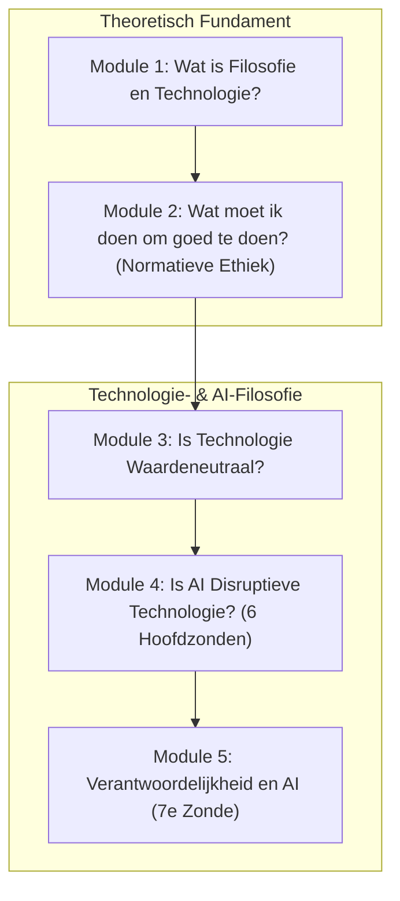

# Onderneming en Ethiek (`B-KUL-T1AOE1` — 3 ECTS)

> [!IMPORTANT] Volledige OPO-Structuur (KU Leuven Campus Groep T)
> **Examen:** **do 21.01.2027 om 12:30** in `AV - 01.12 (aula)` | 🏠 [[00_Groep_T_Command_Center|Groep T Command Center]]
> Dit opleidingsonderdeel van **3 ECTS** bestaat uit **3 OLA's**:
> 1. **OLA Ethiek (40%):** Gedoceerd door Prof. Dr. Lode Lauwaert (schriftelijk examen 16/20 + paper 4/20).
> 2. **OLA Onderneming (40%):** Ondernemingsvormen, Business Model Canvas, strategie, leiderschap & boekhouden/balans (zie `05_Onderneming/` hieronder!).
> 3. **OLA Dag met een ingenieur (20%):** Interview & bedrijfsbezoek gekoppeld aan beide luiken ([[Dag_met_een_Ingenieur_Opdracht_Tracker]]).

---

## 🗺️ Cursusstructuur & Roadmap — Luik Ethiek (40%)

---

## 📚 Directe Links naar de Modules (Ethiek — 40%)

1. **[[Module_1_Wat_is_Filosofie_en_Technologie|Module 1: Wat is Filosofie, Ethiek en Technologie?]]**
   - Conceptuele analyse van technologie (proces vs. ding, artificieel, functioneel, materieel).
   - Vier niveaus van AI (Superintelligentie, AGI, LLM's, Smalle AI/ML) & logisch redeneren (redenen vs. oorzaken, geldigheid).
   - Essentie-analyse van ethiek & subdomeinen (meta-, descriptief, normatief).
2. **[[Module_2_Wat_moet_ik_doen_om_goed_te_doen|Module 2: Wat moet ik doen om goed te doen? (Normatieve Ethiek)]]**
   - **Plichtethiek (Kant)**: Categorische vs. hypothetische imperatieven, universaliteit & regelconformiteit + intenties.
   - **Consequentialisme & Utilitarisme (Bentham & Mill)**: Gevolgen-calculus (waarde × kans), hedonisme en kritieken.
   - **Deugdethiek (Aristoteles)**: Deugden als diep verankerde gewoonten, de gulden middenweg, individueel vs. collectief agens.
3. **[[Module_3_Is_Technologie_Waardeneutraal|Module 3: Is Technologie Waardeneutraal?]]**
   - Neutraliteitsthese (NT) in brede vs. smalle zin, waarde 'hebben' vs. 'zijn', botsingsprobleem.
4. **[[Module_4_Is_AI_Disruptieve_Technologie|Module 4: Is AI Disruptieve Technologie? (De 6 Hoofdzonden)]]**
   - Graduele vs. discontinue disruptiethese; Misbruik, Privacy, Bias, Veiligheid, Transparantie, Duurzaamheid.
5. **[[Module_5_Verantwoordelijkheid_en_AI|Module 5: Verantwoordelijkheid & AI (De 7e Zonde)]]**
   - Responsibility Gap bij autonome wapens (LAWS) en zelfrijdende auto's (Sparrow vs. Lauwaert).

---

## 🏢 Directe Links naar Luik Onderneming (40%) & Dag met een Ingenieur (20%)
- 🏛️ **[[Onderneming_01_Ondernemingsvormen_en_Business_Model_Canvas|Onderneming 1: Ondernemingsvormen & Business Model Canvas (BMC)]]**
- 🎯 **[[Onderneming_02_Strategie_SWOT_en_Stakeholders|Onderneming 2: Missie, Visie, Strategie, SWOT & Stakeholders]]**
- 👥 **[[Onderneming_03_Leiderschap_en_Organisatie|Onderneming 3: Leiderschap, Motivatie & Veranderingsmanagement]]**
- 📊 **[[Onderneming_04_Boekhouden_Balans_Resultatenrekening_MAR|Onderneming 4: Boekhouden, Balans, Resultatenrekening & M.A.R.]]**
- 🧠 **[[Onderneming_05_Q_en_A_Oefeningen|Onderneming 5: Active Recall Q&A & Balansoefeningen]]**
- 👷 **[[Dag_met_een_Ingenieur_Opdracht_Tracker|Dag met een Ingenieur (20%) — Interview & Verslag Tracker]]**

---

## 🛠️ Examentraining & Syntheses
- **[[01_Exam_Guide_&_Strategy|Examenstrategie & Giscorrectie]]**
- **[[01_Exam_Templates|De 4 Verplichte Antwoordsjablonen van Lauwaert]]**
- **[[02_Argumentatievragen|Opgeloste Argumentatievragen]]**
- **[[03_Begripsvragen|Opgeloste Begripsvragen]]**
- **[[04_Verbandsvragen_&_Casus|Opgeloste Verbandsvragen & Casussen]]**
- **[[05_Meerkeuzevragen_Bank|Bank van Meerkeuzevragen]]**
- **[[Wij_Robots_Lode_Lauwaert_Synthese|Boeksynthese: 'Wij, robots']]**
- **[[Ethische_Stromingen_Matrix]]** • **[[Begrippenkader_&_Terminologie]]** • **[[Waarden_in_Technologie]]**
