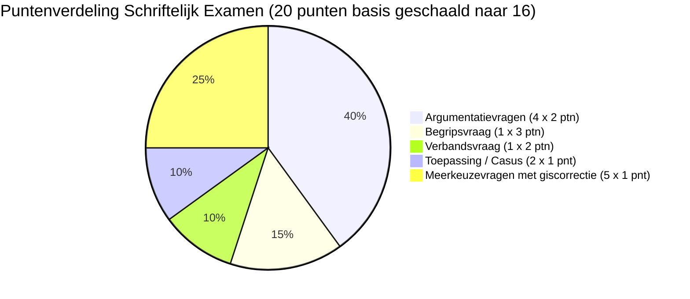

# 🎓 Examenhandleiding, Scoreopbouw & Examenstrategie

## 1. Scoreberekening OLA Ethiek
Het eindcijfer voor het opleidingsonderdeel Ethiek staat op **/20 punten** en is samengesteld uit twee afzonderlijke evaluaties:
* **Examen (gesloten boek):** **16 / 20** (80% van het eindtotaal).
* **Paper / Schrijfopdracht:** **4 / 20** (20% van het eindtotaal).

---

## 2. Structuur van het Schriftelijk Examen (16 punten)
Het examen duurt maximaal **180 minuten** (gesloten boek, anoniem via studentennummer). Het is onderverdeeld in:

### A. Open Vragen (15 punten)
1. **Argumentatievragen (8 punten = 4 vragen × 2 punten):**
   * Je moet één argument pro of contra een specifieke stelling geven en toelichten.
   * Zie [[01_Exam_Templates#1-argumentatievragen-4-x-2-punten|Sjabloon Argumentatievraag]].
2. **Begripsvraag (3 punten = 1 vraag × 3 punten):**
   * Behandelt één kernbegrip aan de hand van vier verplichte componenten: context, definitie, voorbeeld, uitleg.
   * Zie [[01_Exam_Templates#2-begripsvragen-1-x-3-punten|Sjabloon Begripsvraag]].
3. **Verbandsvraag (2 punten = 1 vraag × 2 punten):**
   * Het expliciteren van het inhoudelijke verband tussen twee concepten of theorieën.
   * Zie [[01_Exam_Templates#3-verbandsvragen-1-x-2-punten|Sjabloon Verbandsvraag]].
4. **Toepassings- / Casusvragen (2 punten = 2 vragen × 1 punt):**
   * Een stuk tekst, redenering of praktijkcasus beoordelen en analyseren vanuit de theorieën uit de cursus.

### B. Meerkeuzevragen met Giscorrectie (5 punten = 5 vragen × 1 punt)
* Slechts **één antwoord** is correct per vraag.
* **Giscorrectie:** **-0.3 punten** per fout antwoord (blanco = 0 punten, juist = +1 punt).
* **Wiskundige verwachtingswaarde bij gokken (4 keuzes: A, B, C, D):**
  $$\mathbb{E} = \left(\frac{1}{4} \times 1.0\right) + \left(\frac{3}{4} \times (-0.3)\right) = 0.25 - 0.225 = +0.025$$
  *Vuistregel:* Kun je minstens één antwoord met zekerheid elimineren (kans $\ge 1/3$), dan is gokken statistisch voordelig:
  $$\mathbb{E}_{elim=1} = \left(\frac{1}{3} \times 1.0\right) + \left(\frac{2}{3} \times (-0.3)\right) = 0.333 - 0.200 = +0.133$$

---

## 3. Succesfactoren & Valkuilen

### ✅ Wat je ABSOLUUT moet doen:
1. **Schrijf gestructureerd en to-the-point:** Overschrijd de voorziene kaders op het examenblad niet. Antwoord in volledige, heldere academische zinnen.
2. **Maak het conceptuele onderscheid:**
   * Redenen (rechtvaardiging) $\neq$ Oorzaken (verklaring).
   * Noodzakelijke voorwaarde $\neq$ Voldoende voorwaarde.
   * Waarde *zijn* $\neq$ Waarde *hebben*.
   * Graduele disruptie $\neq$ Discontinue disruptie (breuk).
3. **Ken alle gedachte-experimenten:** De tram/trein (Philippa Foot / Thomson), de Chinese Kamer (Searle), de ervaringsmachine (Nozick), de loslopende hond, de epilepsiepatiënt, de gezonde man in de wachtzaal van de chirurg.

### ❌ Wat je NIET moet doen:
* **Geen namen en jaartallen van buiten leren:** Prof. Lauwaert vraagt geen jaartallen (zoals 1789) of irrelevante persoonsnamen. Focus op de grondleggers (Kant, Bentham, Mill, Aristoteles, Matthias, Jonas, Latour).
* **Geen vage common-sense antwoorden geven:** Schrijf nooit "technologie is gevaarlijk voor de privacy". Schrijf: *"AI-systemen kunnen getraind worden op niet-privacyproof datasets zonder geïnformeerde toestemming (surveillance-bias), maar dit vormt geen ethische discontinuïteit omdat analoge privacyschendingen (zoals snuffelen in een dagboek) dezelfde morele structuur hebben."*
