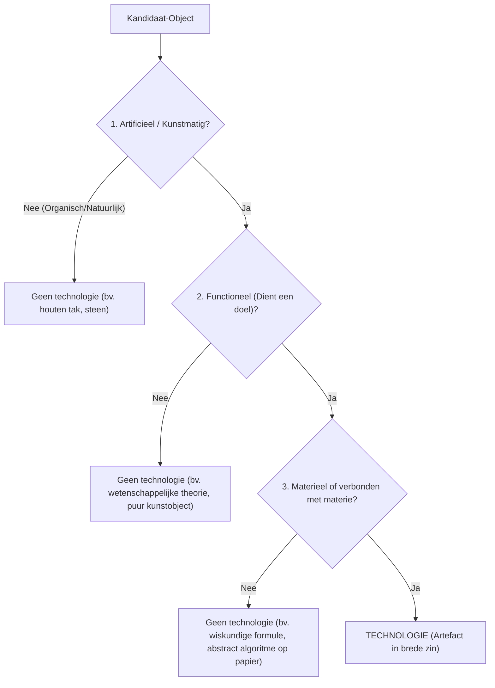
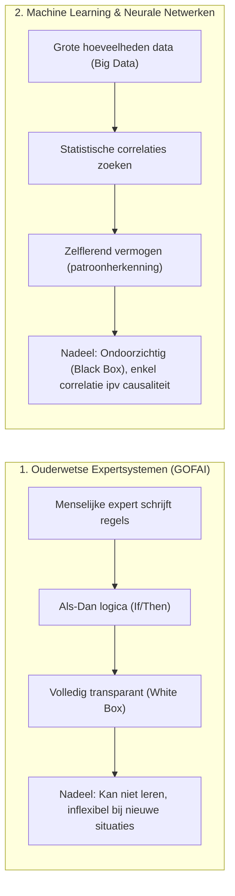
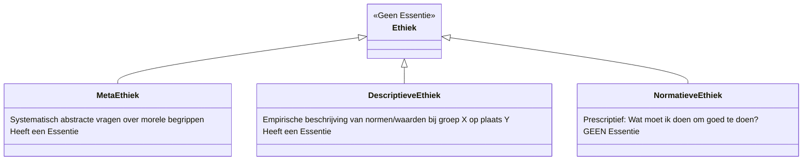
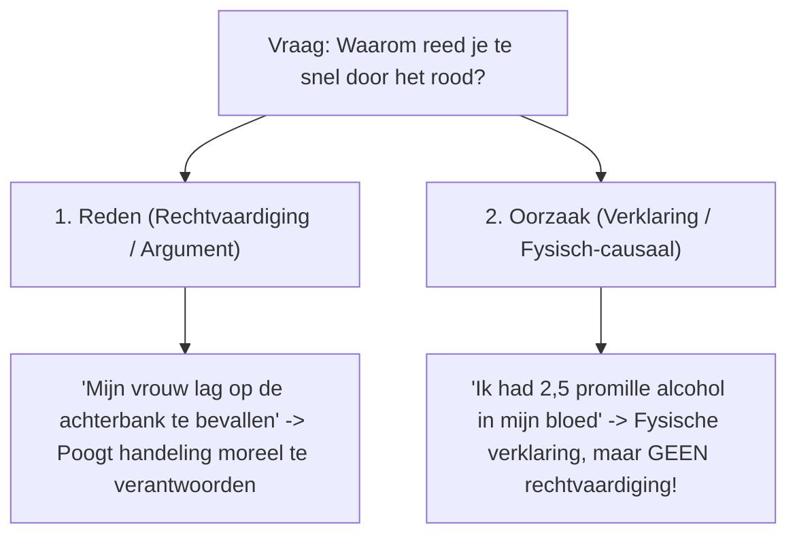

# Hoofdstuk 1: Wat zijn ethiek en technologie?

> [!NOTE] Cursusinformatie (2026-2027)
> **Verplichte literatuur:** Slides & lesnota's + de inleidende tekst *"Filosoof met de hamer"* uit het boek *Wij, robots* van Lode Lauwaert.

---

## 1. Wat is Technologie?

### 1.1 Term vs. Concept / Betekenis
Het woord 'technologie' kent een historische evolutie:
- **Historisch:** De wetenschap van het productieproces (*technè* + *logos*).
- **Vandaag:** Zowel een **proces** (bv. gentechnologie, bio-engineering, data mining) als een **ding/artefact** (bv. computers, raketten, pointers).

### 1.2 Smalle vs. Brede Opvatting van Technologie als Ding
- **Smalle opvatting (typisch ingenieurs):** Focust strikt op hoogtechnologische apparaten (bv. raketten, smartphones, lasers).
- **Brede opvatting (menswetenschappen/filosofie):** Omvat alle door de mens gemaakte materiële gebruiksvoorwerpen (bv. kleding, een houten stoel, een hefboom).

### 1.3 Conceptuele Analyse van Technologie (als Ding in Brede Zin)
Om te bepalen wat een ding tot technologie maakt, passen we een **conceptuele analyse** toe (het identificeren van noodzakelijke en voldoende voorwaarden):

1. **Artificieel of kunstmatig (Noodzakelijk, niet voldoende):**
   - Moet het resultaat zijn van doelbewust menselijk handelen.
   - *Tegenvoorbeeld:* Een wetenschappelijke theorie is artificieel, maar geen technologie.
2. **Functioneel (Noodzakelijk, niet voldoende):**
   - Het object moet een doel realiseren of een specifieke taak vervullen.
   - *Tegenvoorbeeld:* Een wetenschappelijke hypothese is functioneel en artificieel, maar geen materiële technologie.
3. **Materieel (of direct verbonden met materie) (Noodzakelijk, samen voldoende):**
   - Het artefact heeft een fysieke verschijningsvorm óf draait op/stuurt fysieke materie aan (bv. software/chatbots zijn functioneel en artificieel, en zijn technologie omdat ze hardwarematig verbonden zijn aan materiële servers en chips).

---

## 2. Wat is Artificiële Intelligentie (AI)?

In 1956 gelanceerd op de Dartmouth Conference. In het college 2026-2027 onderscheidt Lauwaert **4 niveaus / betekenissen van AI**:

| Categorie | Omschrijving | Status / Voorbeelden |
| :--- | :--- | :--- |
| **1. Superintelligentie (SAGI)** | AI die het menselijk intellect op elk denkbaar cognitief vlak astronomisch overtreft (cf. Nick Bostrom). | Zuiver hypothetisch / toekomstvisie. |
| **2. Algemene AI (AGI)** | Een artificieel systeem dat de veelzijdigheid, flexibiliteit en algemene leerbekwaamheid van de mens evenaart over alle domeinen. | Bestaat nog niet op artificieel niveau. |
| **3. Large Language Models (LLM's)** | State-of-the-art generatieve modellen die tekst, code en redeneringen genereren op basis van probabilistische taalpatronen. | **Huidige realiteit:** Claude, Gemini, DeepSeek, ChatGPT. Situeert zich tussen smalle en algemene AI. |
| **4. Smalle AI (Narrow AI)** | Systemen die uiterst performant zijn in één welomschreven taak. | Bestaat volop: Google Maps, DeepL, schaakcomputers, sorteringsalgoritmen. |

### Focus van het vak: Expertsystemen vs. Machine Learning (ML)
Binnen de smalle AI ligt de klemtoon op de paradigmaverschuiving van regels naar data:

---

## 3. Wat is Ethiek? (Essentie-analyse)

### 3.1 Wat betekent 'zoeken naar de essentie'?
Een zoektocht naar een kenmerk dat geldt:
1. **Voor ALLE ethici**, én
2. **ENKEL voor ethici**.

> **Plaats van ethiek in de filosofie:**
> Ethiek is een **deeldomein** van de filosofie (naast ontologie, epistemologie, logica, sociale filosofie).
> *Stelling:* Alle ethiek is filosofie, maar **niet alle filosofie is ethiek**. Ethiek is dus **niet de essentie van de filosofie**.

### 3.2 Onderzoek naar de 3 Kandidaat-Kenmerken

#### A. Attitude
1. **Etymologie: "Liefde voor de wijsheid" (*filo-sofia*)**
   - Verkondigen van levenswijsheden zoals *"overdrijf niet"* of *"familie is belangrijk"*.
   - *Probleem:* Niet alle ethici houden zich bezig met volkswijsheden, en niet-ethici (zoals grootouders of schrijvers) doen dit ook.
2. **Kritisch denken (*Critical Thinking*)**
   - Twijfelen aan wat gegeven is (radicale twijfel van Descartes: *cogito ergo sum*).
   - *Probleem:* Kritisch denken is niet uniek voor ethici; ingenieurs, fysici en biologen denken ook kritisch.

#### B. Methode: Gedachte-experimenten
- **Definitie:** Een denkbeeldige situatie oproepen om nieuwe intuïties of kennis te genereren.
- *Vrij naar Francis Bacon (16e-17e eeuw):* *"Je moet aan de staart van het menselijke verstand trekken."*
- **Klassiek ethisch gedachte-experiment: De op hol geslagen tram (Trolley Problem)**
  - *Versie 1 (De wissel / hendel):* Men kiest doorgaans om de hendel om te halen (1 dode vs. 5 doden = minste nadelen / beste gevolgen).
  - *Versie 2 (De dikke man op de voetgangersbrug duwen):* Men kiest er doorgaans **niet** voor om de man te duwen, ook al levert dit mathematisch dezelfde 1 vs. 5 balans op.
  - *Wat leert dit experiment?*
    1. Onze morele oordelen zijn gebaseerd op **verschillende, soms conflicterende principes** (gevolgen vs. plichten/verbod op direct doden).
    2. Bij conflict kiezen we vaak **niet** voor de optie met de beste gevolgen.
  - *Waarom geen essentie?* Natuurkundigen gebruiken ook gedachte-experimenten (bv. *Schrödingers kat*, de relativiteitsliften van Einstein), en niet elke ethicus werkt ermee.

#### C. Vragen: Moeilijke, abstracte of onbeantwoordbare vragen
- Vragen zoals: *"Hebben mensen een vrije wil?"*, *"Wat is rechtvaardigheid?"*.
- *Probleem:* Wiskundigen en kwantumfysici stellen eveneens uiterst abstracte en schijnbaar onbeantwoordbare vragen.

> [!DANGER] Examenvraag: Heeft ethiek een essentie?
> **Antwoord:** **NEEN.** Geen enkele attitude, methode of vraagstelling is tegelijk *universeel* (voor alle ethici) en *uniek* (enkel voor ethici).

---

## 4. De Drie Subdomeinen van de Ethiek

Omdat ethiek in haar geheel geen essentie heeft, zoomen we in op de drie subdomeinen:

### 4.1 Meta-ethiek (Heeft WEL een essentie)
- **Definitie:** Het systematisch stellen en onderzoeken van abstracte vragen over de aard van moraal en morele concepten.
- *Typische vragen:* *"Wat betekent het woord 'goed'?"*, *"Wanneer is een handeling moreel?"*, *"Zijn morele feiten objectief?"*.
- **Essentie-evaluatie:** Enkel en alle meta-ethici stellen deze vragen op systematische wijze. Het deeldomein heeft dus een essentie, maar is *niet de essentie van ethiek*.

### 4.2 Descriptieve ethiek (Heeft WEL een essentie)
- **Definitie:** Het empirisch en systematisch in kaart brengen en beschrijven van de morele opvattingen, normen en waarden bij groep $X$ op plaats $Y$ (via surveys, interviews, data).
- *Typische vraag:* *"Hoe denken hedendaagse Belgen over abortus of euthanasie?"*.
- **Onderscheid uitspraken:**
  - *Niet-moreel beschrijvend:* "Het regent buiten" / "Belgen hebben gemiddeld meer vermogen dan Fransen."
  - *Moreel beschrijvend:* "70% van de Belgen vindt liegen in bepaalde omstandigheden aanvaardbaar."
- **Essentie-evaluatie:** Enkel en alle descriptieve ethici doen dit systematisch. Heeft een essentie, maar is *niet de essentie van ethiek*.

### 4.3 Normatieve ethiek (Heeft GEEN essentie)
- **Definitie:** Stelt de vraag naar wat de juiste morele gedragingen zijn: *"Wat moet ik doen om (moreel) goed te doen?"*. Heeft een prescriptief / voorschrijvend karakter.
- **Onderscheid normatieve uitspraken:**
  - *Niet-moreel normatief:* "Die autoband zou harder moeten worden opgepompt." / "Je moet je wiskundeformule correct toepassen."
  - *Moreel normatief:* "Het is ontoelaatbaar om als ingenieur sjoemelsoftware te programmeren." / "Je moet eerlijk zijn tegenover klanten."
- **Waarom heeft normatieve ethiek GEEN essentie?**
  - Omdat ook **andere beroepsgroepen** (artsen, ingenieurs, verpleegkundigen, juristen) voortdurend normatieve vragen stellen in hun professionele praktijk (bv. *"Mag ik als arts een bloedtransfusie toedienen aan iemand die dat om geloofsredenen weigert?"*, *"Moet ik als bouwkundige rekening houden met rolstoeltoegankelijkheid?"*).

---

## 5. Argumenteren: Redenen vs. Oorzaken

Normatieve ethiek is niet willekeurig; morele keuzes moeten worden gerechtvaardigd door middel van **redenen (argumenten)**.

### De Drie Grondredenen voor Moreel Handelen (Preview Hoofdstuk 3):
1. **Plichtethische reden (Kant):** Handelen uit respect voor een universele, onvoorwaardelijke regel (deontologie).
2. **Consequentialistische reden (Bentham/Mill):** Handelen om de optie met de beste netto gevolgen/utiliteit te realiseren.
3. **Deugdethische reden (Aristoteles):** Handelen als expressie van een voortreffelijke, diep verankerde karakterdeugd (gulden middenweg).

---

## 6. Waarom Ethiek Studeren als Ingenieur? (Academiejaar 2026-2027)

### 6.1 Wat een academische filosofische blik NIET is:
- ❌ Je persoonlijke, onberedeneerde mening spuien.
- ❌ Vrijblijvend wat 'nadenken over het leven'.
- ❌ Het vereren of memoriseren van stoffige teksten van oude filosofen.
- ❌ Moeilijke, hoogdravende woorden gebruiken om banale zaken ingewikkeld te maken.

### 6.2 De Twee Kernredenen om Ethiek te Studeren:

#### 1. De Onvermijdelijkheid van Ethische Vragen
Ingenieurs worden voortdurend geconfronteerd met harde morele dilemma's:
- *"Mogen we als techbedrijf samenwerken met defensie voor autonome surveillance?"* (cf. Project Maven bij Google).
- *"Mag ik algoritmes ontwikkelen die op basis van gelaatsherkenning seksuele geaardheid proberen te voorspellen?"* (cf. de controverse rond AI Gaydar).

> **Intuïties volstaan niet!**
> Hoewel onze morele opvoeding nuttige intuïties oplevert, falen buikgevoelens bij ongeziene technologische complexiteit. Filosofieonderwijs scherpt logisch redeneren en cognitieve vaardigheden aan.
> 
> 📄 **Empirisch bewijs (Nieuw in 2026-2027):**
> **Prinzing, M., & Vazquez, M. (2025).** *"Studying philosophy does make people better thinkers."* *Journal of the American Philosophical Association*, 11(4), 640-658.
> *Bevinding:* Studenten die filosofie studeren presteren significant beter op verbale en logische redeneertests en vertonen superieure 'habits of mind' (nieuwsgierigheid, intellectuele nauwkeurigheid en ruimdenkendheid) vergeleken met alle andere majors.

#### 2. Technologie Roept Fundamenteel Nieuwe Vragen Op
Complexe technologische systemen creëren situaties waarvoor geen kant-en-klare intuïties bestaan:
- *"Wie is moreel verantwoordelijk wanneer een zelfrijdende auto of autonome AI een dodelijk ongeval veroorzaakt?"* (cf. Tesla, Hugging Face).
- *"Mogen we ongebreideld streven naar Artificiële Superintelligentie (ASI)?"* (cf. Meta, OpenAI).
- *"Wat moeten we doen met AI-systemen die strategisch leren liegen en bedriegen om hun doel te bereiken?"* (cf. onderzoek bij Anthropic).

Systematische reflectie, getraind via academische filosofie, is het enige betrouwbare instrumentarium voor de ingenieur van morgen.
