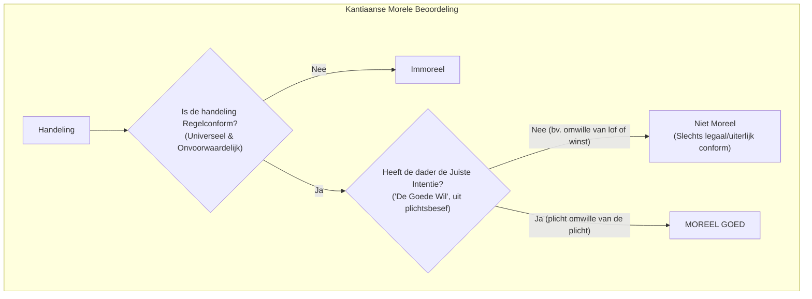
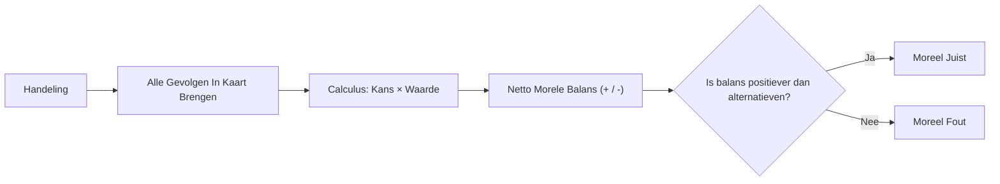
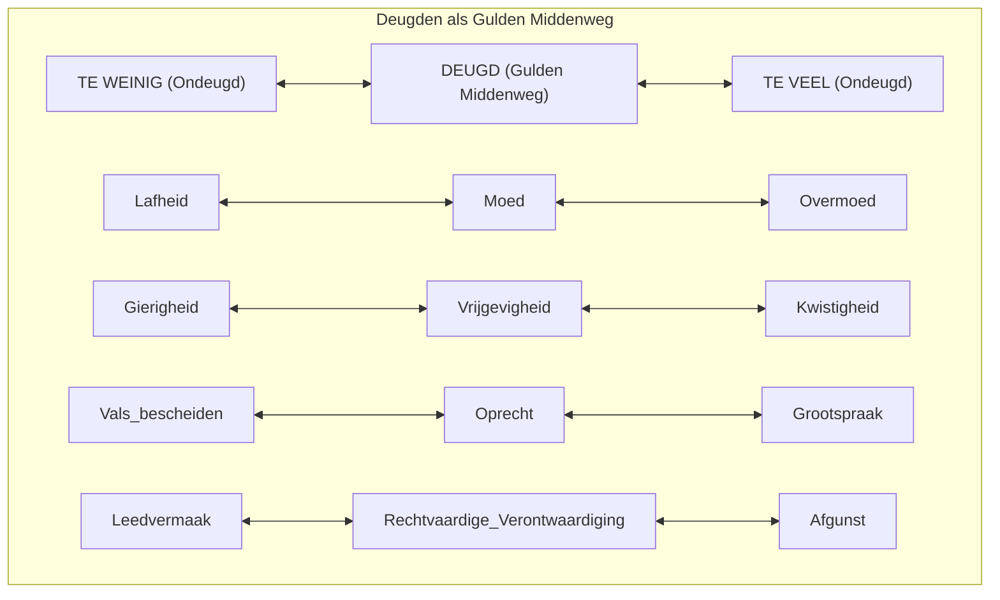

# ⚖️ Module 2: Wat moet ik doen om goed te doen?

[[Module_1_Wat_is_Filosofie_en_Technologie|← Vorige: Module 1]] | [[00_Course_Index|Index]] | [[Module_3_Is_Technologie_Waardeneutraal|Volgende: Module 3 (Neutraliteitsthese) →]]

---

## 1. Morele Psychologie & Alledaagse Oordelen

Voordat we normatieve theorieën bestuderen, toont empirisch onderzoek aan dat alledaagse menselijke morele oordelen vaak **onredelijk** zijn en beïnvloed worden door volstrekt irrelevante factoren:
* **Het windenspray-experiment (Alex Jordan, 2008):** Proefpersonen kregen dezelfde morele casus voorgelegd. De groep die werd blootgesteld aan een vieze geur (stinkspray) oordeelde significant strenger en kende zwaardere straffen toe dan de controlegroep.
* **Tijdstip en honger bij rechters (Danziger et al.):** Rechters verlenen vlak vóór de lunchpauze significant minder voorwaardelijke invrijheidstellingen dan net na de maaltijd.
* **Politieke beïnvloeding:** Kiezers passen hun ethisch standpunt over een wet aan zodra ze horen wat hun partijgenoten of tegenstanders ervan vinden.

> **Conclusie:** Alledaagse intuïties zijn volatiel. Normatieve ethiek zoekt naar **rationele redenen** (rechtvaardigingen) die standhouden tegen willekeur.

---

## 2. Plichtethiek (Deontologie / Kantiaanse Ethiek)

Grondlegger: **Immanuel Kant** (18e eeuw, *Kritik der praktischen Vernunft*).

### 2.1 Twee Kenmerken van de Morele Wet
1. **Onvoorwaardelijk (Categorisch):** De wet moet altijd gehoorzaamd worden, ongeacht de concrete gevolgen of persoonlijke verlangens (vs. *Hypothetische imperatief*: "Als je X wilt, doe dan Y").
2. **Universeel:** De regel moet voor iedereen gelden, zonder uitzondering voor jezelf (*"Handel volgens die regel waarvan je tegelijk kunt willen dat het een algemene wet wordt"*).

### 2.2 Noodzakelijke en Voldoende Voorwaarden voor Moreel Handelen
* **Regelconform handelen:** Noodzakelijk, maar **onvoldoende**.
* **Juiste intentie (De goede wil):** Noodzakelijk, maar **onvoldoende**.
* **Regelconform + Juiste intentie samen:** **Voldoende** voor een morele handeling.
  * *Lof als gevolg:* Wie handelt *omwille van lof*, handelt immoreel/niet-moreel. Wie handelt uit plicht en *daarbovenop* geprezen wordt (voorzien onbedoeld effect), handelt wel degelijk moreel.

### 2.3 Supererogatie
* **Definitie:** Een handeling die moreel zeer prijzenswaardig is, maar **niet verplicht** (boven de plicht uitstijgen).
* *Voorbeeld:* Lesnota's nauwkeurig bijhouden en overhandigen aan een zieke medestudent; jezelf op een granaat werpen om kameraden te redden.
* *Probleem voor Kant:* Kantiaanse ethiek erkent enkel strikte plichten; voor supererogatie is binnen het binaire systeem van verplicht/verboden eigenlijk geen plaats.

### 2.4 Immoraliteit vs. Illegaliteit
Immoraliteit en illegaliteit overlappen vaak, maar vallen conceptueel niet samen:
* **Immoreel, maar legaal:** Je partner bedriegen; liegen tegen een vriend over een triviaal feit; een zinkend bedrijf verlaten met een bonus.
* **Illegaal, maar niet immoreel:** Je identiteitskaart vergeten meenemen; vluchtelingen verbergen voor een tiran; de wetten van een dictatuur overtreden (burgerlijke ongehoorzaamheid).

### 2.5 Kritiek op de Plichtethiek: Regelfetisjisme
* **Regelfetisjisme:** Een blinde, rigide fixatie op het naleven van een morele wet, zonder rekening te houden met de catastrofale kosten of gevolgen ervan.
* *De Moordenaar aan de deur:* Kant stelde berucht dat het een misdaad zou zijn om te liegen tegen een moordenaar die vraagt waar je vriend zich verbergt. Onze morele intuïtie verwerpt dit categorisch: in extreme situaties overruled de consequentie de plicht.

---

## 3. Consequentialisme (Gevolgethiek)

Grondleggers: **Jeremy Bentham** (18e eeuw) en **John Stuart Mill** (19e eeuw).

### 3.1 Kerndefinitie
Het consequentialisme stelt dat de morele waarde van een handeling, beleid of technologie **uitsluitend afhangt van de reële morele gevolgen**.
* **Intenties zijn irrelevant:** Intenties zijn noch noodzakelijk, noch voldoende. Een goede daad uit kwade opzet (bv. een vervuilend schip zinkt per ongeluk en vormt een prachtig koraalrif) is moreel goed als de balans positief is.
* **Voorzienbaarheid is irrelevant:** Onvoorziene negatieve gevolgen maken een handeling alsnog moreel verwerpelijk (bv. het invoeren van cfk's in koelkasten met goede bedoelingen, wat het gat in de ozonlaag veroorzaakte).

### 3.2 Utilitarisme (Een Specifieke Hedonistische Vorm)
Het utilitarisme stelt: handelingen zijn juist in zoverre ze streven naar **het grootste geluk voor het grootste aantal** (*utility*).
* **Geluk = Balans tussen genot en pijn.**
* **Gelijkheid telt slechts indirect:** 100 eenheden genot voor de allerrijksten is utilitaristisch beter dan 99 eenheden verdeeld onder de allerarmsten. Kwaliteit telt voor Bentham niet (*"Pushpin is as good as poetry"*).

### 3.3 Kritiek op het Hedonistisch Geluksbegrip
1. **Illusoir genot (Robert Nozick's Ervaringsmachine):** Als men kan inpluggen in een machine die permanent de illusie van optimaal genot geeft, weigeren de meeste mensen. We willen dat ons geluk gebaseerd is op een authentieke werkelijkheid.
2. **Laag en sardonisch plezier:** Sadistisch genot (iemand zien lijden) mag volgens onze intuïtie niet zomaar als 'positief genot' in de calculus worden meegeteld.

### 3.4 Kritiek op het Normatief Consequentialisme
1. **Te wreed:** Gedachte-experiment van de gezonde passant in het ziekenhuis. Een chirurg heeft vijf doodzieke patiënten die elk een ander orgaan nodig hebben. Mag de arts een kerngezonde man in de wachtzaal doden om met zijn organen vijf levens te redden? De utilitaristische som zegt $5 - 1 = +4$ levens gered, maar onze intuïtie noemt dit een gruwelijke misdaad. Mensen hebben rechten en een morele status die niet zomaar opgeofferd mogen worden.
2. **Te veeleisend:** Als men continu de beste gevolgen moet realiseren, mag men nooit ontspannen, films kijken of hobby's uitoefenen; elke vrije minuut moet worden besteed aan ontwikkelingshulp of vrijwilligerswerk.

---

## 4. Deugdethiek (Aristoteliaanse Ethiek)

Grondleggers: **Aristoteles** (4e eeuw v.Chr., *Ethica Nicomachea*), herontdekt door Alasdair MacIntyre en Paul van Tongeren.

### 4.1 Klemtoon op de Agens (Handelende Persoon)
In tegenstelling tot Kant (de daad/regel) en het consequentialisme (de gevolgen), focust de deugdethiek op **het karakter van de actor (de agens)**.
* **Wat is een deugd?** Een diep verankerde morele houding of karaktereigenschap die door oefening en habituatie is verworven.
* **Gulden Middenweg:** Een deugd is steeds het harmonieuze evenwicht tussen twee uitersten (te weinig en te veel).

### 4.2 Status van Deugden in de Drie Stromingen (Cruciaal Examenpunt!)
* **In de Deugdethiek:** Deugden zijn **noodzakelijk én voldoende** voor moreel handelen. Een handeling is moreel goed *omdat en in zoverre* zij de expressie is van een deugd.
* **In Plichtethiek en Consequentialisme:** Deugden zijn **noch noodzakelijk, noch voldoende**, maar hebben louter een **instrumentele waarde**. Moed kan een chirurg helpen om vijf levens te redden, of een ingenieur helpen een lastige plicht te vervullen, maar het is niet de deugd die de handeling rechtvaardigt.

### 4.3 Evaluatie van de Deugdethiek
* **Pro Normatief:** Past uitstekend bij een complexe, diffuse wereld waar centrale regels en rigide calculaties tekortschieten; professionals moeten situationeel kunnen oordelen.
* **Contra Normatief:** Deugdzaamheid is geen absolute normatieve prioriteit en kan immoreel gedrag faciliteren. Een huurmoordenaar of een naziofficier heeft uitzonderlijk veel discipline en moed nodig om gruweldaden te plegen, maar dat maakt de daad geenszins moreel goed.
