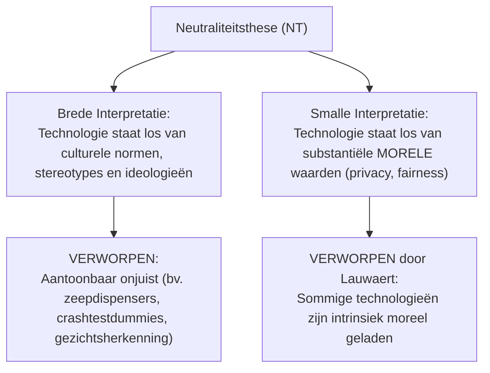
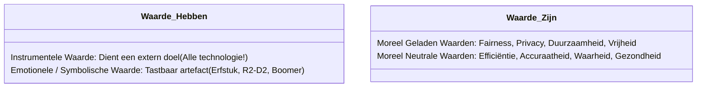
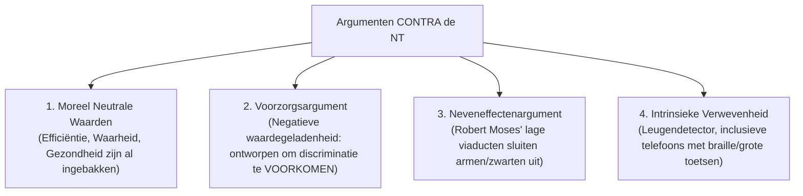
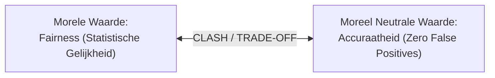

# 🛡️ Module 3: Is Technologie Waardeneutraal?

[[Module_2_Wat_moet_ik_doen_om_goed_te_doen|← Vorige: Module 2]] | [[00_Course_Index|Index]] | [[Module_4_Is_AI_Disruptieve_Technologie|Volgende: Module 4 (AI Hoofdzonden) →]]

---

## 1. De Neutraliteitsthese (NT) Geformuleerd

De Neutraliteitsthese (NT) is een van de meest hardnekkige dogma's binnen het technologische denken (verwoord door o.a. de National Rifle Association: *"Guns don't kill people, people kill people"*, of Noam Chomsky: *"A hammer doesn't care whether you build a house or smash a skull"*).

### 1.1 Brede vs. Smalle Interpretatie
1. **Brede interpretatie:** Technologie staat los van perspectieven, culturele normen, stereotypen en maatschappelijke ideologieën.
   * *Weerlegging:* Deze these is overduidelijk onjuist. Veel technologieën zijn ontworpen vanuit een specifiek mannelijk of westers perspectief:
     * Automatische zeepdispensers die enkel functioneren bij lichte huidskleur door optische sensoren afgesteld op wit reflecterend licht.
     * Crashtestdummies gemodelleerd naar het gemiddelde mannenlichaam, waardoor vrouwen een veel hogere kans op ernstige letsels hebben bij auto-ongelukken.
     * WEIRD-bias (Western, Educated, Industrialized, Rich, Democratic) in AI-trainingsdata.
2. **Smalle interpretatie (De eigenlijke filosofische NT):**
   * Stelt dat technologie **per definitie vrij is van morele waarden** (zoals rechtvaardigheid, autonomie, privacy, duurzaamheid).

---

## 2. Conceptuele Analyse: Wat betekent Waarde?

### 2.1 Waarde 'Hebben' vs. Waarde 'Zijn'

* **Waarde 'Hebben':**
  1. *Instrumentele waarde:* Een middel om een doel te bereiken. **Alle technologie heeft per definitie instrumentele waarde** (omdat functionaliteit een noodzakelijke voorwaarde is voor technologie). De NT gaat dus *niet* over instrumentele waarde!
  2. *Symbolische / Emotionele waarde:* Een erfstuk van je grootvader, een trouwring, de ontmijningsrobot Boomer die met militaire eer begraven wordt. De NT ontkent niet dat objecten emotionele waarde kunnen krijgen.
* **Waarde 'Zijn':**
  * Verwijst naar een stand van zaken die intrinsiek nastrevenswaardig is (een moreel goed). De smalle NT beweert dat technologie **losstaat van waarden die 'zijn' (morele waarden)**.

### 2.2 Wat houdt de Smalle NT PRECIES in? (Vier Specificaties)
1. **Per definitie:** De these stelt niet louter dat technologie *toevallig* feitelijk vaak neutraal is, maar dat technologie per definitie *nooit* geladen kan zijn met morele waarden.
2. **Figuurlijk geladen:** Waarden zitten niet letterlijk fysiek ingebakken in printplaten of metaal; 'waardegeladen' betekent dat het ontwerp van het artefact zozeer refereert aan een morele waarde dat je het apparaat niet kunt begrijpen of definiëren zonder die waarde.
3. **Uitsluitend Morele Waarden:** De these ontkent niet dat technologie efficiënt of accuraat is (moreel neutrale waarden), maar ontkent dat het morele waarden (zoals rechtvaardigheid) kan dragen.
4. **Ontwerpfase vs. Gebruiksfase:** De NT gaat over technologie **op zich** (in de ontwerpfase), niet over de effecten in de gebruiksfase.

---

## 3. Argumenten PRO de Neutraliteitsthese

### 3.1 Het Zichtbaarheidsargument
* **Premisse 1:** Het waarnemen/zien van een waarde is een noodzakelijke voorwaarde voor de toekenning van waardegeladenheid.
* **Premisse 2:** Men kan in materiële technologie geen morele waarden visueel detecteren (men ziet slechts draden, pixels, metaal).
* **Conclusie:** Technologie kan niet geladen zijn met morele waarden.
* **Kritiek van Lauwaert:** Premisse 1 is veel te streng en epistemologisch onjuist. Ook in wetenschappelijk onderzoek naar racisme kun je 'gelijkheid' niet fysiek zien of vastpakken, maar toch is het onderzoek intrinsiek moreel geladen.

### 3.2 Het Argument van het Dubbele Gebruik (Dual-Use)
* **Redenering:** Een auto kan gebruikt worden om een gewonde naar het ziekenhuis te brengen (moreel goed) of om een terroristische aanslag te plegen (moreel slecht). Als een technologie voor tegengestelde doelen kan worden ingezet, moet het object zelf neutraal zijn.
* **Kritiek van Lauwaert:** Dit argument verwart het gebruik met de inherente ontwerpintentie van specifieke artefacten (bv. foltertuigen of leugendetectors zijn specifiek ontworpen met een doel dat intrinsiek moreel geladen is).

---

## 4. Argumenten CONTRA de Neutraliteitsthese (Lauwaert)

Lauwaert toont aan dat de NT faalt via vier overtuigende argumenten:

1. **Moreel Neutrale Waardegeladenheid als Indicatie:**
   * Technologie is onbetwist geladen met neutrale waarden zoals efficiëntie, betrouwbaarheid en snelheid. Wetenschappelijke instrumenten zijn geladen met de epistemische waarde van 'waarheid'. Als machines geladen kunnen zijn met neutrale waarden, waarom dan principieel niet met morele waarden?
2. **Het Voorzorgsargument (Negatieve Waardegeladenheid):**
   * Ingenieurs hebben de plicht om algoritmen en artefacten zo te ontwerpen dat ze discriminatie, vooringenomenheid of milieuvervuiling **voorkomen**.
   * Een algoritme dat expliciet ontworpen is met wiskundige correctiemechanismen om bias tegen minderheden te verhinderen, is doelbewust gekoppeld aan de morele waarde van *rechtvaardigheid*. Zelfs al is dit 'negatief' (iets onwenselijks beletten), het artefact is moreel geladen.
3. **Het Neveneffectenargument:**
   * Artefacten kunnen structurele morele gevolgen in hun fysieke ontwerp dragen. Het klassieke voorbeeld van urbanist **Robert Moses**: hij ontwierp opzettelijk uitzonderlijk lage bruggen over de Long Island Parkway zodat bussen (openbaar vervoer gebruikt door arme Afro-Amerikanen) de stranden van Jones Beach niet konden bereiken. De brug belichaamt rassenscheiding.
4. **Intrinsieke Verwevenheid:**
   * Een leugendetector kan niet gedefinieerd worden zonder te refereren aan de concepten waarheid en eerlijkheid.

---

## 5. Het Botsingsprobleem & Spraakverwarring

Wanneer we erkennen dat technologie met waarden geladen kan worden, stuiten ingenieurs op twee fundamentele problemen:

### 5.1 Het Spraakverwarringsprobleem
Morele waarden zijn meerduidig. Wat betekent *Fairness* in een algoritme?
* **Statistische gelijkheid (Pariteit):** Het percentage goedgekeurde leningen moet identiek zijn over alle demografische groepen.
* **Gelijke kansen (Meritocratisch):** Personen met hetzelfde terugbetalingspotentieel moeten een gelijke kans op een lening krijgen, ongeacht hun groep.
* Wiskundig kunnen deze twee definities van fairness niet gelijktijdig gerealiseerd worden!

### 5.2 Het Botsingsprobleem (Trade-offs)
Morele waarden botsen vaak rechtstreeks met **moreel neutrale waarden**:

* **De Banklening-Casus:**
  * Groep 1 (zwarte vrouwen) betaalt in 15% van de gevallen terug.
  * Groep 2 (witte mannen) betaalt in 30% van de gevallen terug.
  * Een AI-systeem met 100% accuraatheid voorspelt perfect wie terugbetaalt.
  * Wil de bank *statistische fairness* (evenveel vrouwen als mannen een lening), dan **moet** het AI-systeem aan minder kredietwaardige vrouwen leningen verstrekken of betrouwbare mannen afwijzen $\rightarrow$ **De accuraatheid van het systeem daalt drastisch.**
* *Conclusie:* Meer ethiek (fairness) kan ten koste gaan van technische excellentie (accuraatheid). Ingenieurs moeten transparante *trade-offs* maken.

---

## 6. Waarom verdedigen mensen de Neutraliteitsthese?

Volgens Lauwaert zijn er twee diepere verklaringen:
1. **Verlangen naar schone handen:** Fabrikanten en ontwikkelaars willen de morele schuld afwentelen op de eindgebruiker (*"Wij leveren alleen de neutrale software/wapens, de gebruiker is verantwoordelijk"*).
2. **De Moderne Bril (Bruno Latour):** De moderne cultuur maakt een rigide, binaire scheiding tussen de menselijke wereld (geest, cultuur, moraal) en de materiële wereld (dode objecten, technologie, stenen). In werkelijkheid zijn technologische artefacten **hybriden**: verwevingen van dode materie en menselijke waarden.
