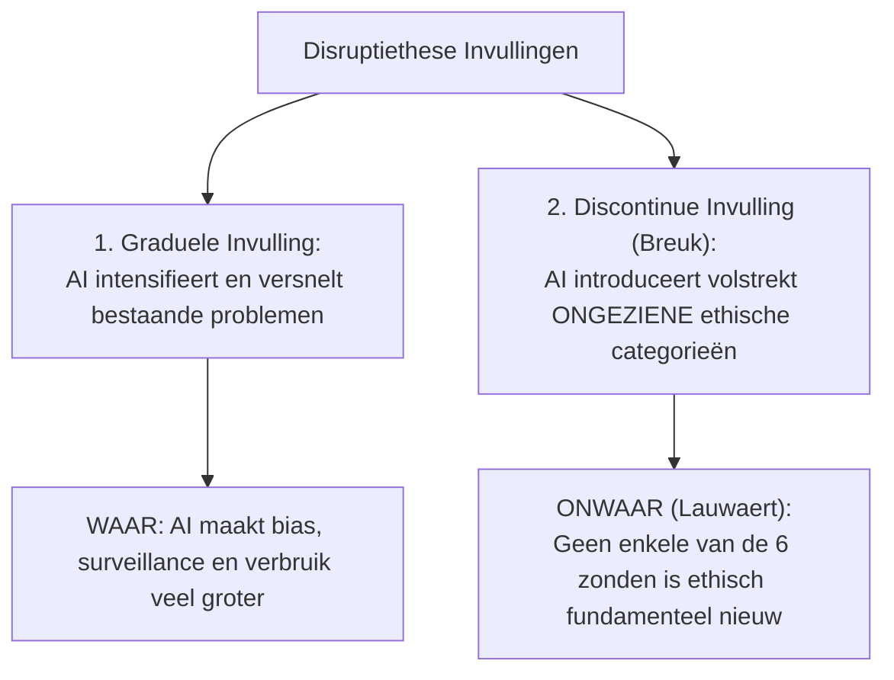
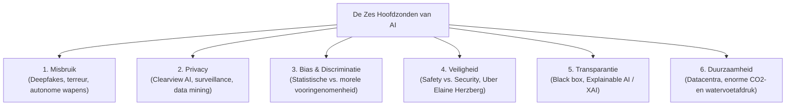

# 🤖 Module 4: Is AI Disruptieve Technologie?

[[Module_3_Is_Technologie_Waardeneutraal|← Vorige: Module 3]] | [[00_Course_Index|Index]] | [[Module_5_Verantwoordelijkheid_en_AI|Volgende: Module 5 (Verantwoordelijkheid) →]]

---

## 1. De Disruptiethese (DT) Geanalyseerd

De term 'disruptieve innovatie' stamt van econoom **Clayton Christensen** (1995), maar wordt in de technologie-ethiek breder gebruikt:
$$\text{Disruptiethese (DT): } \text{"AI creëert fundamenteel nieuwe morele problemen en breekt bestaande ethische kaders open."}$$

* **Valse indicaties van disruptie:**
  * *Tandenborstel van Oral-B:* Heeft AI en sensoren om te zien waar je poetst $\rightarrow$ nuttig, maar geenszins ethisch ontwrichtend.
  * *Drukpers en wiel:* Hebben onze cultuur historisch getransformeerd, maar 'domme' mechanische uitvindingen tonen aan dat maatschappelijke impact niet gelijkstaat aan ethische disruptie.

---

## 2. De Zes Hoofdzonden van AI

Lauwaert analyseert de zes meest besproken ethische bezwaren tegen AI en toetst of ze een **discontinue breuk** vormen met het verleden:

### 2.1 Hoofdzond 1: Misbruik
* **AI-manifestatie:** Deepfakes (stemmanipulatie, pornografische manipulatie, fake news) en autonome drones voor terreur.
* **Historische analogie:** Misbruik is zo oud als de mensheid; propaganda, vervalste foto's (Stalin die mensen uit foto's wiste) en wapens bestonden lang voor AI.
* *Conclusie:* Geen nieuw ethisch probleem.

### 2.2 Hoofdzond 2: Privacy
* **AI-manifestatie:** Gezichtsherkenning getraind op miljarden openbare webfoto's zonder toestemming (**Clearview AI**); medische apps voor diabetici die data delen met commerciële partijen.
* **Historische analogie:** Snuffelen in het dagboek van je kind, afluisteren van telefoons, of medische dossiers inkijken.
* *Conclusie:* AI schaalt surveillance enorm op (gradueel), maar het recht op privacy en de schending ervan zijn klassieke concepten.

### 2.3 Hoofdzond 3: Bias (Vooringenomenheid)
* **AI-manifestatie:**
  * Amazon schrapte een AI-wervingstool die vrouwelijke cv's systematisch lager rankte.
  * COMPAS-algoritme in de VS kende hogere recidiverisico's toe aan zwarte verdachten.
* **Conceptueel onderscheid:**
  * *Statistische bias:* Een niet-representatieve steekproef (bv. WEIRD-datasets).
  * *Morele bias:* Het onrechtvaardig benadelen van groepen op basis van irrelevante kenmerken (racisme, seksisme, lookism).
* **Historische analogie:** Menselijke werkgevers en rechters vertoonden al eeuwenlang vooroordelen en *in-group favoritism*. AI spiegelt simpelweg de historische data van menselijke beslissers.
* *Conclusie:* Geen nieuw probleem.

### 2.4 Hoofdzond 4: Veiligheid
* **AI-manifestatie:** Zelfrijdende Uber-auto die in 2018 voetganger Elaine Herzberg doodreed; kwetsbaarheid van AI voor *adversarial attacks*.
* **Conceptueel onderscheid:**
  * **Safety:** Vrij zijn van fysiek letsel of accidentele crashes.
  * **Security:** Bescherming tegen kwaadwillige indringers en hackers.
* **Historische analogie:** Vliegtuigen, kerncentrales en stoomschepen brachten altijd inherente risico's op systeemfouten mee.
* *Conclusie:* Risicobeheersing is een traditioneel ingenieursvraagstuk.

### 2.5 Hoofdzond 5: Transparantie (Ondoorzichtigheid)
* **AI-manifestatie:** Deep neural networks zijn zogeheten *black boxes*; ontwerpers kunnen niet exact deduceren waarom een neuraal netwerk tot een specifieke output kwam.
* **Relevantie:**
  * *Instrumenteel probleem:* Als je niet weet waarom een systeem beslist, kun je discriminatoire bias niet corrigeren.
  * *Probleem op zich:* Moreel respect vereist dat een burger of sollicitant een begrijpelijke rechtvaardiging krijgt voor een afwijzing.
* **Historische analogie:** Mensen zijn zelf vaak volstrekt ondoorzichtig. Voetbalcoaches kunnen niet altijd sluitend uitleggen waarom speler X op de bank zit; rechters kenden vroeger doodstraffen toe zonder motivering.
* *Conclusie:* Transparantiegebrek is noch noodzakelijk noch voldoende om een systeem immoreel te maken (Spotify die muziek kiest hoeft niet transparant te zijn). Geen nieuw probleem.

### 2.6 Hoofdzond 6: Duurzaamheid (Ecologische Impact)
* **AI-manifestatie:** Wereldwijd ca. 35.000 datacentra; het trainen van één groot taalmodel verbruikt honderden megawatturen en duizenden liters koelwater.
* **Historische analogie:** De klimaatcrisis en grondstoffenuitputting zijn ontstaan tijdens de Industriële Revolutie door steenkool en stoommachines.
* *Conclusie:* AI vergroot de ecologische crisis uit, maar introduceert geen nieuwe ethische categorie.

---

## 3. Conclusie over de Zes Hoofdzonden
Geen van de zes hoofdzonden levert een valide argument op voor de **discontinue disruptiethese**. Er is sprake van een **graduele intensivering**, niet van een ethische breuk tussen heden en verleden.

Maar wat met de hypothetische **Zevende Zonde: de Verantwoordelijkheidskloof**? Zie [[Module_5_Verantwoordelijkheid_en_AI|Module 5]].
