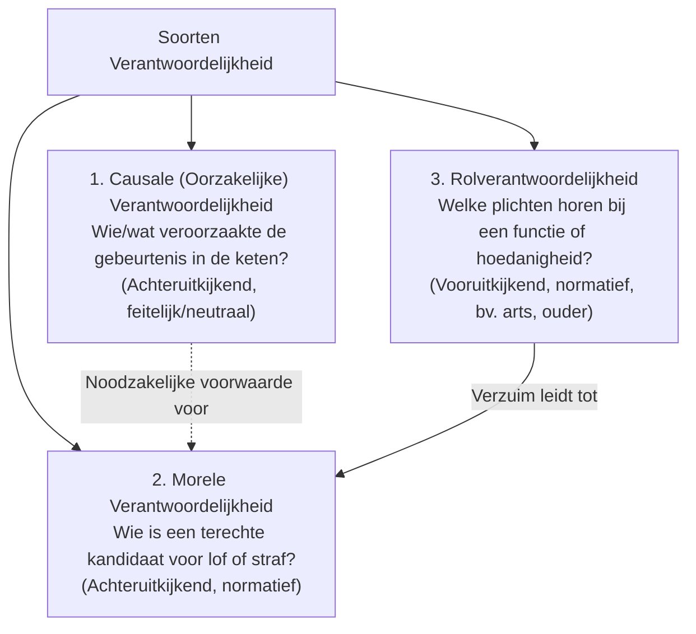
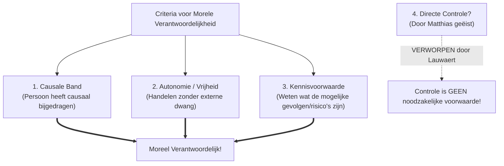
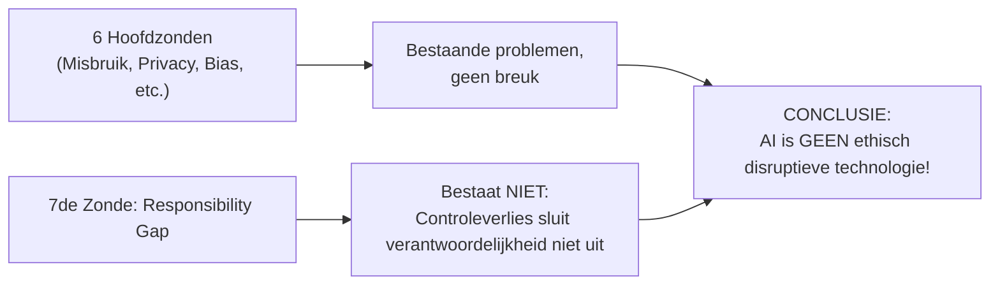

# 🎯 Module 5: Morele Verantwoordelijkheid & AI

[[Module_4_Is_AI_Disruptieve_Technologie|← Vorige: Module 4]] | [[00_Course_Index|Index]] | [[Ethische_Stromingen_Matrix|Volgende: Vergelijkende Matrix →]]

---

## 1. De Stelling van de Responsibility Gap

Volgens filosoof **Andreas Matthias** (2004) en aanhangers van de disruptiethese brengt autonome AI wél een fundamenteel nieuw moreel probleem voort: de **Responsibility Gap (Verantwoordelijkheidskloof)**.

$$\text{Responsibility Gap: } \text{"Bij fouten veroorzaakt door autonome AI is het principieel onmogelijk om nog een mens moreel verantwoordelijk te houden."}$$

Als deze stelling klopt, zou AI wél een discontinue breuk vormen met alle voorgaande technologieën.

---

## 2. Conceptuele Typologie van Verantwoordelijkheid

Om de gap te evalueren, onderscheidt Lauwaert drie vormen van verantwoordelijkheid:

* **Waarover gaat de Responsibility Gap?**
  * *Oorzakelijke verantwoordelijkheid?* **Neen.** De machine of de gebruiker is evident causaal betrokken in de keten.
  * *Rolverantwoordelijkheid?* **Neen, integendeel!** Volgens **Hans Jonas** (*Das Prinzip Verantwortung*, 1979) leidt de introductie van complexe, autonome systemen juist tot een **toename van de rolverantwoordelijkheid** van ingenieurs en managers: zij moeten immers anticiperen op risico's.
  * *Morele verantwoordelijkheid:* **Hierover gaat de stelling.** Matthias beweert dat niemand nog terecht kandidaat is voor morele lof of blaam/straf.

---

## 3. Drie Fatale Begripsverwarringen

Lauwaert toont aan dat de claim van een verantwoordelijkheidskloof berust op conceptuele verwarringen:

1. **'Zijn' vs. 'Kennen' (Epistemologisch vs. Ontologisch):**
   * *Verwarring:* Dat we *niet weten* wie de dader is, betekent niet dat er *geen dader is*.
   * *Voorbeeld:* Je stapt op straat en er plakt kauwgom aan je schoen. Je weet niet wie de kauwgom heeft uitgespuwd (epistemologisch probleem van kennen), maar er is ongetwijfeld iemand die het gedaan heeft en verantwoordelijk is (ontologisch niveau van zijn).
2. **Het Probleem van de Vele Handen (Problem of Many Hands):**
   * Bij complexe AI-systemen zijn duizenden programmeurs, datacleaners, managers en testers betrokken. Het is praktisch complex om te kwantificeren wie welk aandeel had (zoals in een symfonieorkest), maar de verantwoordelijkheid lost daardoor niet op in het niets.
3. **Onverantwoord Handelen $\neq$ Geen Verantwoordelijke:**
   * Een AI-systeem kan ethisch *onverantwoord* zijn om in te zetten (omdat het gebiast of onveilig is). Dat betekent juist dat de bestuurder of ingenieur die besliste om het toch te gebruiken, **moreel verantwoordelijk** is voor het nemen van dat onaanvaardbare risico!

---

## 4. De Drie Voorwaarden voor Morele Verantwoordelijkheid

Wanneer kan iemand terecht moreel verantwoordelijk worden gehouden voor een gebeurtenis?

1. **Causale band:** De persoon heeft rechtstreeks of indirect bijgedragen aan het intreden van het effect.
2. **Autonomie (Positieve vrijheid):** De persoon handelde uit vrije wil en niet onder absolute externe fysieke dwang (zoals iemand die met een pistool tegen het hoofd gedwongen wordt).
3. **Kennis (Epistemische voorwaarde):** De persoon wist of had redelijkerwijs moeten weten wat de mogelijke risico's en gevolgen waren van zijn keuze.

### Waarom 'Controle' GEEN Noodzakelijke Voorwaarde is (Lauwaert's Tegenwerping)
Matthias stelt dat door het lerend vermogen van AI de ingenieur de controle verliest, en dat verlies van controle verantwoordelijkheid uitsluit. Lauwaert weerlegt dit aan de hand van twee overtuigende voorbeelden:

* **De Alledaagse Morele Praktijk (De Loslopende Hond):**
  * Je gaat wandelen in een openbaar bos met een gevaarlijke hond en besluit doelbewust de leiband los te klikken. De hond rent weg, ontsnapt aan je gezichtsveld (je hebt **nul controle** meer over het dier), en bijt een kind.
  * Is er een *responsibility gap* omdat de hond niet toerekeningsvatbaar is en jij geen controle had? **Absoluut niet!** De eigenaar is ten volle moreel verantwoordelijk: hij besliste autonoom om de hond los te laten, veroorzaakte de situatie causaal, en kende het risico.
* **Het Gedachte-experiment van de Epilepsiepatiënt:**
  * Iemand met ernstige epilepsie die weet dat hij aanvallen kan krijgen, besluit met de auto te rijden omdat het regent. Achter het stuur krijgt hij een aanval, verliest het bewustzijn (volledig controleverlies), en ramt een voetganger. De chauffeur blijft moreel verantwoordelijk voor de beslissing om te gaan rijden.

> **Analogie met Kindsoldaten:** Kindsoldaten missen de morele autonomie van een volwassene, maar de bevelvoerende officier die hen bewapent blijft moreel aansprakelijk voor de oorlogsmisdaden.

---

## 5. Eindconclusie over de Disruptiethese

1. Er zijn **slechts zes zonden**, geen zeven. De *responsibility gap* bestaat in de praktijk niet. Er is altijd een mens (programmeur, CEO, bevelhebber, gebruiker) die aan de drie voorwaarden voldoet.
2. Mocht de kloof in een uitzonderlijk geval wél bestaan, dan is dit niet uniek voor AI (denk aan natuurrampen of daden onder psychotische dwang).
3. **Eindoordeel van Lode Lauwaert:** AI verandert onze maatschappij en economie diepgaand, maar creëert op ethisch vlak **geen discontinue breuk**. De klassieke moraalfilosofie blijft volledig van kracht.
