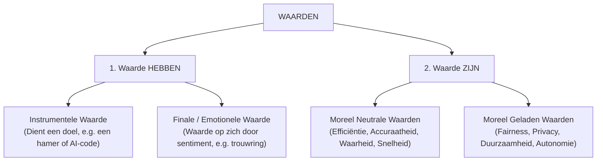

# ⚖️ Waarden in Technologie: Typologie & Botsingen

## 1. De Hiërarchie van Waarden



* **Cruciaal:** De Neutraliteitsthese (smalle zin) heeft uitsluitend betrekking op de claim dat technologie **per definitie vrij is van waarden die 'zijn' in morele zin**.

---

## 2. Het Botsingsprobleem (Trade-Off Analyse)

Wanneer ingenieurs morele waarden willen integreren in het ontwerp van een algoritme (Value-Sensitive Design), botsen deze waarden onvermijdelijk met moreel neutrale waarden:

```mermaid
quadrantChart
    title Waarde-afweging bij AI-kredietsystemen
    x-axis Lage Fairness --> Hoge Fairness (Statistische Pariteit)
    y-axis Lage Accuraatheid --> Hoge Accuraatheid (Exacte Predictie)
    quadrant-1 "Ideaal (Wiskundig Onmogelijk)"
    quadrant-2 "Zuiver Technisch (Groot Bias-risico)"
    quadrant-3 "Slecht Systeem (Beide Falen)"
    quadrant-4 "Ethisch Gelijk (Minder Accuraat)"
    "Standaard Bank-AI": [0.2, 0.85]
    "Gecorrigeerd Ethisch Algoritme": [0.85, 0.4]
```

### De Wiskundige Onmogelijkheid van Dubbele Fairness
Onderzoek naar risico-taxatietools (zoals COMPAS) bewijst dat bij verschillende basisincidenties tussen twee groepen:
1. **Statistische Pariteit** (gelijk percentage gunstige beslissingen), en
2. **Predictieve Gelijkheid** (gelijke kans op fout-positieven en fout-negatieven),
**nooit wiskundig gelijktijdig verwezenlijkt kunnen worden.**
