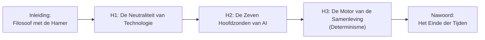

# 📖 Boeksynthese: *Wij, robots* — Lode Lauwaert

Deze synthese vat het integrale handboek *Wij, robots: Een filosofische blik op technologie en artificiële intelligentie* van Lode Lauwaert samen, ingedeeld per hoofdstuk.

---

## Inleiding: Filosoof met de Hamer
* **De rol van de filosofie:** Lauwaert stelt dat de techgemeenschap vaak lijdt aan een gebrek aan zelfinzicht (geciteerd: John Battelle: *"Wij zijn ingenieurs, geen filosofen"*).
* **Doel van het boek:** Geen empirisch handboek over programmeercode, maar een conceptuele bevraging van aannames rond technologie, neutraliteit, ethische ontwrichting en determinisme.
* **Brede definitie van technologie:** Alle artefacten die artificieel, functioneel en materieel (of gekoppeld aan materie) zijn (stoelen, computers, AI).

---

## Hoofdstuk 1: De Neutraliteit van Technologie
* **Analyse van de stelling:** Lauwaert nuanceert het aloude gezegde dat technologie louter een blanco instrument is.
* **Brede neutraliteit verworpen:** Technologie spiegelt menselijke machtsstructuren, sekseverschillen en vooroordelen (bv. crashtestdummies, zeepdispensers).
* **Smalle neutraliteit ontleed:** Gaat over de vraag of technologie op zichzelf losstaat van *morele waarden*.
* **Weerlegging van de smalle NT:**
  * Het *zichtbaarheidsargument* en het *dubbele-gebruiksargument* falen logisch.
  * Het *voorzorgsargument* toont aan dat technologie negatief geladen kan zijn met morele waarden (ingebouwde discriminatiepreventie).
  * Casus van *Robert Moses*: De viaducten naar Jones Beach zijn fysiek gestolde rassenscheiding.
* **Waarom houdt men vast aan neutraliteit?**
  1. *Schone handen willen houden:* Fabrikanten wentelen blaam af op de gebruiker.
  2. *De moderne zuiveringsdrang (Bruno Latour):* De misvatting dat mensen de enige dragers van moraal zijn en machines louter 'dode stenen'.

---

## Hoofdstuk 2: De Zeven Hoofdzonden van AI
* **Is AI disruptieve technologie op ethisch vlak?**
  * *Gradueel:* Ja, AI intensiveert bestaande fenomenen en verhoogt de snelheid en schaal enorm.
  * *Discontinu (ethische breuk):* Neen, geen enkele van de zes zonden introduceert een radicaal nieuw moreel concept.
* **De Zes Hoofdzonden doorgelicht:**
  1. *Misbruik:* Bestond al met analoge wapens en manipulatie.
  2. *Privacy:* Clearview AI en data mining zijn grootschalig, maar analoge surveillance bestond reeds.
  3. *Bias:* Amazon-recruitment en COMPAS spiegelen historische menselijke ongelijkheid.
  4. *Veiligheid:* Risico's (Uber-crash) zijn eigen aan alle complexe sociotechnische systemen.
  5. *Transparantie:* Niet alle ondoorzichtigheid is problematisch (bv. Spotify); mensen begrijpen elkaars redeneringen vaak evenmin.
  6. *Duurzaamheid:* Datacentra stoten gigantisch veel CO2 uit, maar milieucrises dateren van de vroege industrialisering.
* **De Zevende Zonde (Responsibility Gap):**
  * Andreas Matthias beweert dat lerende AI een onoverbrugbare kloof in toerekeningsvatbaarheid slaat.
  * Lauwaert weerlegt dit: **controle is geen noodzakelijke voorwaarde voor verantwoordelijkheid** (analoog aan de losgelaten hond en de epilepsiepatiënt). Er is altijd een menselijke actor aansprakelijk.

---

## Hoofdstuk 3: De Motor van de Samenleving (Technologisch Determinisme)
* **Wat is Technologisch Determinisme?**
  * De opvatting dat de ontwikkeling van technologie een autonome, onstuitbare wetmatigheid volgt die de samenleving eenzijdig stuurt (*"Je kunt de vooruitgang niet tegenhouden"*).
* **Twee Kernclaims van het Determinisme:**
  1. *Autonoom ontstaan en evolutie:* Elke technologische stap volgt noodzakelijk uit de vorige (bv. stoommachine $\rightarrow$ stoomboot).
  2. *Eenrichtingsverkeer:* Technologie vormt de maatschappij, zonder dat maatschappelijke onderhandeling de technologie fundamenteel kan wijzigen.
* **Kritiek van Lauwaert (Social Shaping of Technology):**
  * Innovatie is geen lineair natuurkundig proces, maar het resultaat van maatschappelijke keuzes, economische macht, politieke subsidies en wetgeving.
  * Casus: De automatische spinmachine en planningssoftware bij Starbucks werden ontworpen vanuit specifieke management- en controlebelangen, niet door loutere technische noodzaak.

---

## Nawoord: Het Einde der Tijden
* **Tegen het binaire denken:** Lauwaert waarschuwt zowel voor naïef techno-optimisme (dat gelooft dat AI alle wereldproblemen oplost) als voor apocalyptisch technopessimisme (de existentiële angst voor superintelligente 'Terminators').
* **De taak van de ingenieur:** Kritische reflectie, bescheidenheid in claims, en het besef dat elke technische ontwerpkeuze tegelijkertijd een maatschappelijke en ethische keuze is.
