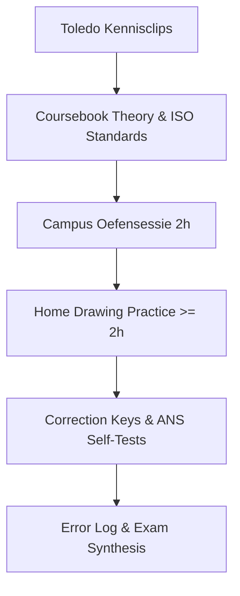

# 🔄 Study Workflow & Blended Learning Methodology

The course **IB1/EE1 Ruimtelijk Inzicht en CAD** is structured without traditional passive lecture halls. Success relies on disciplined execution of this 5-stage loop:

### 1. Preparation Phase (Pre-Session)
- Watch the designated Toledo video clips in [[Kennisclips Dashboard]].
- Take notes using the dedicated clip templates in `01 - Kennisclips`.
- Cross-reference with [[Chapter 02 - Orthogonale Aanzichten (Multiview Projections)]] or [[Chapter 03 - Doorsnedeaanzichten (Section Views)]].
- Complete the formative **ANS Test** on `toledo.kuleuven.be/ans`.

### 2. Contact Hours (Campus)
- Apply concepts directly onto physical drafting paper.
- Receive immediate visual critique and line-weight feedback from instructors.

### 3. Consolidation Phase (Home Practice)
- Dedicate a minimum of 2 hours completing unfinished exercise figures.
- Check drawings against Toledo solutions (*Oplossingen Oefeningen*).
- Any discrepancy is recorded in [[Past Exams & Error Log]].

### 4. Semester Structuur & Oefensessie Mijlpalen
1. **Sessie 1 & 2 — Orthogonale Aanzichten Tekenen**: Beheersing van 3D-naar-2D omzetting, Europese projectiemethode, $45^\circ$-versteklijn, doorsnijdingen en omwentelingslichamen.
2. **Sessie 3 & 4 — Doorsnedeaanzichten Tekenen**: Toepassing van ISO 128 snedes, arceringsregels, niet-arceren van ribben/assen, en verspringende doorsneden.
3. **Sessie 5 — Oefentest Doorsnedeaanzicht (Mock Test)**: Proefevaluatie onder examenomstandigheden als voorbereiding op de evaluatie. Zie [[Oefensessie 5 - Oefentest Doorsnedeaanzicht]].
4. **Sessie 6 — Permanente Evaluatie (Aanwezigheid Verplicht!)**: Definitieve praktijkevaluatie op campus. Zie [[Oefensessie 6 - Permanente Evaluatie]].
