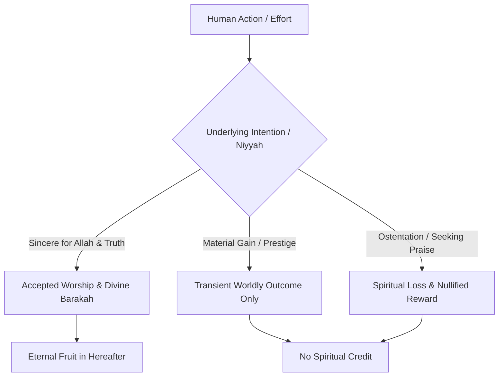

# Hadith 01: Actions are Judged by Intentions
### إنما الأعمال بالنيات

> **Narrated by:** Umar ibn al-Khattab (رضي الله عنه)  
> **Canonical Sources:** Sahih al-Bukhari 1, Sahih Muslim 1907

---

## 📜 Complete Prophetic Text

**عَنْ أَمِيرِ الْمُؤْمِنِينَ أَبِي حَفْصٍ عُمَرَ بْنِ الْخَطَّابِ رَضِيَ اللهُ عَنْهُ قَالَ: سَمِعْتُ رَسُولَ اللَّهِ صلى الله عليه وسلم يَقُولُ: «إِنَّمَا الْأَعْمَالُ بِالنِّيَّاتِ، وَإِنَّمَا لِكُلِّ امْرِئٍ مَا نَوَى، فَمَنْ كَانَتْ هِجْرَتُهُ إِلَى اللَّهِ وَرَسُولِهِ فَهِجْرَتُهُ إِلَى اللَّهِ وَرَسُولِهِ، وَمَنْ كَانَتْ هِجْرَتُهُ لِدُنْيَا يُصِيبُهَا أَوْ امْرَأَةٍ يَنْكِحُهَا فَهِجْرَتُهُ إِلَى مَا هَاجَرَ إِلَيْهِ».**

> *"Actions are judged by motives (intentions), so each person will have what they intended. Thus, he whose migration was to Allah and His Messenger, his migration is to Allah and His Messenger; but he whose migration was for some worldly benefit he might attain, or for a spouse he might marry, his migration is to that for which he migrated."*

---

## 🔍 Line-by-Line Arabic & Morphological Breakdown

| Arabic Segment | Transliteration | Word-by-Word Analysis & Meaning |
| :--- | :--- | :--- |
| **إِنَّمَا الْأَعْمَالُ بِالنِّيَّاتِ** | *Innamal-a'mālu bin-niyyāt* | إِنَّمَا (particle of restriction: only/verily) + الْأَعْمَالُ (actions/deeds) + بِـ (preposition: by/accompanied with) + النِّيَّاتِ (intentions). The legal validity, spiritual reality, and ultimate worth of all human deeds are dictated strictly by internal intent. |
| **وَإِنَّمَا لِكُلِّ امْرِئٍ مَا نَوَى** | *Wa innamā likulli-mri'in mā nawā* | وَ (and) + إِنَّمَا (only) + لِكُلِّ (for each) + امْرِئٍ (individual) + مَا (what) + نَوَى (he intended). Indicates that no deed earns reward merely through external performance; divine reward corresponds exclusively to the spiritual aim. |
| **فَمَنْ كَانَتْ هِجْرَتُهُ إِلَى اللَّهِ وَرَسُولِهِ** | *Fa-man kānat hijratuhu ilallāhi wa rasūlih* | فَـ (so) + مَنْ (whoever) + كَانَتْ هِجْرَتُهُ (his migration was) + إِلَى اللَّهِ (to Allah) + وَرَسُولِهِ (and His Messenger). The benchmark of pure spiritual alignment: physical relocation driven solely by devotion to divine truth and prophetic guidance. |
| **فَهِجْرَتُهُ إِلَى اللَّهِ وَرَسُولِهِ** | *Fa-hijratuhu ilallāhi wa rasūlih* | The predicate repeats the noble condition verbatim to demonstrate high honor, complete divine acceptance, and that reaching divine pleasure is an incomparable achievement in itself. |
| **وَمَنْ كَانَتْ هِجْرَتُهُ لِدُنْيَا يُصِيبُهَا** | *Wa man kānat hijratuhu li-dunyā yuṣībuhā* | وَمَنْ (and whoever) + كَانَتْ هِجْرَتُهُ (his migration was) + لِدُنْيَا (for worldly matter/gain) + يُصِيبُهَا (he attains/captures it). Contrasts sublime spiritual intent with temporal, ephemeral acquisition. |
| **أَوْ امْرَأَةٍ يَنْكِحُهَا** | *Aw imra'atin yankihuhā* | أَوْ (or) + امْرَأَةٍ (a spouse) + يَنْكِحُهَا (he marries her). Highlights a specific personal desire within worldly ambitions to illustrate that non-spiritual motivations yield only limited temporal outcomes. |
| **فَهِجْرَتُهُ إِلَى مَا هَاجَرَ إِلَيْهِ** | *Fa-hijratuhu ilā mā hājara ilayh* | Belittles the purely worldly migration by refusing to repeat the specific phrase, summarizing it as whatever transient worldly ambition the traveler chased. |

---

## 📊 Conceptual Framework & Visual Model

---

## 💡 In-Depth Sharh & Classical Commentary

### Central Theological & Juristic Status
- **Foundational Pillar:** Imam al-Shafi'i famously stated: *"This hadith represents one third of all sacred knowledge, and it enters into seventy chapters of jurisprudence (Fiqh)."* Imam Ahmad and Abu Dawud agreed that Islam revolves around fundamental master hadiths, of which this is the foremost.
- **Two Distinct Principles in the Hadith:**
  1. *"Actions are by intentions":* Addresses the validity and reality of deeds (Fiqh level). An act of washing without the intent of purification does not constitute ritual ablution; abstaining from food without intent does not constitute fasting.
  2. *"Each person will have what they intended":* Addresses the reward and spiritual compensation (Ikhlas / Akhirah level). Even if an action is formally correct, reward is proportional to internal sincerity.
- **Classical Commentary Insight (Ibn Rajab al-Hanbali in *Jami' al-Ulum wal-Hikam*):** Actions are divided into:
  - Worship done purely for Allah (rewarded).
  - Worship contaminated by ostentation (*Riya'*): if mixed from inception, the spiritual benefit is compromised.
  - Neutral worldly actions (work, coding, studying, sleeping): through conscious intention, these are converted into acts of continuous worship (*'Ibadah*).

---

## ⚡ Practical & Productivity Application

### Productivity & Daily Execution
- **Reframing Routine into Worship:** An engineer developing software, a researcher analyzing data, or a professional managing projects can convert hours of mental toil into spiritual reward by intending to benefit society, secure lawful livelihood, and fulfill family responsibilities.
- **Overcoming Burnout & Need for External Applause:** When your fundamental motive is divine pleasure, anxiety over workplace politics or lack of public recognition dissipates. You focus on craftsmanship because the Ultimate Observer never overlooks sincere effort.

---

## 📖 Canonical References & Scholarly Grading
- **References:** Sahih al-Bukhari 1, Sahih Muslim 1907
- **Scholarly Classification:** Authenticated in classical collections; selected by Imam an-Nawawi as foundational principles (*Qawa'id al-Deen*).

---

## 🎥 Curated Video Insights & Lectures
- **Recommended Video Lecture:** YouTube Search: `Hadith 1 Nawawi Actions are by intentions Yaqeen Institute Omar Suleiman`
- https://youtu.be/B28zDw8-ZaU?t=36

---

[[00_Hadith_Index|⬅ Index]] | [[00_Hadith_Index|📖 Hadith Index]] | [[Hadith_02_Islam_Iman_Ihsan|Next: Hadith 02 ➡]]
