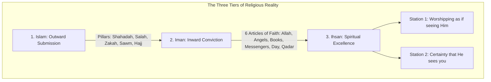

# Hadith 02: Hadith Jibril: Islam, Iman, and Ihsan
### حديث جبريل عليه السلام: مراتب الدين

> **Narrated by:** Umar ibn al-Khattab (رضي الله عنه)  
> **Canonical Sources:** Sahih Muslim 8

---

## 📜 Complete Prophetic Text

**عَنْ عُمَرَ رَضِيَ اللهُ عَنْهُ أَيْضًا قَالَ: بَيْنَمَا نَحْنُ جُلُوسٌ عِنْدَ رَسُولِ اللَّهِ صلى الله عليه و سلم ذَاتَ يَوْمٍ، إذْ طَلَعَ عَلَيْنَا رَجُلٌ شَدِيدُ بَيَاضِ الثِّيَابِ، شَدِيدُ سَوَادِ الشَّعْرِ، لَا يُرَى عَلَيْهِ أَثَرُ السَّفَرِ، وَلَا يَعْرِفُهُ مِنَّا أَحَدٌ... فَقَالَ رَسُولُ اللَّهِ صلى الله عليه و سلم: «الْإِسْلَامُ أَنْ تَشْهَدَ أَنْ لَا إلَهَ إلَّا اللَّهُ وَأَنَّ مُحَمَّدًا رَسُولُ اللَّهِ، وَتُقِيمَ الصَّلَاةَ، وَتُؤْتِيَ الزَّكَاةَ، وَتَصُومَ رَمَضَانَ، وَتَحُجَّ الْبَيْتَ إنْ اسْتَطَعْت إلَيْهِ سَبِيلًا...»**

> *"Also on the authority of 'Umar (ra) who said: While we were one day sitting with the Messenger of Allah (ﷺ) there appeared before us a man dressed in intensely white clothes and with extremely black hair. No traces of journey were visible upon him, yet none of us knew him. He sat down close to the Prophet (ﷺ), placed his knees against his, placed his palms on his thighs, and said: "O Muhammad! Tell me about Islam...""*

---

## 🔍 Line-by-Line Arabic & Morphological Breakdown

| Arabic Segment | Transliteration | Word-by-Word Analysis & Meaning |
| :--- | :--- | :--- |
| **شَدِيدُ بَيَاضِ الثِّيَابِ، شَدِيدُ سَوَادِ الشَّعْرِ** | *Shadeedu bayādith-thiyāb, shadeedu sawādish-sha'r* | Intensely white garments, deep black hair. Demonstrates pristine personal presentation and adab (decorum) in seeking sacred knowledge. |
| **الْإِسْلَامُ: أَنْ تَشْهَدَ... وَتُقِيمَ الصَّلَاةَ...** | *Al-Islāmu: an tash-hada... wa tuqeemas-salāh...* | Islam defined through outward bodily actions: the Shahadah, establishment of regular prayer, paying Zakah, fasting Ramadan, and pilgrimage to Makkah. |
| **الْإِيمَانُ: أَنْ تُؤْمِنَ بِاللَّهِ وَمَلَائِكَتِهِ...** | *Al-Īmānu: an tu'mina billāhi wa malā'ikatih...* | Iman defined through internal convictions: belief in Allah, His angels, revealed scriptures, Messengers, the Last Day, and divine decree (Qadar), good and adverse. |
| **الْإِحْسَانُ: أَنْ تَعْبُدَ اللَّهَ كَأَنَّكَ تَرَاهُ** | *Al-Iḥsānu: an ta'budallāha ka-annaka tarāh* | Ihsan (highest perfection): Worshipping and serving Allah as though you behold Him directly (station of contemplation - Mushahadah). |
| **فَإِنْ لَمْ تَكُنْ تَرَاهُ فَإِنَّهُ يَرَاك** | *Fa-in lam takun tarāhu fa-innahu yarāk* | The second tier of Ihsan: Living in acute mindfulness that He continuously observes you (station of surveillance - Muraqabah). |
| **مَا الْمَسْئُولُ عَنْهَا بِأَعْلَمَ مِنَ السَّائِلِ** | *Mal-mas'ūlu 'anhā bi-a'lama minas-sā'il* | "The one questioned knows no more than the questioner." Demonstrates scholarly humility and confirms that the precise timing of the Hour belongs to the Unseen (*Ghayb*). |
| **فَإِنَّهُ جِبْرِيلُ أَتَاكُمْ يُعَلِّمُكُمْ دِينَكُمْ** | *Fa-innahu Jibrīlu atākum yu'allimukum deenakum* | "That was Jibril; he came to teach you your religion." Connects all three levels into an integrated definition of faith. |

---

## 📊 Conceptual Framework & Visual Model

---

## 💡 In-Depth Sharh & Classical Commentary

### The Architectural Blueprint of the Religion (*Umm al-Sunnah*)
- **Status in Islamic Literature:** Termed *Umm al-Sunnah* (the Mother of Prophetic Tradition) because every doctrine, legal ruling, and spiritual practice stems from the three tiers outlined by Jibril:
  1. **Islam (Shari'ah):** The physical, legal practices governing external limbs.
  2. **Iman (Aqeedah):** The intellectual and heart-centered convictions.
  3. **Ihsan (Tazkiyah / Akhlaq):** The experiential reality of spiritual mindfulness and excellence.
- **Pedagogical Brilliance:** Jibril modeled the quintessential etiquette of the sincere student: approaching respectfully, sitting attentively, asking focused questions, and acknowledging clear truth.

---

## ⚡ Practical & Productivity Application

### Productivity & Engineering Architecture
- **Multi-Tiered System Architecture:** Human character mirrors modular system design:
  - Base Layer (Execution / Interface): Consistent daily habits (Salah, obligations).
  - Core Logic (Engine / Beliefs): Clear principles, resilient mindset, purposeful goals (Iman).
  - Polish Layer (Quality / Attention): Craftsmanship and ethical integrity when completely unobserved (Ihsan).
- **The Power of Muraqabah:** When developing code, analyzing financial records, or writing research, Ihsan compels high standards because your work is accountable to the Supreme Witness.

---

## 📖 Canonical References & Scholarly Grading
- **References:** Sahih Muslim 8
- **Scholarly Classification:** Authenticated in classical collections; selected by Imam an-Nawawi as foundational principles (*Qawa'id al-Deen*).

---

## 🎥 Curated Video Insights & Lectures
- **Recommended Video Lecture:** YouTube Search: `Hadith Jibril Yasir Qadhi detailed explanation`

---

[[Hadith_01_Actions_and_Intentions|⬅ Prev: Hadith 01]] | [[00_Hadith_Index|📖 Hadith Index]] | [[Hadith_03_Pillars_of_Islam|Next: Hadith 03 ➡]]
