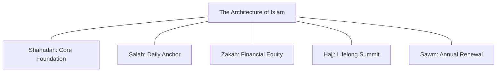

# Hadith 03: The Five Pillars of Islam
### بني الإسلام على خمس

> **Narrated by:** Abdullah ibn Umar (رضي الله عنهما)  
> **Canonical Sources:** Sahih al-Bukhari 8, Sahih Muslim 16

---

## 📜 Complete Prophetic Text

**عَنْ أَبِي عَبْدِ الرَّحْمَنِ عَبْدِ اللَّهِ بْنِ عُمَرَ بْنِ الْخَطَّابِ رَضِيَ اللَّهُ عَنْهُمَا قَالَ: سَمِعْت رَسُولَ اللَّهِ صلى الله عليه و سلم يَقُولُ: «بُنِيَ الْإِسْلَامُ عَلَى خَمْسٍ: شَهَادَةِ أَنْ لَا إلَهَ إلَّا اللَّهُ وَأَنَّ مُحَمَّدًا رَسُولُ اللَّهِ، وَإِقَامِ الصَّلَاةِ، وَإِيتَاءِ الزَّكَاةِ، وَحَجِّ الْبَيْتِ، وَصَوْمِ رَمَضَانَ».**

> *"On the authority of Abu Abdur-Rahman Abdullah, son of Umar bin al-Khattab (ra), who said: I heard the Messenger of Allah (ﷺ) say: "Islam has been built upon five [pillars]: testifying that there is no deity worthy of worship except Allah and that Muhammad is the Messenger of Allah, establishing the prayer, paying the Zakat, making pilgrimage to the House, and fasting in Ramadan.""*

---

## 🔍 Line-by-Line Arabic & Morphological Breakdown

| Arabic Segment | Transliteration | Word-by-Word Analysis & Meaning |
| :--- | :--- | :--- |
| **بُنِيَ الْإِسْلَامُ عَلَى خَمْسٍ** | *Buniya al-Islāmu 'alā khams* | بُنِيَ (passive verb: was constructed) + الْإِسْلَامُ (Islam) + عَلَى خَمْسٍ (upon five). Uses architectural construction as a metaphor for spiritual life. |
| **شَهَادَةِ أَنْ لَا إلَهَ إلَّا اللَّهُ** | *Shahādati an lā ilāha illallāh* | The foundational cornerstone: bearing witness to absolute Tawheed and renouncing all false authorities. |
| **وَإِقَامِ الصَّلَاةِ** | *Wa iqāmis-salāh* | Establishing prayer regularly and properly with focus, punctuality, and community harmony. |
| **وَإِيتَاءِ الزَّكَاةِ** | *Wa eetā'iz-zakāh* | Discharging the purifying annual charity to cleanse wealth and alleviate poverty. |
| **وَحَجِّ الْبَيْتِ** | *Wa ḥajjil-bayt* | Pilgrimage to Makkah once in a lifetime for those with physical and financial capability. |
| **وَصَوْمِ رَمَضَانَ** | *Wa ṣawmi Ramaḍān* | Fasting the month of Ramadan to master biological drives and cultivate discipline. |

---

## 📊 Conceptual Framework & Visual Model

---

## 💡 In-Depth Sharh & Classical Commentary

### Structural Harmony of Faith
- **The Analogy of the Edifice:** The Prophet (ﷺ) compared Islam to a tent or structure sustained by primary columns. If the central foundation is compromised, the canopy collapses; if secondary columns are neglected, structural integrity is weakened.
- **Iqamah vs. Mere Performance:** The Arabic term *Iqamah* means setting something upright. Salah is not merely performed; it is established as an unshakeable constant throughout the rhythms of life.
- **Synthesizing Inner and Outer:** The five pillars balance verbal declaration (Shahadah), physical discipline (Salah, Sawm), financial contribution (Zakah), and comprehensive life journey (Hajj).

---

## ⚡ Practical & Productivity Application

### Productivity Application
- **Establishing Non-Negotiables:** High-reliability systems depend on core invariants. In personal productivity, the 5 pillars form daily anchor points (prayer intervals establish focused time blocks), annual resets (Ramadan restores spiritual priorities), and economic hygiene (Zakah removes greed).

---

## 📖 Canonical References & Scholarly Grading
- **References:** Sahih al-Bukhari 8, Sahih Muslim 16
- **Scholarly Classification:** Authenticated in classical collections; selected by Imam an-Nawawi as foundational principles (*Qawa'id al-Deen*).

---

## 🎥 Curated Video Insights & Lectures
- **Recommended Video Lecture:** YouTube Search: `Hadith 3 Nawawi Five pillars explanation Bilal Philips`

---

[[Hadith_02_Islam_Iman_Ihsan|⬅ Prev: Hadith 02]] | [[00_Hadith_Index|📖 Hadith Index]] | [[Hadith_04_Creation_and_Destiny|Next: Hadith 04 ➡]]
