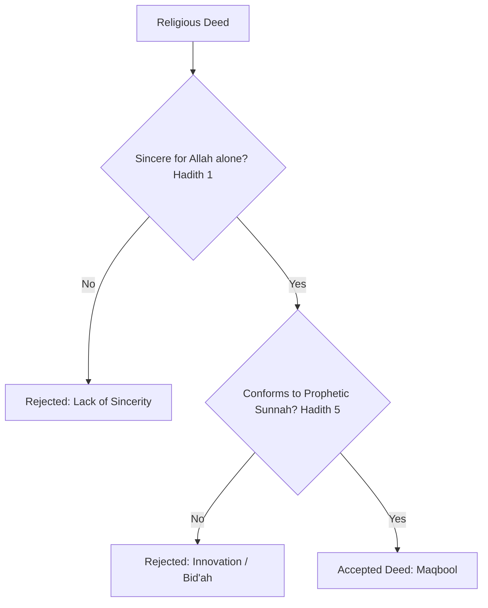

# Hadith 05: Preservation of Deen & Rejection of Innovations
### النهي عن الابتداع في الدين

> **Narrated by:** Aisha (رضي الله عنها)  
> **Canonical Sources:** Sahih al-Bukhari 2697, Sahih Muslim 1718

---

## 📜 Complete Prophetic Text

**عَنْ أُمِّ الْمُؤْمِنِينَ أُمِّ عَبْدِ اللَّهِ عَائِشَةَ رَضِيَ اللَّهُ عَنْهَا، قَالَتْ: قَالَ رَسُولُ اللَّهِ صلى الله عليه و سلم: «مَنْ أَحْدَثَ فِي أَمْرِنَا هَذَا مَا لَيْسَ مِنْهُ فَهُوَ رَدٌّ». وَفِي رِوَايَةٍ لِمُسْلِمٍ: «مَنْ عَمِلَ عَمَلًا لَيْسَ عَلَيْهِ أَمْرُنَا فَهُوَ رَدٌّ».**

> *"On the authority of the Mother of the Believers, Umm Abdillah Aisha (ra) who said: The Messenger of Allah (ﷺ) said: "He who innovates something in this matter of ours (Islam) that is not of it, will have it rejected." And in a narration by Muslim: "He who does an act which is not in accordance with our command will have it rejected.""*

---

## 🔍 Line-by-Line Arabic & Morphological Breakdown

| Arabic Segment | Transliteration | Word-by-Word Analysis & Meaning |
| :--- | :--- | :--- |
| **مَنْ أَحْدَثَ** | *Man aḥdatha* | Whoever invents, originates, or introduces something novel without divine sanction. |
| **فِي أَمْرِنَا هَذَا** | *Fī amrinā hādhā* | "In this matter of ours" — specifically signifies sacred worship (*'Ibadah*) and theology (*Aqeedah*), not worldly technological advances. |
| **مَا لَيْسَ مِنْهُ** | *Mā laysa minhu* | That which lacks authority, scriptural basis, or validation in revelation. |
| **فَهُوَ رَدٌّ** | *Fa-huwa radd* | Rejected, void, and unworthy of divine acceptance. |
| **مَنْ عَمِلَ عَمَلًا لَيْسَ عَلَيْهِ أَمْرُنَا** | *Man 'amila 'amalan laysa 'alayhi amrunā* | Expands the scope: even if someone did not invent the innovation, practicing it renders the ritual void. |

---

## 📊 Conceptual Framework & Visual Model

---

## 💡 In-Depth Sharh & Classical Commentary

### The Dual Filter of Accepted Deeds
- **Complement to Hadith 1:** While Hadith 1 evaluates the internal condition of sincerity (*Ikhlas*), Hadith 5 evaluates the external condition of conformity to Sunnah (*Ittiba'*). An act requires both conditions to be accepted by Allah.
- **Preservation of Sacred Heritage:** Religious traditions historically experienced degradation when subsequent generations added rituals under emotional enthusiasm. This hadith maintains a clean perimeter protecting authentic worship.
- **Worldly vs Religious Innovations:** Innovation in engineering, science, medicine, and technology is encouraged under the general Islamic principle of worldly benefit, whereas innovation in religious doctrine and ritual worship is prohibited.

---

## ⚡ Practical & Productivity Application

### Productivity & Standard Operating Procedures
- **Adhering to Core Specifications:** Just as software developers adhere to verified protocol specifications to prevent corrupt states, spiritual routines thrive when anchored to verified prophetic practices rather than arbitrary customs.

---

## 📖 Canonical References & Scholarly Grading
- **References:** Sahih al-Bukhari 2697, Sahih Muslim 1718
- **Scholarly Classification:** Authenticated in classical collections; selected by Imam an-Nawawi as foundational principles (*Qawa'id al-Deen*).

---

## 🎥 Curated Video Insights & Lectures
- **Recommended Video Lecture:** YouTube Search: `Hadith 5 Nawawi innovation in religion explanation Yasir Qadhi`

---

[[Hadith_04_Creation_and_Destiny|⬅ Prev: Hadith 04]] | [[00_Hadith_Index|📖 Hadith Index]] | [[Hadith_06_Doubtful_Matters_and_the_Heart|Next: Hadith 06 ➡]]
