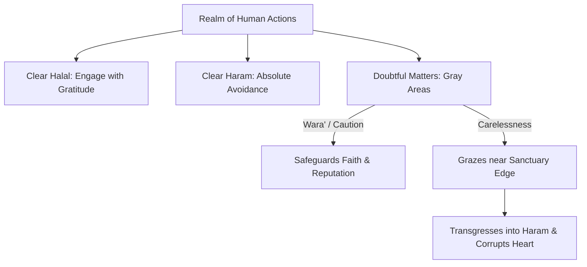

# Hadith 06: Halal, Haram, Doubtful Matters & the Heart
### الحلال والحرام والشبهات وصلاح القلب

> **Narrated by:** An-Nu'man ibn Bashir (رضي الله عنهما)  
> **Canonical Sources:** Sahih al-Bukhari 52, Sahih Muslim 1599

---

## 📜 Complete Prophetic Text

**عَنْ أَبِي عَبْدِ اللَّهِ النُّعْمَانِ بْنِ بَشِيرٍ رَضِيَ اللَّهُ عَنْهُمَا، قَالَ: سَمِعْت رَسُولَ اللَّهِ صلى الله عليه و سلم يَقُولُ: «إِنَّ الْحَلَالَ بَيِّنٌ، وَإِنَّ الْحَرَامَ بَيِّنٌ، وَبَيْنَهُمَا أُمُورٌ مُشْتَبِهَاتٌ لَا يَعْلَمُهُنَّ كَثِيرٌ مِنْ النَّاسِ، فَمَنْ اتَّقَى الشُّبُهَاتِ فَقْد اسْتَبْرَأَ لِدِينِهِ وَعِرْضِهِ، وَمَنْ وَقَعَ فِي الشُّبُهَاتِ وَقَعَ فِي الْحَرَامِ، كَالرَّاعِي يَرْعَى حَوْلَ الْحِمَى يُوشِكُ أَنْ يَرْتَعَ فِيهِ، أَلَا وَإِنَّ لِكُلِّ مَلِكٍ حِمًى، أَلَا وَإِنَّ حِمَى اللَّهِ مَحَارِمُهُ، أَلَا وَإِنَّ فِي الْجَسَدِ مُضْغَةً إِذَا صَلَحَتْ صَلَحَ الْجَسَدُ كُلُّهُ، وَإِذَا فَسَدَتْ فَسَدَ الْجَسَدُ كُلُّهُ، أَلَا وَهِيَ الْقَلْبُ».**

> *"On the authority of Abu Abdillah an-Nu'man bin Bashir (ra) who said: I heard the Messenger of Allah (ﷺ) say: "Truly that which is lawful is clear, and that which is unlawful is clear, and between them are doubtful matters about which many people do not know. Thus he who avoids doubtful matters safeguards his religion and his honor; but he who falls into doubtful matters falls into that which is unlawful, like the shepherd who grazes around a private sanctuary, nearly grazing within it. Unquestionably, every sovereign has a sanctuary, and truly Allah's sanctuary is His prohibitions. Truly in the body there is a morsel of flesh: if it is sound, the entire body is sound; and if it is corrupted, the entire body is corrupted. Unquestionably, it is the heart.""*

---

## 🔍 Line-by-Line Arabic & Morphological Breakdown

| Arabic Segment | Transliteration | Word-by-Word Analysis & Meaning |
| :--- | :--- | :--- |
| **إِنَّ الْحَلَالَ بَيِّنٌ، وَإِنَّ الْحَرَامَ بَيِّنٌ** | *Innal-ḥalāla bayyin, wa innal-ḥarāma bayyin* | Manifest Halal (wholesome foods, honest commerce) and clear Haram (usury, injustice, deceit) are transparent. |
| **وَبَيْنَهُمَا أُمُورٌ مُشْتَبِهَاتٌ** | *Wa baynahumā umūrun mushtabihāt* | Ambiguous gray zones where ethical boundaries appear unclear to the majority of people. |
| **فَمَنْ اتَّقَى الشُّبُهَاتِ اسْتَبْرَأَ لِدِينِهِ وَعِرْضِهِ** | *Fa-manit-taqash-shubuhāti istabra'a li-dīnihī wa 'irḍih* | He who practices scrupulous caution (*Wara'*) clears his religious standing before Allah and his public reputation before society. |
| **كَالرَّاعِي يَرْعَى حَوْلَ الْحِمَى** | *Kar-rā'ī yar'ā ḥawlal-ḥimā* | Analogy of the shepherd pasturing near a protected estate: proximity breeds carelessness until boundaries are breached. |
| **أَلَا وَإِنَّ فِي الْجَسَدِ مُضْغَةً... أَلَا وَهِيَ الْقَلْبُ** | *Alā wa inna fil-jasadi muḍghatan... alā wahiyal-qalb* | The spiritual driver: the heart governs physical senses and limbs like a sovereign commander. |

---

## 📊 Conceptual Framework & Visual Model

---

## 💡 In-Depth Sharh & Classical Commentary

### The Three Categories of Actions and Heart Governance
- **Comprehensive Taxonomy:** Human actions fall into three zones: clear permissible, clear prohibited, and ambiguous matters known to deeply grounded scholars.
- **Reputational and Spiritual Shield:** Avoiding gray areas protects two vital dimensions: *Deen* (one's relationship with Allah) and *'Ird* (one's honor and standing among peers).
- **The Heart as Spiritual CPU:** Physical limbs execute what the heart approves. When the heart ingests dubious wealth or compromises integrity, spiritual perception becomes blunted.

---

## ⚡ Practical & Productivity Application

### Productivity & Ethical Boundaries
- **Safety Margins in Professional Life:** In engineering and finance, prudent leaders design robust safety margins away from critical failure thresholds. Keeping distance from questionable business practices ensures long-term reputation and uncompromised focus.

---

## 📖 Canonical References & Scholarly Grading
- **References:** Sahih al-Bukhari 52, Sahih Muslim 1599
- **Scholarly Classification:** Authenticated in classical collections; selected by Imam an-Nawawi as foundational principles (*Qawa'id al-Deen*).

---

## 🎥 Curated Video Insights & Lectures
- **Recommended Video Lecture:** YouTube Search: `Hadith 6 Nawawi Halal Haram heart explanation Omar Suleiman`

---

[[Hadith_05_Rejection_of_Innovations|⬅ Prev: Hadith 05]] | [[00_Hadith_Index|📖 Hadith Index]] | [[Hadith_07_Religion_is_Sincerity|Next: Hadith 07 ➡]]
