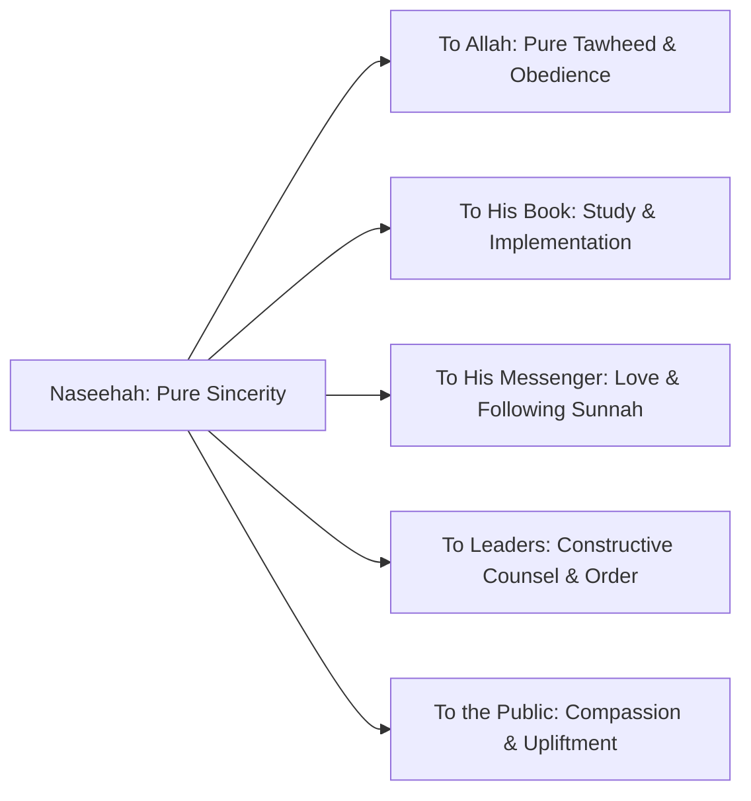

# Hadith 07: The Essence of Religion: Naseehah (Sincerity)
### الدين النصيحة

> **Narrated by:** Tamim al-Dari (رضي الله عنه)  
> **Canonical Sources:** Sahih Muslim 55

---

## 📜 Complete Prophetic Text

**عَنْ أَبِي رُقَيَّةَ تَمِيمِ بْنِ أَوْسٍ الدَّارِيِّ رَضِيَ اللهُ عَنْهُ أَنَّ النَّبِيَّ صلى الله عليه وسلم قَالَ: «الدِّينُ النَّصِيحَةُ». قُلْنَا: لِمَنْ؟ قَالَ: «لِلَّهِ، وَلِكِتَابِهِ، وَلِرَسُولِهِ، وَلِأَئِمَّةِ الْمُسْلِمِينَ وَعَامَّتِهِمْ».**

> *"On the authority of Abu Ruqayyah Tamim ibn Aus ad-Dari (ra) that the Prophet (ﷺ) said: "The Deen (Religion) is Naseehah (sincere counsel, purity of purpose, genuine loyalty)." We said: "To whom?" He replied: "To Allah, His Book, His Messenger, the leaders of the Muslims, and their common folk.""*

---

## 🔍 Line-by-Line Arabic & Morphological Breakdown

| Arabic Segment | Transliteration | Word-by-Word Analysis & Meaning |
| :--- | :--- | :--- |
| **الدِّينُ النَّصِيحَةُ** | *Ad-dīnun-naṣīḥah* | Linguistically, Naseehah derives from purifying honey from wax or mending a garment. It signifies unadulterated goodwill and moral integrity. |
| **لِلَّهِ** | *Lillāh* | Sincerity to Allah: Affirming His absolute Oneness, fulfilling His commands, and loving solely for His pleasure. |
| **وَلِكِتَابِهِ** | *Wa li-kitābih* | Sincerity to His Book: Reciting it with reflection, defending its guidance, and living by its injunctions. |
| **وَلِرَسُولِهِ** | *Wa li-rasūlih* | Sincerity to His Messenger: Acknowledging his prophethood, reviving his Sunnah, and embodying his character. |
| **وَلِأَئِمَّةِ الْمُسْلِمِينَ** | *Wa li-a'immatil-muslimīn* | Sincerity to leaders: Offering constructive, principled counsel and promoting justice and social order. |
| **وَعَامَّتِهِمْ** | *Wa 'āmmatihim* | Sincerity to common folk: Showing compassion, honoring their rights, concealing their faults, and desiring their welfare. |

---

## 📊 Conceptual Framework & Visual Model

---

## 💡 In-Depth Sharh & Classical Commentary

### The Comprehensive Sphere of Naseehah
- **Linguistic Essence:** *Naseehah* implies cleansing something of all impurities. In human relationships, it is the opposite of deceit (*Ghashsh*).
- **Core of Religious Life:** Just as the Prophet (ﷺ) declared that the pilgrimage is embodied in 'Arafah, he summarized all religion in *Naseehah*—a disposition of pure goodwill toward Creator and creation.

---

## ⚡ Practical & Productivity Application

### Productivity & Constructive Collaboration
- **Radical Candor and Code Reviews:** When giving peer feedback, architectural reviews, or managing teams, embody *Naseehah*: constructive, private, objective, and driven purely by collective excellence rather than ego.

---

## 📖 Canonical References & Scholarly Grading
- **References:** Sahih Muslim 55
- **Scholarly Classification:** Authenticated in classical collections; selected by Imam an-Nawawi as foundational principles (*Qawa'id al-Deen*).

---

## 🎥 Curated Video Insights & Lectures
- **Recommended Video Lecture:** YouTube Search: `Hadith 7 Nawawi Ad-Deen an-Naseehah explanation Omar Suleiman`

---

[[Hadith_06_Doubtful_Matters_and_the_Heart|⬅ Prev: Hadith 06]] | [[00_Hadith_Index|📖 Hadith Index]] | [[Hadith_08_Sanctity_of_Life_and_Property|Next: Hadith 08 ➡]]
