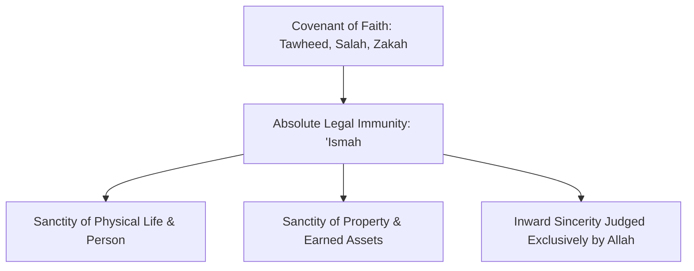

# Hadith 08: The Sanctity of a Muslim's Life and Property
### حرمة دم المسلم وماله

> **Narrated by:** Abdullah ibn Umar (رضي الله عنهما)  
> **Canonical Sources:** Sahih al-Bukhari 25, Sahih Muslim 22

---

## 📜 Complete Prophetic Text

**عَنْ ابْنِ عُمَرَ رَضِيَ اللَّهُ عَنْهُمَا، أَنَّ رَسُولَ اللَّهِ صلى الله عليه و سلم قَالَ: «أُمِرْتُ أَنْ أُقَاتِلَ النَّاسَ حَتَّى يَشْهَدُوا أَنْ لَا إلَهَ إلَّا اللَّهُ وَأَنَّ مُحَمَّدًا رَسُولُ اللَّهِ، وَيُقِيمُوا الصَّلَاةَ، وَيُؤْتُوا الزَّكَاةَ؛ فَإِذَا فَعَلُوا ذَلِكَ عَصَمُوا مِنِّي دِمَاءَهُمْ وَأَمْوَالَهُمْ إلَّا بِحَقِّ الْإِسْلَامِ، وَحِسَابُهُمْ عَلَى اللَّهِ تَعَالَى».**

> *"On the authority of Ibn Umar (ra) that the Messenger of Allah (ﷺ) said: "I have been commanded to address people until they testify that there is no deity worthy of worship except Allah and that Muhammad is the Messenger of Allah, establish the prayer, and pay the Zakat. If they do that, they have safeguarded their lives and wealth from me, except by the rightful due of Islam, and their ultimate reckoning is with Allah the Almighty.""*

---

## 🔍 Line-by-Line Arabic & Morphological Breakdown

| Arabic Segment | Transliteration | Word-by-Word Analysis & Meaning |
| :--- | :--- | :--- |
| **أُمِرْتُ أَنْ أُقَاتِلَ النَّاسَ** | *Umirtu an uqātilan-nās* | I have been commanded to contend against hostile opposing forces until civil security and the covenant of faith are established. |
| **حَتَّى يَشْهَدُوا... وَيُقِيمُوا الصَّلَاةَ...** | *Ḥattā yash-hadū... wa yuqeemus-salāh...* | Until they acknowledge Tawheed, establish communal prayer, and fulfill social charity. |
| **عَصَمُوا مِنِّي دِمَاءَهُمْ وَأَمْوَالَهُمْ** | *'Aṣamū minnī dimā'ahum wa amwālahum* | They attain complete legal inviolability (*'Ismah*) protecting physical life, personal dignity, and economic property. |
| **إِلَّا بِحَقِّ الْإِسْلَامِ** | *Illā bi-ḥaqqil-Islām* | Except by legitimate due process established by Islamic law (such as judicial retribution or public debts). |
| **وَحِسَابُهُمْ عَلَى اللَّهِ تَعَالَى** | *Wa ḥisābuhum 'alallāhi ta'ālā* | Hidden motives and heart secrets belong exclusively to divine reckoning; human courts judge only manifest adherence. |

---

## 📊 Conceptual Framework & Visual Model

---

## 💡 In-Depth Sharh & Classical Commentary

### Inviolability of Rights and Judgment by Outward Actions
- **No Inquisition into Consciences:** The Prophet (ﷺ) established the foundational legal rule that believers deal with people according to outward integrity, leaving inward secrets to Allah.
- **Universal Protection:** Once an individual enters the covenant, their life, savings, and dignity are protected by divine law against arbitrary transgression.

---

## ⚡ Practical & Productivity Application

### Productivity & Ethical Asset Management
- **Honoring Contracts and Intellectual Property:** Respect for wealth and rights means honoring software licenses, non-disclosure agreements, and business partnerships with absolute fidelity.

---

## 📖 Canonical References & Scholarly Grading
- **References:** Sahih al-Bukhari 25, Sahih Muslim 22
- **Scholarly Classification:** Authenticated in classical collections; selected by Imam an-Nawawi as foundational principles (*Qawa'id al-Deen*).

---

## 🎥 Curated Video Insights & Lectures
- **Recommended Video Lecture:** YouTube Search: `Hadith 8 Nawawi Sanctity of life and property explanation`

---

[[Hadith_07_Religion_is_Sincerity|⬅ Prev: Hadith 07]] | [[00_Hadith_Index|📖 Hadith Index]] | [[Hadith_09_Ease_in_Obligations|Next: Hadith 09 ➡]]
