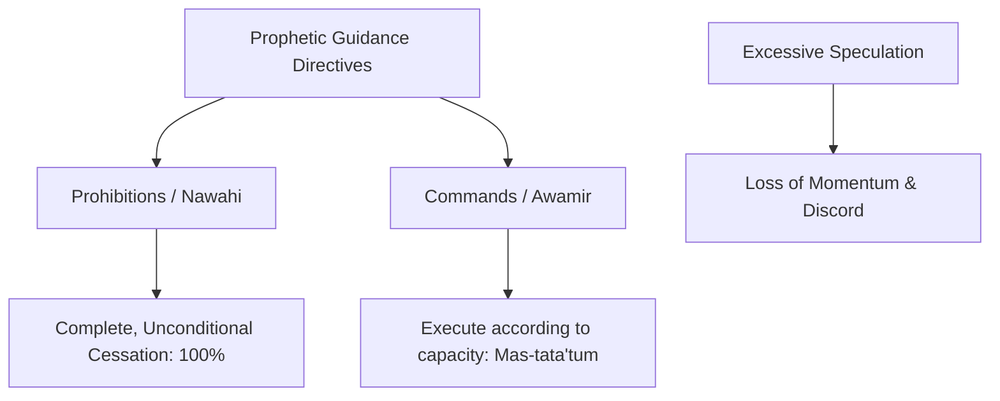

# Hadith 09: Ease in Obligations & Avoiding Speculation
### التكليف بما يستطاع والنهي عن كثرة السؤال

> **Narrated by:** Abu Hurairah (رضي الله عنه)  
> **Canonical Sources:** Sahih al-Bukhari 7288, Sahih Muslim 1337

---

## 📜 Complete Prophetic Text

**عَنْ أَبِي هُرَيْرَةَ عَبْدِ الرَّحْمَنِ بْنِ صَخْرٍ رَضِيَ اللهُ عَنْهُ قَالَ: سَمِعْت رَسُولَ اللَّهِ صلى الله عليه و سلم يَقُولُ: «مَا نَهَيْتُكُمْ عَنْهُ فَاجْتَنِبُوهُ، وَمَا أَمَرْتُكُمْ بِهِ فَأْتُوا مِنْهُ مَا اسْتَطَعْتُمْ، فَإِنَّمَا أَهْلَكَ الَّذِينَ مِنْ قَبْلِكُمْ كَثْرَةُ مَسَائِلِهِمْ وَاخْتِلَافُهُمْ عَلَى أَنْبِيَائِهِمْ».**

> *"On the authority of Abu Hurayrah Abdur-Rahman bin Sakhr (ra) who said: I heard the Messenger of Allah (ﷺ) say: "What I have forbidden you, avoid completely; and what I have ordered you to do, perform as much of it as you have capacity for. For indeed, what ruined those nations before you was only their excessive questioning and their disagreement with their Prophets.""*

---

## 🔍 Line-by-Line Arabic & Morphological Breakdown

| Arabic Segment | Transliteration | Word-by-Word Analysis & Meaning |
| :--- | :--- | :--- |
| **مَا نَهَيْتُكُمْ عَنْهُ فَاجْتَنِبُوهُ** | *Mā nahaytukum 'anhu faj-tanibūh* | What is forbidden requires immediate, unconditional cessation. Restraint requires no physical energy—only cessation of action. |
| **وَمَا أَمَرْتُكُمْ بِهِ فَأْتُوا مِنْهُ مَا اسْتَطَعْتُمْ** | *Wa mā amartukum bihī fa'tū minhu mastata'tum* | Positive commandments are scaled to individual human capacity (*Istita'ah*), introducing divine ease and flexibility. |
| **فَإِنَّمَا أَهْلَكَ الَّذِينَ مِنْ قَبْلِكُمْ** | *Fa-innamā ahlakal-ladhīna min qablikum* | Historical warning: prior communities brought hardship upon themselves through argumentative hair-splitting. |
| **كَثْرَةُ مَسَائِلِهِمْ وَاخْتِلَافُهُمْ** | *Kathratu masā'ilihim wakhtilāfuhum* | Excessive hypothetical nitpicking and disputing with prophetic messengers. |

---

## 📊 Conceptual Framework & Visual Model

---

## 💡 In-Depth Sharh & Classical Commentary

### Foundational Legal Maxim of Facilitation
- **Hardship Brings Ease:** This narration anchors the legal rule *"Al-Mashaqqatu tajlibut-tayseer"*. When an obligation cannot be met in full due to valid inability, it is met to the degree possible.
- **Asymmetry of Forbidding vs Commanding:** Refraining from a vice requires zero resource consumption, whereas fulfilling commands requires energy, health, and means.

---

## ⚡ Practical & Productivity Application

### Productivity & Overcoming Analysis Paralysis
- **Focus on Actionable Fundamentals:** In project management and technical studies, avoid getting bogged down in edge-case hypotheticals. Execute the core directives diligently according to current resources.

---

## 📖 Canonical References & Scholarly Grading
- **References:** Sahih al-Bukhari 7288, Sahih Muslim 1337
- **Scholarly Classification:** Authenticated in classical collections; selected by Imam an-Nawawi as foundational principles (*Qawa'id al-Deen*).

---

## 🎥 Curated Video Insights & Lectures
- **Recommended Video Lecture:** YouTube Search: `Hadith 9 Nawawi What I have forbidden avoid Bilal Philips`

---

[[Hadith_08_Sanctity_of_Life_and_Property|⬅ Prev: Hadith 08]] | [[00_Hadith_Index|📖 Hadith Index]] | [[Hadith_10_Wholesome_Sustenance|Next: Hadith 10 ➡]]
