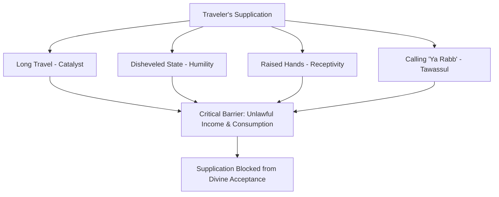

# Hadith 10: Wholesome Sustenance & Acceptance of Dua
### الطيب من الرزق والعمل وشروط إجابة الدعاء

> **Narrated by:** Abu Hurairah (رضي الله عنه)  
> **Canonical Sources:** Sahih Muslim 1015

---

## 📜 Complete Prophetic Text

**عَنْ أَبِي هُرَيْرَةَ رَضِيَ اللهُ عَنْهُ قَالَ: قَالَ رَسُولُ اللَّهِ صلى الله عليه و سلم: «إِنَّ اللَّهَ طَيِّبٌ لَا يَقْبَلُ إِلَّا طَيِّبًا، وَإِنَّ اللَّهَ أَمَرَ الْمُؤْمِنِينَ بِمَا أَمَرَ بِهِ الْمُرْسَلِينَ فَقَالَ تَعَالَى: ﴿يَا أَيُّهَا الرُّسُلُ كُلُوا مِنَ الطَّيِّبَاتِ وَاعْمَلُوا صَالِحًا﴾، وَقَالَ تَعَالَى: ﴿يَا أَيُّهَا الَّذِينَ آمَنُوا كُلُوا مِنْ طَيِّبَاتِ مَا رَزَقْنَاكُمْ﴾، ثُمَّ ذَكَرَ الرَّجُلَ يُطِيلُ السَّفَرَ أَشْعَثَ أَغْبَرَ يَمُدُّ يَدَيْهِ إِلَى السَّمَاءِ: يَا رَبِّ! يَا رَبِّ! وَمَطْعَمُهُ حَرَامٌ، وَمَشْرَبُهُ حَرَامٌ، وَمَلْبَسُهُ حَرَامٌ، وَغُذِّيَ بِالْحَرَامِ، فَأَنَّى يُسْتَجَابُ لَهُ؟».**

> *"On the authority of Abu Hurayrah (ra) who said: The Messenger of Allah (ﷺ) said: "Verily Allah the Almighty is Pure and Good (Tayyib) and accepts only that which is pure and good. And indeed Allah has commanded the believers with that which He commanded the Messengers... Then he mentioned the case of a man who, having journeyed far, is disheveled and dusty, spreading out his hands to the sky saying, 'O Lord! O Lord!'—while his food is unlawful, his drink is unlawful, his clothing is unlawful, and he has been nourished with unlawful; how then could his supplication be answered?""*

---

## 🔍 Line-by-Line Arabic & Morphological Breakdown

| Arabic Segment | Transliteration | Word-by-Word Analysis & Meaning |
| :--- | :--- | :--- |
| **إِنَّ اللَّهَ طَيِّبٌ لَا يَقْبَلُ إِلَّا طَيِّبًا** | *Innallāha ṭayyibun lā yaqbalu illā ṭayyibā* | Allah is transcendent above all flaws and accepts only deeds and charity derived from untainted, lawful sources. |
| **كُلُوا مِنَ الطَّيِّبَاتِ وَاعْمَلُوا صَالِحًا** | *Kulū minaṭ-ṭayyibāti wa'malū ṣāliḥā* | Divine sequencing: pure physical nourishment precedes righteous deeds because inputs directly affect spiritual vitality. |
| **يُطِيلُ السَّفَرَ أَشْعَثَ أَغْبَرَ** | *Yuṭīlus-safara ash'atha aghbara* | The petitioner marshals powerful catalysts for answered prayer: traveler status, humility, outstretched hands, and earnest invocation. |
| **وَمَطْعَمُهُ حَرَامٌ... فَأَنَّى يُسْتَجَابُ لَهُ؟** | *Wa maṭ'amuhu ḥarāmun... fa-annā yustajābu lah?* | Yet every external catalyst is neutralized because his sustenance and lifestyle are permeated with unlawful gains. |

---

## 📊 Conceptual Framework & Visual Model

---

## 💡 In-Depth Sharh & Classical Commentary

### The Organic Link Between Wealth and Spiritual Receptivity
- **Tayyib in Faith and Charity:** Allah is Pure and accepts neither compromised charity nor hollow supplications nourished by exploitation.
- **The Tragedy of Unanswered Dua:** The traveler in the hadith possesses four recognized conditions of accepted prayer, yet his supplication fails to ascend because illicit wealth acts as an impenetrable barrier.

---

## ⚡ Practical & Productivity Application

### Productivity & High-Integrity Earnings
- **Purity of Sustenance as Fuel:** Just as high-performance computing requires clean, reliable power without voltage spikes, mental clarity and barakah in time require honest income free from questionable shortcuts.

---

## 📖 Canonical References & Scholarly Grading
- **References:** Sahih Muslim 1015
- **Scholarly Classification:** Authenticated in classical collections; selected by Imam an-Nawawi as foundational principles (*Qawa'id al-Deen*).

---

## 🎥 Curated Video Insights & Lectures
- **Recommended Video Lecture:** YouTube Search: `Hadith 10 Nawawi Allah is Pure and Accepts Only Pure Omar Suleiman`

---

[[Hadith_09_Ease_in_Obligations|⬅ Prev: Hadith 09]] | [[00_Hadith_Index|📖 Hadith Index]] | [[Hadith_11_Leaving_Doubt_for_Certainty|Next: Hadith 11 ➡]]
