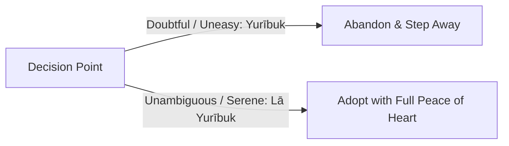

# Hadith 11: Leaving Doubt for What is Certain
### دع ما يريبك إلى ما لا يريبك

> **Narrated by:** Al-Hasan ibn Ali (رضي الله عنهما)  
> **Canonical Sources:** Jami` at-Tirmidhi 2520, Sunan an-Nasa'i 5711

---

## 📜 Complete Prophetic Text

**عَنْ أَبِي مُحَمَّدٍ الْحَسَنِ بْنِ عَلِيِّ بْنِ أَبِي طَالِبٍ سِبْطِ رَسُولِ اللَّهِ صلى الله عليه و سلم وَرَيْحَانَتِهِ رَضِيَ اللَّهُ عَنْهُمَا، قَالَ: حَفِظْت مِنْ رَسُولِ اللَّهِ صلى الله عليه و سلم: «دَعْ مَا يُرِيبُك إِلَى مَا لَا يُرِيبُك».**

> *"On the authority of Abu Muhammad al-Hasan ibn Ali ibn Abi Talib (ra), the grandson of the Messenger of Allah (ﷺ) and his cherished flower, who said: I memorized from the Messenger of Allah (ﷺ): "Leave that which makes you doubt for that which causes you no doubt.""*

---

## 🔍 Line-by-Line Arabic & Morphological Breakdown

| Arabic Segment | Transliteration | Word-by-Word Analysis & Meaning |
| :--- | :--- | :--- |
| **دَعْ** | *Da'* | Imperative verb: Abandon, leave behind, discard decisively. |
| **مَا يُرِيبُك** | *Mā yurībuk* | That which stirs hesitation, disquiet, unease, or moral suspicion in your conscience. |
| **إِلَى مَا لَا يُرِيبُك** | *Ilā mā lā yurībuk* | Towards that which instills confidence, tranquility, and unambiguous ethical certainty. |

---

## 📊 Conceptual Framework & Visual Model

---

## 💡 In-Depth Sharh & Classical Commentary

### Psychological Serenity Through Ethical Precision
- **Internal Moral Sensor:** Truth (*Sidq*) generates inner stillness (*Tuma'ninah*), while falsehood and dubiousness trigger internal turbulence (*Rayb*).
- **Practical Application of Wara':** When faced with a questionable contract or borderline ambiguous practice, choosing the clear alternative purchases priceless mental tranquility.

---

## ⚡ Practical & Productivity Application

### Productivity & Decision Fatigue
- **Eliminating Cognitive Friction:** Agonizing over gray-area decisions drains finite executive focus. Applying the heuristic "When in doubt, opt for clarity" frees mental bandwidth for decisive, creative execution.

---

## 📖 Canonical References & Scholarly Grading
- **References:** Jami` at-Tirmidhi 2520, Sunan an-Nasa'i 5711
- **Scholarly Classification:** Authenticated in classical collections; selected by Imam an-Nawawi as foundational principles (*Qawa'id al-Deen*).

---

## 🎥 Curated Video Insights & Lectures
- **Recommended Video Lecture:** YouTube Search: `Hadith 11 Nawawi Leave that which makes you doubt explanation`

---

[[Hadith_10_Wholesome_Sustenance|⬅ Prev: Hadith 10]] | [[00_Hadith_Index|📖 Hadith Index]] | [[Hadith_12_Leaving_What_Does_Not_Concern_You|Next: Hadith 12 ➡]]
