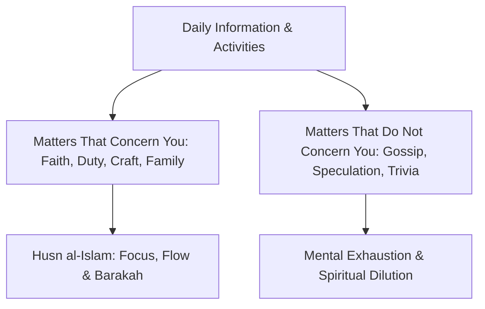

# Hadith 12: Perfection of Islam: Leaving What Does Not Concern You
### من حسن إسلام المرء تركه ما لا يعنيه

> **Narrated by:** Abu Hurairah (رضي الله عنه)  
> **Canonical Sources:** Jami` at-Tirmidhi 2318, Sunan Ibn Majah 3976

---

## 📜 Complete Prophetic Text

**عَنْ أَبِي هُرَيْرَةَ رَضِيَ اللهُ عَنْهُ قَالَ: قَالَ رَسُولُ اللَّهِ صلى الله عليه و سلم: «مِنْ حُسْنِ إِسْلَامِ الْمَرْءِ تَرْكُهُ مَا لَا يَعْنِيهِ».**

> *"On the authority of Abu Hurayrah (ra) who said: The Messenger of Allah (ﷺ) said: "Part of the perfection of a person's Islam is his leaving that which does not concern him.""*

---

## 🔍 Line-by-Line Arabic & Morphological Breakdown

| Arabic Segment | Transliteration | Word-by-Word Analysis & Meaning |
| :--- | :--- | :--- |
| **مِنْ حُسْنِ إِسْلَامِ الْمَرْءِ** | *Min ḥusni Islāmil-mar'* | From the beauty, maturity, and spiritual excellence of an individual's faith. |
| **تَرْكُهُ** | *Tarkuhu* | His voluntary, disciplined abandonment and intentional abstention from. |
| **مَا لَا يَعْنِيهِ** | *Mā lā ya'nīh* | That which carries no genuine religious necessity, worldly utility, or legitimate moral responsibility. |

---

## 📊 Conceptual Framework & Visual Model

---

## 💡 In-Depth Sharh & Classical Commentary

### The Ultimate Discipline of Focus and Energy
- **The Pillar of Adab:** Scholars like Ibn Abi Zayd al-Qayrawani stated that the entire code of Islamic manners stems from four hadiths, with this being the primary filter of speech and attention.
- **Defining 'What Concerns You':** Includes all duties towards Allah, legitimate professional labor, providing for dependants, and acquiring beneficial knowledge. Everything beyond that—celebrity trivia, idle controversy, unsolicited prying—falls under *Mā lā ya'neeh*.

---

## ⚡ Practical & Productivity Application

### Productivity & Deep Work Mastery
- **Radical Elimination of Distractions:** In the digital attention economy, information overload fragments focus. This prophetic principle is the timeless formula for deep work: relentlessly filter out noise, unsubscribe from toxic debates, and direct attention solely to what yields real impact.

---

## 📖 Canonical References & Scholarly Grading
- **References:** Jami` at-Tirmidhi 2318, Sunan Ibn Majah 3976
- **Scholarly Classification:** Authenticated in classical collections; selected by Imam an-Nawawi as foundational principles (*Qawa'id al-Deen*).

---

## 🎥 Curated Video Insights & Lectures
- **Recommended Video Lecture:** YouTube Search: `Hadith 12 Nawawi Leaving what does not concern you Mufti Menk`

---

[[Hadith_11_Leaving_Doubt_for_Certainty|⬅ Prev: Hadith 11]] | [[00_Hadith_Index|📖 Hadith Index]] | [[Hadith_13_Brotherly_Love|Next: Hadith 13 ➡]]
