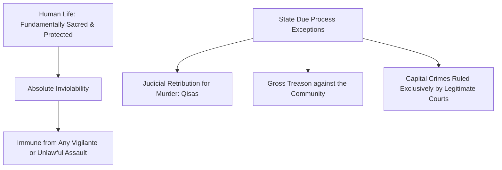

# Hadith 14: The Sacred Inviolability of Human Life
### حرمة دم المسلم وأسباب إهداره

> **Narrated by:** Abdullah ibn Mas'ud (رضي الله عنه)  
> **Canonical Sources:** Sahih al-Bukhari 6878, Sahih Muslim 1676

---

## 📜 Complete Prophetic Text

**عَنْ ابْنِ مَسْعُودٍ رَضِيَ اللهُ عَنْهُ قَالَ: قَالَ رَسُولُ اللَّهِ صلى الله عليه و سلم: «لَا يَحِلُّ دَمُ امْرِئٍ مُسْلِمٍ [يَشْهَدُ أَنْ لَا إِلَهَ إِلَّا اللَّهُ، وَأَنِّي رَسُولُ اللَّهِ] إِلَّا بِإِحْدَى ثَلَاثٍ: الثَّيِّبُ الزَّانِي، وَالنَّفْسُ بِالنَّفْسِ، وَالتَّارِكُ لِدِينِهِ الْمُفَارِقُ لِلْجَمَاعَةِ».**

> *"On the authority of Ibn Mas'ud (ra) who said: The Messenger of Allah (ﷺ) said: "The life of a Muslim who testifies that there is no deity worthy of worship except Allah and that I am the Messenger of Allah is inviolable, except in one of three cases: the married person who commits adultery, a life for a life (retributive justice), and one who abandons their religion and separates from the community.""*

---

## 🔍 Line-by-Line Arabic & Morphological Breakdown

| Arabic Segment | Transliteration | Word-by-Word Analysis & Meaning |
| :--- | :--- | :--- |
| **لَا يَحِلُّ دَمُ امْرِئٍ مُسْلِمٍ** | *Lā yaḥillu damu-mri'in muslim* | Absolute prohibition: Human life in Islam possesses fundamental, sacred immunity against unlawful harm. |
| **إِلَّا بِإِحْدَى ثَلَاثٍ** | *Illā bi-iḥdā thalāth* | Strict legal exceptions governed exclusively by formal judicial authority, never vigilante actions. |
| **الثَّيِّبُ الزَّانِي** | *Ath-thayyibuz-zānī* | A legally married person who violates marriage vows through manifest public adultery, threatening family stability. |
| **وَالنَّفْسُ بِالنَّفْسِ** | *Wan-nafsu bin-nafs* | Legitimate judicial Qisas (capital retribution for deliberate, unprovoked murder), safeguarding societal security. |
| **وَالتَّارِكُ لِدِينِهِ الْمُفَارِقُ لِلْجَمَاعَةِ** | *Wat-tāriku li-dīnihil-mufāriqu lil-jamā'ah* | One who commits treason against the civic and spiritual fabric of the community. |

---

## 📊 Conceptual Framework & Visual Model

---

## 💡 In-Depth Sharh & Classical Commentary

### Judicial Safeguards and the Sanctity of Existence
- **Preservation of Life (*Hifdh an-Nafs*):** One of the five universal objectives of the Shari'ah (*Maqasid*).
- **Exclusivity of Judicial Courts:** Classical jurists unanimously agree that these capital sentences can never be enacted by individuals, groups, or vigilantes; they require sovereign due process with rigorous evidentiary standards to protect human society.

---

## ⚡ Practical & Productivity Application

### Productivity & Societal Peace
- **Foundations for Human Flourishing:** Intellectual, technological, and economic innovation can only take place in a stable civilization where the rule of law guarantees physical security and fundamental rights.

---

## 📖 Canonical References & Scholarly Grading
- **References:** Sahih al-Bukhari 6878, Sahih Muslim 1676
- **Scholarly Classification:** Authenticated in classical collections; selected by Imam an-Nawawi as foundational principles (*Qawa'id al-Deen*).

---

## 🎥 Curated Video Insights & Lectures
- **Recommended Video Lecture:** YouTube Search: `Hadith 14 Nawawi Sanctity of human life in Islam explanation`

---

[[Hadith_13_Brotherly_Love|⬅ Prev: Hadith 13]] | [[00_Hadith_Index|📖 Hadith Index]] | [[Hadith_15_Good_Speech_and_Manners|Next: Hadith 15 ➡]]
