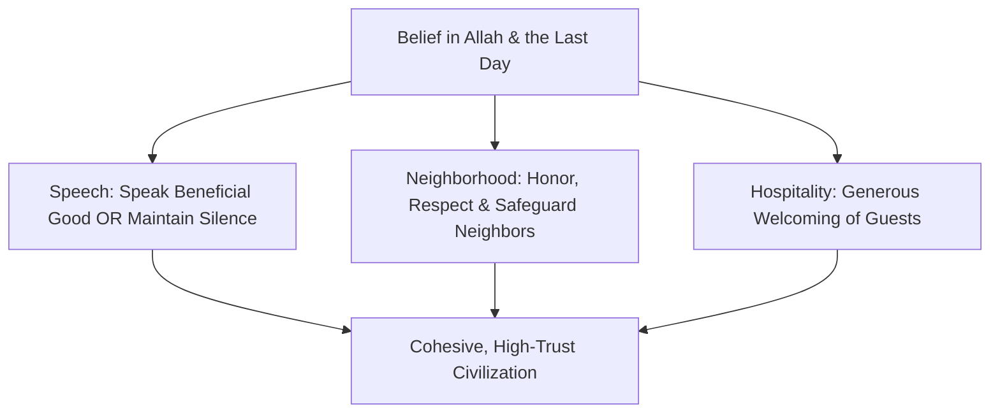

# Hadith 15: Good Speech, Neighborliness, and Generosity
### الكلمة الطيبة وإكرام الجار والضيف

> **Narrated by:** Abu Hurairah (رضي الله عنه)  
> **Canonical Sources:** Sahih al-Bukhari 6018, Sahih Muslim 47

---

## 📜 Complete Prophetic Text

**عَنْ أَبِي هُرَيْرَةَ رَضِيَ اللهُ عَنْهُ أَنَّ رَسُولَ اللَّهِ صلى الله عليه و سلم قَالَ: «مَنْ كَانَ يُؤْمِنُ بِاللَّهِ وَالْيَوْمِ الْآخِرِ فَلْيَقُلْ خَيْرًا أَوْ لِيَصْمُتْ، وَمَنْ كَانَ يُؤْمِنُ بِاللَّهِ وَالْيَوْمِ الْآخِرِ فَلْيُكْرِمْ جَارَهُ، وَمَنْ كَانَ يُؤْمِنُ بِاللَّهِ وَالْيَوْمِ الْآخِرِ فَلْيُكْرِمْ ضَيْفَهُ».**

> *"On the authority of Abu Hurayrah (ra) that the Messenger of Allah (ﷺ) said: "Whoever believes in Allah and the Last Day, let him speak good or remain silent; whoever believes in Allah and the Last Day, let him be generous to his neighbor; and whoever believes in Allah and the Last Day, let him be generous to his guest.""*

---

## 🔍 Line-by-Line Arabic & Morphological Breakdown

| Arabic Segment | Transliteration | Word-by-Word Analysis & Meaning |
| :--- | :--- | :--- |
| **مَنْ كَانَ يُؤْمِنُ بِاللَّهِ وَالْيَوْمِ الْآخِرِ** | *Man kāna yu'minu billāhi wal-yawmil-ākhir* | Couples moral character directly to belief in divine accountability on Judgment Day. |
| **فَلْيَقُلْ خَيْرًا** | *Fal-yaqul khayrā* | Let him articulate constructive, beneficial, truthful speech (praise, encouragement, teaching, reconciliation). |
| **أَوْ لِيَصْمُتْ** | *Aw li-yaṣmut* | Or hold his tongue in dignified silence to avert slander, vanity, and interpersonal friction. |
| **فَلْيُكْرِمْ جَارَهُ** | *Fal-yukrim jārah* | Let him treat his neighbor with generosity, patience, and non-intrusion. |
| **فَلْيُكْرِمْ ضَيْفَهُ** | *Fal-yukrim ḍayfah* | Let him honor guests with warmth, gracious hospitality, and open hospitality. |

---

## 📊 Conceptual Framework & Visual Model

---

## 💡 In-Depth Sharh & Classical Commentary

### The Triple Triad of Social Decorum
- **Verbal Discipline:** Imam an-Nawawi observed: *"When a person wishes to speak, let them contemplate first: if there is clear benefit, let them speak; if there is harm or no benefit, let them maintain silence."*
- **Social Ecology:** A civilization is judged by how it guards communication (averting toxic gossip), honors immediate geography (neighbors), and welcomes transient travelers (guests).

---

## ⚡ Practical & Productivity Application

### Productivity & Communication Hygiene
- **High Signal-to-Noise Ratio:** Professional communication (Slack, emails, code comments, meetings) should follow the prophetic protocol: clear, concise, constructive, or quiet. Unnecessary banter and snark drain cognitive clarity.

---

## 📖 Canonical References & Scholarly Grading
- **References:** Sahih al-Bukhari 6018, Sahih Muslim 47
- **Scholarly Classification:** Authenticated in classical collections; selected by Imam an-Nawawi as foundational principles (*Qawa'id al-Deen*).

---

## 🎥 Curated Video Insights & Lectures
- **Recommended Video Lecture:** YouTube Search: `Hadith 15 Nawawi Speak good or remain silent Omar Suleiman`

---

[[Hadith_14_Inviolability_of_Life|⬅ Prev: Hadith 14]] | [[00_Hadith_Index|📖 Hadith Index]] | [[Hadith_16_Controlling_Anger|Next: Hadith 16 ➡]]
