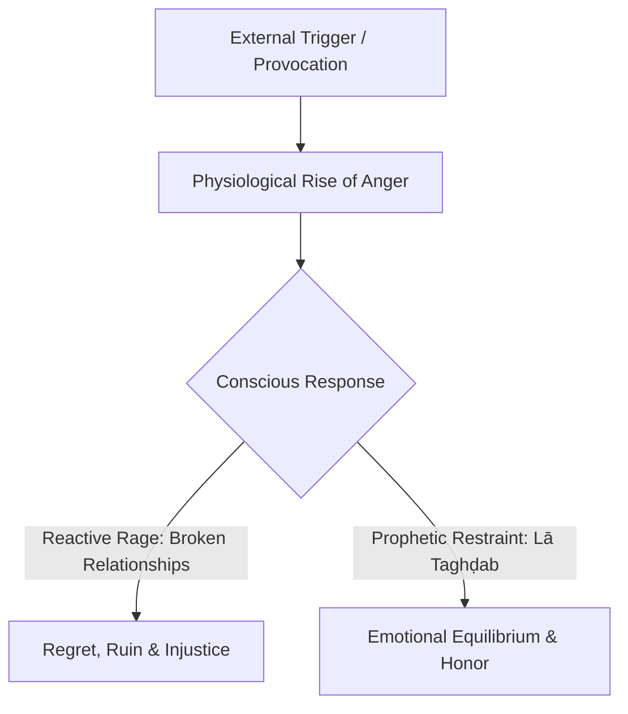

# Hadith 16: Emotional Mastery: Restraining Anger
### النهي عن الغضب والتحكم في النفس

> **Narrated by:** Abu Hurairah (رضي الله عنه)  
> **Canonical Sources:** Sahih al-Bukhari 6116

---

## 📜 Complete Prophetic Text

**عَنْ أَبِي هُرَيْرَةَ رَضِيَ اللهُ عَنْهُ أَنَّ رَجُلًا قَالَ لِلنَّبِيِّ صلى الله عليه و سلم: أَوْصِنِي. قَالَ: «لَا تَغْضَبْ». فَرَدَّدَ مِرَارًا، قَالَ: «لَا تَغْضَبْ».**

> *"On the authority of Abu Hurayrah (ra) that a man said to the Prophet (ﷺ): "Counsel me." He (ﷺ) said: "Do not become angry." The man repeated his request several times, and each time he (ﷺ) replied: "Do not become angry.""*

---

## 🔍 Line-by-Line Arabic & Morphological Breakdown

| Arabic Segment | Transliteration | Word-by-Word Analysis & Meaning |
| :--- | :--- | :--- |
| **أَوْصِنِي** | *Awṣinī* | A request for a comprehensive, life-defining piece of wisdom that encapsulates personal rectitude. |
| **لَا تَغْضَبْ** | *Lā taghḍab* | Two meanings: (1) Do not let anger conquer your rational faculties, and (2) Do not execute the impulsive actions that anger commands. |
| **فَرَدَّدَ مِرَارًا** | *Fa-raddada mirārā* | The man repeated the query hoping for complex spiritual directives, but the Prophet reiterated the same master command. |

---

## 📊 Conceptual Framework & Visual Model

---

## 💡 In-Depth Sharh & Classical Commentary

### The Master Key to Emotional Intelligence
- **Comprehensive Scope:** Al-Jarjani defined anger as the boiling of blood in the heart seeking vengeance. By advising *"Do not get angry"*, the Prophet (ﷺ) barred the door to murder, severing family ties, divorce, and professional wreckage.
- **Prophetic Techniques for Anger Management:**
  1. Seeking refuge in Allah from Satan (*Isti'adhah*).
  2. Changing physical state: sitting down if standing, lying down if sitting.
  3. Performing Wudu (water extinguishes the fire of rage).
  4. Deliberate, intentional silence.

---

## ⚡ Practical & Productivity Application

### Productivity & High-Stress Leadership
- **Non-Reactive Executive Poise:** In high-stakes engineering deployments, server outages, or boardroom disputes, reacting with anger clouds logic and alienates teams. True power is emotional composure under pressure.

---

## 📖 Canonical References & Scholarly Grading
- **References:** Sahih al-Bukhari 6116
- **Scholarly Classification:** Authenticated in classical collections; selected by Imam an-Nawawi as foundational principles (*Qawa'id al-Deen*).

---

## 🎥 Curated Video Insights & Lectures
- **Recommended Video Lecture:** YouTube Search: `Hadith 16 Nawawi Do not get angry explanation Nouman Ali Khan`

---

[[Hadith_15_Good_Speech_and_Manners|⬅ Prev: Hadith 15]] | [[00_Hadith_Index|📖 Hadith Index]] | [[Hadith_17_Ihsan_in_All_Things|Next: Hadith 17 ➡]]
