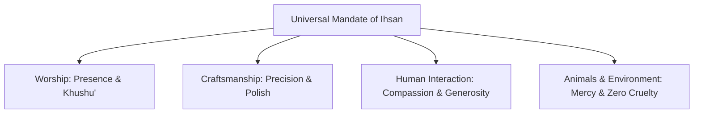

# Hadith 17: Ihsan: Excellence and Proficiency in All Endeavors
### الأمر بالإحسان في كل شيء

> **Narrated by:** Shaddad ibn Aws (رضي الله عنه)  
> **Canonical Sources:** Sahih Muslim 1955

---

## 📜 Complete Prophetic Text

**عَنْ أَبِي يَعْلَى شَدَّادِ بْنِ أَوْسٍ رَضِيَ اللهُ عَنْهُ عَنْ رَسُولِ اللَّهِ صلى الله عليه و سلم قَالَ: «إِنَّ اللَّهَ كَتَبَ الْإِحْسَانَ عَلَى كُلِّ شَيْءٍ، فَإِذَا قَتَلْتُمْ فَأَحْسِنُوا الْقِتْلَةَ، وَإِذَا ذَبَحْتُمْ فَأَحْسِنُوا الذِّبْحَةَ، وَلْيُحِدَّ أَحَدُكُمْ شَفْرَتَهُ، وَلْيُرِحْ ذَبِيحَتَهُ».**

> *"On the authority of Abu Ya'la Shaddad bin Aws (ra) that the Messenger of Allah (ﷺ) said: "Verily Allah has prescribed Ihsan (proficiency, excellence, compassion) in all things. So if you must kill, kill well; and if you slaughter, slaughter well. Let each one of you sharpen his blade and give relief to his slaughtered animal.""*

---

## 🔍 Line-by-Line Arabic & Morphological Breakdown

| Arabic Segment | Transliteration | Word-by-Word Analysis & Meaning |
| :--- | :--- | :--- |
| **إِنَّ اللَّهَ كَتَبَ** | *Innallāha kataba* | Verily Allah has decreed, ordained, and made binding upon creation. |
| **الْإِحْسَانَ** | *Al-Iḥsān* | Excellence, beauty of execution, supreme proficiency, and utmost empathy. |
| **عَلَى كُلِّ شَيْءٍ** | *'Alā kulli shay'* | Universal mandate: applies to worship, technical labor, human relations, animal welfare, and nature. |
| **وَلْيُحِدَّ أَحَدُكُمْ شَفْرَتَهُ** | *Wal-yuḥidda aḥadukum shafratah* | Sharpening the instrument represents technical preparation to ensure speed, efficiency, and zero unnecessary suffering. |
| **وَلْيُرِحْ ذَبِيحَتَهُ** | *Wal-yuriḥ dhabīḥatah* | Providing swift comfort illustrates that even in moments of taking life for sustenance, mercy remains paramount. |

---

## 📊 Conceptual Framework & Visual Model

---

## 💡 In-Depth Sharh & Classical Commentary

### Universal Standard of Quality and Empathy
- **Kataba (Divine Obligation):** *Ihsan* is not an optional aesthetic flourish; it is an obligation mandated by the Creator across every domain of action.
- **The Ultimate Test of Mercy:** If mercy and precision are commanded even when slaughtering livestock for nourishment, how much more should excellence and compassion govern dealings with human beings and daily vocations?

---

## ⚡ Practical & Productivity Application

### Productivity & Professional Craftsmanship
- **The Ethos of Mastery:** Whether writing an algorithm, designing user experiences, or compiling reports, the Muslim engineer operates under the divine mandate of *Ihsan*—polishing details, optimizing performance, and eliminating waste and friction.

---

## 📖 Canonical References & Scholarly Grading
- **References:** Sahih Muslim 1955
- **Scholarly Classification:** Authenticated in classical collections; selected by Imam an-Nawawi as foundational principles (*Qawa'id al-Deen*).

---

## 🎥 Curated Video Insights & Lectures
- **Recommended Video Lecture:** YouTube Search: `Hadith 17 Nawawi Allah has prescribed excellence Ihsan in all things`

---

[[Hadith_16_Controlling_Anger|⬅ Prev: Hadith 16]] | [[00_Hadith_Index|📖 Hadith Index]] | [[Hadith_18_Taqwa_and_Good_Character|Next: Hadith 18 ➡]]
