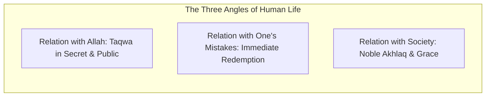

# Hadith 18: Taqwa Everywhere, Good Deeds, and Noble Character
### التقوى وحسن الخلق ومحو السيئات

> **Narrated by:** Abu Dharr & Mu'adh ibn Jabal (رضي الله عنهما)  
> **Canonical Sources:** Jami` at-Tirmidhi 1987

---

## 📜 Complete Prophetic Text

**عَنْ أَبِي ذَرٍّ جُنْدَبِ بْنِ جُنَادَةَ، وَأَبِي عَبْدِ الرَّحْمَنِ مُعَاذِ بْنِ جَبَلٍ رَضِيَ اللَّهُ عَنْهُمَا، عَنْ رَسُولِ اللَّهِ صلى الله عليه و سلم قَالَ: «اتَّقِ اللَّهَ حَيْثُمَا كُنْت، وَأَتْبِعْ السَّيِّئَةَ الْحَسَنَةَ تَمْحُهَا، وَخَالِقْ النَّاسَ بِخُلُقٍ حَسَنٍ».**

> *"On the authority of Abu Dharr Jundub ibn Junadah and Abu Abdur-Rahman Mu'adh bin Jabal (ra) that the Messenger of Allah (ﷺ) said: "Have Taqwa (consciousness, reverence) of Allah wherever you may be; follow up an evil deed with a good deed which will wipe it out; and behave towards people with noble character.""*

---

## 🔍 Line-by-Line Arabic & Morphological Breakdown

| Arabic Segment | Transliteration | Word-by-Word Analysis & Meaning |
| :--- | :--- | :--- |
| **اتَّقِ اللَّهَ حَيْثُمَا كُنْت** | *Ittaqillāha ḥaythumā kunt* | Maintain divine mindfulness in all spaces—in public gatherings, private rooms, and secret digital environments alike. |
| **وَأَتْبِعْ السَّيِّئَةَ الْحَسَنَةَ تَمْحُهَا** | *Wa atbi'is-sayyi'atal-ḥasanata tamḥuhā* | Immediately follow an error or slip with a restorative good action (charity, istighfar, prayer) to expunge the spiritual blemish. |
| **وَخَالِقْ النَّاسَ بِخُلُقٍ حَسَنٍ** | *Wa khāliqin-nāsa bi-khuluqin ḥasan* | Interact with all humanity with gracious manners, patience, fair dealing, and generous warmth. |

---

## 📊 Conceptual Framework & Visual Model

---

## 💡 In-Depth Sharh & Classical Commentary

### The Comprehensive Triangle of Righteous Living
- **Threefold Integrity:**
  1. *Vertical:* Taqwa anchors your relationship with Allah.
  2. *Internal / Self-Correction:* Fast-tracked repentance prevents despair.
  3. *Horizontal:* Beautiful character softens interactions with creation.
- **The Erasing Mechanism:** Good deeds possess dynamic cleansing power (*Innal-hasanati yudh-hibnas-sayyi'at* - Quran 11:114).

---

## ⚡ Practical & Productivity Application

### Productivity & Rapid Incident Recovery
- **Blameless Rapid Post-Mortem:** In engineering systems, when a bug causes an outage, top engineers do not dwell in self-pity; they immediately ship a patch and add tests. In personal morality, when you err, do not stay in guilt—immediately execute a compensating virtuous deed.

---

## 📖 Canonical References & Scholarly Grading
- **References:** Jami` at-Tirmidhi 1987
- **Scholarly Classification:** Authenticated in classical collections; selected by Imam an-Nawawi as foundational principles (*Qawa'id al-Deen*).

---

## 🎥 Curated Video Insights & Lectures
- **Recommended Video Lecture:** YouTube Search: `Hadith 18 Nawawi Have Taqwa wherever you are Omar Suleiman`
- [9:35](https://www.youtube.com/watch?v=B28zDw8-ZaU&t=575s) Hadith 18: Taqwa Wherever You Are

---

[[Hadith_17_Ihsan_in_All_Things|⬅ Prev: Hadith 17]] | [[00_Hadith_Index|📖 Hadith Index]] | [[Hadith_19_Mindfulness_and_Divine_Help|Next: Hadith 19 ➡]]
