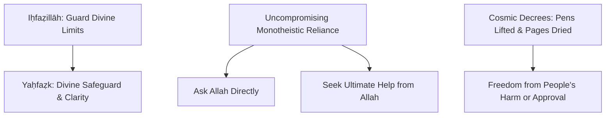

# Hadith 19: Mindfulness of Allah, Divine Protection, and Qadar
### الوصية الجامعة: احفظ الله يحفظك

> **Narrated by:** Abdullah ibn Abbas (رضي الله عنهما)  
> **Canonical Sources:** Jami` at-Tirmidhi 2516

---

## 📜 Complete Prophetic Text

**عَنْ عَبْدِ اللَّهِ بْنِ عَبَّاسٍ رَضِيَ اللَّهُ عَنْهُمَا قَالَ: كُنْت خَلْفَ رَسُولِ اللَّهِ صلى الله عليه و سلم يَوْمًا، فَقَالَ: «يَا غُلَامِ! إِنِّي أُعَلِّمُك كَلِمَاتٍ: احْفَظْ اللَّهَ يَحْفَظْك، احْفَظْ اللَّهَ تَجِدْهُ تُجَاهَك، إِذَا سَأَلْت فَاسْأَلْ اللَّهَ، وَإِذَا اسْتَعَنْت فَاسْتَعِنْ بِاللَّهِ، وَاعْلَمْ أَنَّ الْأُمَّةَ لَوْ اجْتَمَعَتْ عَلَى أَنْ يَنْفَعُوك بِشَيْءٍ لَمْ يَنْفَعُوك إِلَّا بِشَيْءٍ قَدْ كَتَبَهُ اللَّهُ لَك، وَإِنْ اجْتَمَعُوا عَلَى أَنْ يَضُرُّوك بِشَيْءٍ لَمْ يَضُرُّوك إِلَّا بِشَيْءٍ قَدْ كَتَبَهُ اللَّهُ عَلَيْك؛ رُفِعَتْ الْأَقْلَامُ، وَجَفَّتْ الصُّحُفُ».**

> *"On the authority of Abu Abbas Abdullah bin Abbas (ra) who said: One day I was behind the Prophet (ﷺ) [riding on the same mount] and he said: "O young man, I shall teach you some words [of profound advice]: Be mindful of Allah and Allah will protect you. Be mindful of Allah and you will find Him in front of you. If you ask, ask of Allah [alone]; and if you seek help, seek help from Allah [alone]. And know that if the entire nation were to gather together to benefit you with something, they would not benefit you except with what Allah had already written for you. And if they were to gather together to harm you with something, they would not harm you except with what Allah had already written against you. The pens have been lifted and the pages have dried.""*

---

## 🔍 Line-by-Line Arabic & Morphological Breakdown

| Arabic Segment | Transliteration | Word-by-Word Analysis & Meaning |
| :--- | :--- | :--- |
| **احْفَظْ اللَّهَ يَحْفَظْك** | *Iḥfaẓillāha yaḥfaẓk* | Guard Allah's boundaries, commandments, and rights; He will guard your faith, body, family, and destiny. |
| **احْفَظْ اللَّهَ تَجِدْهُ تُجَاهَك** | *Iḥfaẓillāha tajid-hu tujāhak* | Be mindful of Him in obedience, and you will find His divine guidance, support, and clarity accompanying you in every trial. |
| **إِذَا سَأَلْت فَاسْأَلْ اللَّهَ** | *Idhā sa'alta fas'alillāh* | Anchor your core dependence in the Creator; turn to Him first before pleading with mortal creation. |
| **وَإِذَا اسْتَعَنْت فَاسْتَعِنْ بِاللَّهِ** | *Wa idhas-ta'anta fasta'in billāh* | Seek ultimate strength and enabling success (*Tawfeeq*) exclusively from the Almighty. |
| **لَوْ اجْتَمَعَتْ... لَمْ يَنْفَعُوك... لَمْ يَضُرُّوك...** | *Lawij-tama'at... lam yanfa'ūka... lam yaḍurrūka...* | Universal liberation from fear: all creation combined possesses zero independent power to benefit or harm outside divine will. |
| **رُفِعَتْ الْأَقْلَامُ، وَجَفَّتْ الصُّحُفُ** | *Rufi'atil-aqlāmu wa jaffatiṣ-ṣuḥuf* | Cosmic finality: divine decrees are established; sovereign reality is forever beyond human manipulation. |

---

## 📊 Conceptual Framework & Visual Model

---

## 💡 In-Depth Sharh & Classical Commentary

### The Masterwork of Spiritual Sovereignty and Psychological Fearlessness
- **Pedagogy of Leadership:** The Prophet (ﷺ) chose a casual moment while riding with the young Ibn Abbas to instill unshakeable monotheistic self-possession.
- **The Guarantee of Protection:** Ibn Rajab explained that guarding Allah's limits brings two types of preservation:
  1. Earthly protection: health, wealth, intellect, and loved ones.
  2. Ultimate spiritual protection: safeguarding faith during times of trial and granting peace at death.
- **Victory with Patience:** In another narration: *"Know that victory comes with patience, relief with distress, and with hardship comes ease."*

---

## ⚡ Practical & Productivity Application

### Productivity & High-Risk Decision Making
- **Overcoming Fear of Failure and People-Pleasing:** Founders, executives, and engineers face paralyzing anxiety regarding market volatility, competitor moves, or stakeholder pressure. Internalizing that nobody can harm or elevate you outside divine decree unlocks fearless innovation and uncompromised ethics.

---

## 📖 Canonical References & Scholarly Grading
- **References:** Jami` at-Tirmidhi 2516
- **Scholarly Classification:** Authenticated in classical collections; selected by Imam an-Nawawi as foundational principles (*Qawa'id al-Deen*).

---

## 🎥 Curated Video Insights & Lectures
- **Recommended Video Lecture:** YouTube Search: `Hadith 19 Nawawi Be Mindful of Allah and He will Protect You Yaqeen`

---

[[Hadith_18_Taqwa_and_Good_Character|⬅ Prev: Hadith 18]] | [[00_Hadith_Index|📖 Hadith Index]] | [[Hadith_20_Modesty_and_Haya|Next: Hadith 20 ➡]]
