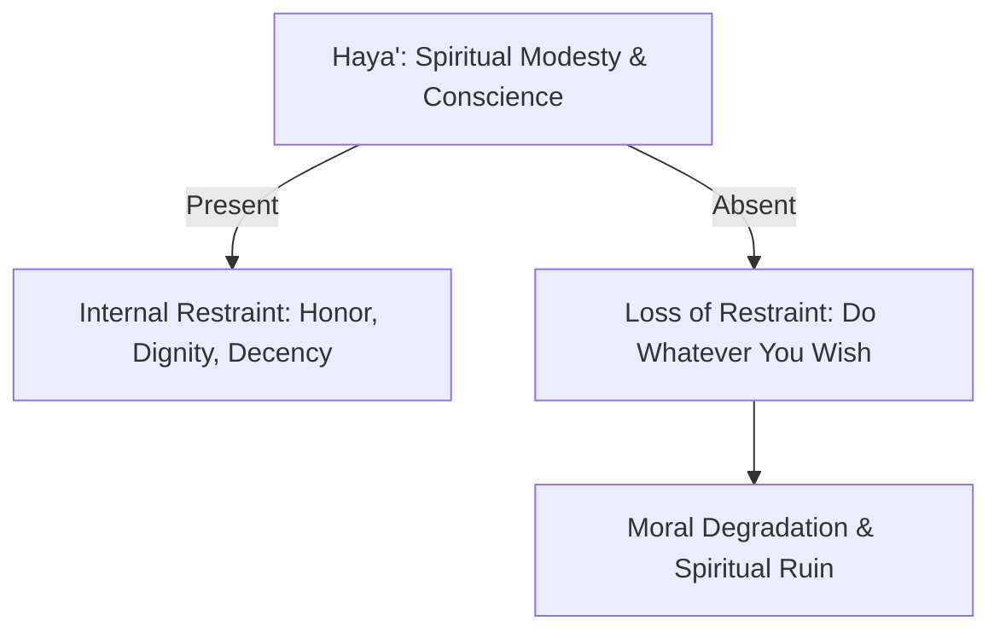

# Hadith 20: Haya' (Modesty): The Heritage of Prophecy
### الحياء من الإيمان ومن كلام النبوة الأولى

> **Narrated by:** Abu Mas'ud al-Badri (رضي الله عنه)  
> **Canonical Sources:** Sahih al-Bukhari 3484

---

## 📜 Complete Prophetic Text

**عَنْ أَبِي مَسْعُودٍ عُقْبَةَ بْنِ عَمْرٍو الْأَنْصَارِيِّ الْبَدْرِيِّ رَضِيَ اللهُ عَنْهُ قَالَ: قَالَ رَسُولُ اللَّهِ صلى الله عليه و سلم: «إِنَّ مِمَّا أَدْرَكَ النَّاسُ مِنْ كَلَامِ النُّبُوَّةِ الْأُولَى: إِذَا لَمْ تَسْتَحِ فَاصْنَعْ مَا شِئْت».**

> *"On the authority of Abu Mas'ud Uqbah bin 'Amr al-Ansari al-Badri (ra) who said: The Messenger of Allah (ﷺ) said: "Verily, from that which people reached from the speech of earliest prophecy is: 'If you feel no shame (modesty), then do whatever you wish.'""*

---

## 🔍 Line-by-Line Arabic & Morphological Breakdown

| Arabic Segment | Transliteration | Word-by-Word Analysis & Meaning |
| :--- | :--- | :--- |
| **إِنَّ مِمَّا أَدْرَكَ النَّاسُ** | *Inna mimmā adrakan-nās* | A timeless universal truth transmitted intact across centuries of prophetic dispensation. |
| **مِنْ كَلَامِ النُّبُوَّةِ الْأُولَى** | *Min kalāmin-nubuwwatil-ūlā* | From the earliest teachings delivered by all historical prophets of God. |
| **إِذَا لَمْ تَسْتَحِ** | *Idhā lam tastaḥi* | When internal modesty, spiritual conscience, and reverence for divine witness are lost. |
| **فَاصْنَعْ مَا شِئْت** | *Faṣ-na' mā shi't* | Formulated as an imperative but carries a profound warning: without modesty, a person descends into shamelessness and will face divine recompense. |

---

## 📊 Conceptual Framework & Visual Model

---

## 💡 In-Depth Sharh & Classical Commentary

### The Bedrock Barrier of Human Decency
- **Two Scholarly Interpretations:**
  1. *Warning / Threat:* If you lack conscience and fear neither Allah nor social accountability, do whatever vulgarity you desire—and prepare for the consequences.
  2. *Ethical Heuristic:* If an contemplated action violates no moral modesty before Allah or righteous people, proceed with confidence.
- **Haya' as a Complete Character Suite:** The Prophet (ﷺ) noted: *"Haya' brings nothing but good."* It prevents shameless exploitation, deceit, and arrogance.

---

## ⚡ Practical & Productivity Application

### Productivity & Professional Ethics
- **The Self-Regulating Internal Compass:** In environments where surveillance or QA cannot catch every shortcut, *Haya'* acts as the internal conscience that stops someone from plagiarizing code, cutting structural corners, or falsifying test data.

---

## 📖 Canonical References & Scholarly Grading
- **References:** Sahih al-Bukhari 3484
- **Scholarly Classification:** Authenticated in classical collections; selected by Imam an-Nawawi as foundational principles (*Qawa'id al-Deen*).

---

## 🎥 Curated Video Insights & Lectures
- **Recommended Video Lecture:** YouTube Search: `Hadith 20 Nawawi If you feel no shame do as you wish explanation`

---

[[Hadith_19_Mindfulness_and_Divine_Help|⬅ Prev: Hadith 19]] | [[00_Hadith_Index|📖 Hadith Index]] | [[Hadith_21_Faith_and_Steadfastness|Next: Hadith 21 ➡]]
