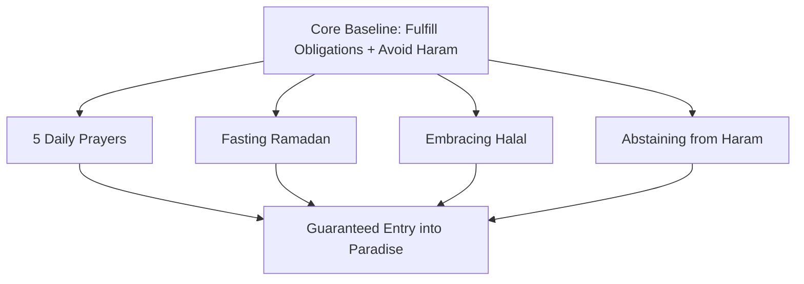

# Hadith 22: Fulfilling Obligations: The Direct Route to Paradise
### الاقتصار على الفرائض ودخول الجنة

> **Narrated by:** Jabir ibn Abdullah (رضي الله عنهما)  
> **Canonical Sources:** Sahih Muslim 15

---

## 📜 Complete Prophetic Text

**عَنْ أَبِي عَبْدِ اللَّهِ جَابِرِ بْنِ عَبْدِ اللَّهِ الْأَنْصَارِيِّ رَضِيَ اللَّهُ عَنْهُمَا: أَنَّ رَجُلًا سَأَلَ رَسُولَ اللَّهِ صلى الله عليه و سلم فَقَالَ: أَرَأَيْت إذَا صَلَّيْت الْمَكْتُوبَاتِ، وَصُمْت رَمَضَانَ، وَأَحْلَلْت الْحَلَالَ، وَحَرَّمْت الْحَرَامَ، وَلَمْ أَزِدْ عَلَى ذَلِكَ شَيْئًا؛ أَأَدْخُلُ الْجَنَّةَ؟ قَالَ: «نَعَمْ».**

> *"On the authority of Abu Abdullah Jabir bin Abdullah al-Ansari (ra) that a man questioned the Messenger of Allah (ﷺ) and said: "Do you see that if I pray the prescribed prayers, fast Ramadan, treat as lawful that which is halal, and treat as forbidden that which is haram, and add nothing further to that—will I enter Paradise?" He (ﷺ) replied: "Yes.""*

---

## 🔍 Line-by-Line Arabic & Morphological Breakdown

| Arabic Segment | Transliteration | Word-by-Word Analysis & Meaning |
| :--- | :--- | :--- |
| **صَلَّيْتُ الْمَكْتُوبَاتِ** | *Ṣallaytul-maktūbāt* | Performing strictly the five obligatory daily prayers without voluntary additions. |
| **وَصُمْتُ رَمَضَانَ** | *Wa ṣumtu Ramaḍān* | Fasting the required month of Ramadan completely. |
| **وَأَحْلَلْتُ الْحَلَالَ** | *Wa aḥlaltul-ḥalāl* | Believing in the lawfulness of what Allah permitted and acting upon it without false asceticism. |
| **وَحَرَّمْتُ الْحَرَامَ** | *Wa ḥarramtul-ḥarām* | Firmly believing in the prohibition of what Allah forbade and abstaining entirely. |
| **وَلَمْ أَزِدْ عَلَى ذَلِكَ شَيْئًا** | *Wa lam azid 'alā dhālika shay'ā* | Adding zero voluntary (Nawafil) deeds. |
| **أَأَدْخُلُ الْجَنَّةَ؟ قَالَ: نَعَمْ** | *A-adkhulul-Jannah? Qāla: Na'am* | The decisive prophetic affirmation: Fulfilling obligations and avoiding prohibitions guarantees Paradise. |

---

## 📊 Conceptual Framework & Visual Model

---

## 💡 In-Depth Sharh & Classical Commentary

### The Sufficiency of the Fundamentals
- **Demystifying Salvation:** Islam is an accessible path. A person who masters the core obligations and preserves themselves from major prohibitions achieves ultimate salvation.
- **Meaning of 'Treating Halal as Halal':** Accepting divine permission without creating self-imposed burdens, and treating Haram as unequivocally forbidden.

---

## ⚡ Practical & Productivity Application

### Productivity & MVP (Minimum Viable Performance)
- **Protect the Core Baseline First:** In software and organizational design, ensuring 100% reliability of the core architecture (the Minimum Viable Product) takes precedence over ornamental features. Master your daily non-negotiables before adding optional complexity.

---

## 📖 Canonical References & Scholarly Grading
- **References:** Sahih Muslim 15
- **Scholarly Classification:** Authenticated in classical collections; selected by Imam an-Nawawi as foundational principles (*Qawa'id al-Deen*).

---

## 🎥 Curated Video Insights & Lectures
- **Recommended Video Lecture:** YouTube Search: `Hadith 22 Nawawi If I pray obligatory and fast Ramadan will I enter paradise`

---

[[Hadith_21_Faith_and_Steadfastness|⬅ Prev: Hadith 21]] | [[00_Hadith_Index|📖 Hadith Index]] | [[Hadith_23_Purification_and_Gratitude|Next: Hadith 23 ➡]]
