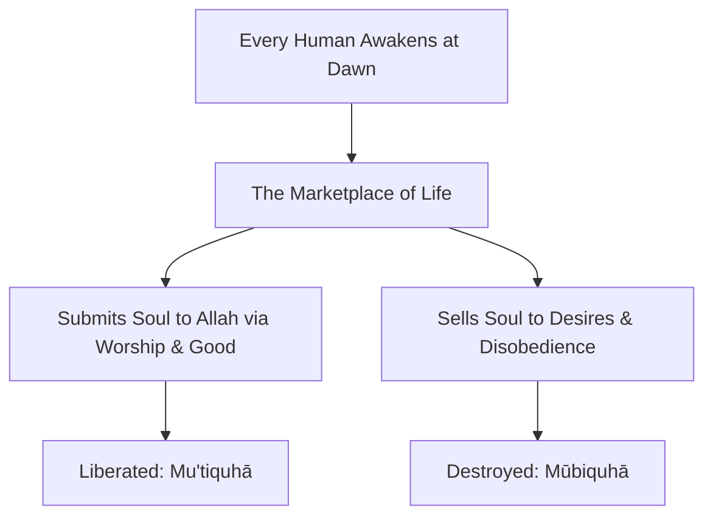

# Hadith 23: Purification, Dhikr, Light of Prayer & Selling the Soul
### الطهور شطر الإيمان وجوامع الخير

> **Narrated by:** Abu Malik al-Ash'ari (رضي الله عنه)  
> **Canonical Sources:** Sahih Muslim 223

---

## 📜 Complete Prophetic Text

**عَنْ أَبِي مَالِكٍ الْحَارِثِ بْنِ عَاصِمٍ الْأَشْعَرِيِّ رَضِيَ اللهُ عَنْهُ قَالَ: قَالَ رَسُولُ اللَّهِ صلى الله عليه و سلم: «الطَّهُورُ شَطْرُ الْإِيمَانِ، وَالْحَمْدُ لِلَّهِ تَمْلَأُ الْمِيزَانَ، وَسُبْحَانَ اللَّهِ وَالْحَمْدُ لِلَّهِ تَمْلَآنِ -أَوْ: تَمْلَأُ- مَا بَيْنَ السَّمَاءِ وَالْأَرْضِ، وَالصَّلَاةُ نُورٌ، وَالصَّدَقَةُ بُرْهَانٌ، وَالصَّبْرُ ضِيَاءٌ، وَالْقُرْآنُ حُجَّةٌ لَك أَوْ عَلَيْك، كُلُّ النَّاسِ يَغْدُو، فَبَائِعٌ نَفْسَهُ فَمُعْتِقُهَا أَوْ مُوبِقُهَا».**

> *"On the authority of Abu Malik al-Harith bin Asim al-Ash'ari (ra) who said: The Messenger of Allah (ﷺ) said: "Purity is half of faith. 'Al-hamdulillah' (praise be to Allah) fills the scale. 'Subhan-Allah' and 'Al-hamdulillah' fill what is between heaven and earth. Prayer is a light, charity is a proof, patience is an illumination, and the Quran is an argument for you or against you. Every person starts their day trading their soul—either freeing it or bringing about its ruin.""*

---

## 🔍 Line-by-Line Arabic & Morphological Breakdown

| Arabic Segment | Transliteration | Word-by-Word Analysis & Meaning |
| :--- | :--- | :--- |
| **الطَّهُورُ شَطْرُ الْإِيمَانِ** | *Aṭ-ṭuhūru shaṭrul-īmān* | Physical and spiritual purification constitutes half of faith, cleansing internal heart and external limbs. |
| **وَالْحَمْدُ لِلَّهِ تَمْلَأُ الْمِيزَانَ** | *Wal-ḥamdu lillāhi tamla'ul-mīzān* | Expressing gratitude and praise for divine perfection fills the cosmic scale of deeds. |
| **وَالصَّلَاةُ نُورٌ** | *Waṣ-ṣalātu nūr* | Prayer is gentle, radiant light illuminating guidance in worldly life and guiding across the Sirat. |
| **وَالصَّدَقَةُ بُرْهَانٌ** | *Waṣ-ṣadaqatu burhān* | Charity is decisive evidence (*Burhan*) demonstrating sincere faith over the human love of money. |
| **وَالصَّبْرُ ضِيَاءٌ** | *Waṣ-ṣabru ḍiyā'* | Patience is an intense, burning illumination (*Diya'*, like sunlight) that produces heat and burns through adversity. |
| **وَالْقُرْآنُ حُجَّةٌ لَك أَوْ عَلَيْك** | *Wal-Qur'ānu ḥujjatun laka aw 'alayk* | The Quran stands as an intercessor for you if recited and applied, or a prosecutor against you if abandoned. |
| **كُلُّ النَّاسِ يَغْدُو فَبَائِعٌ نَفْسَهُ...** | *Kullun-nāsi yaghdū fa-bā'i'un nafsahu...* | Every human sets out at dawn as an entrepreneur of their soul: either liberating it through obedience or ruining it through sin. |

---

## 📊 Conceptual Framework & Visual Model

---

## 💡 In-Depth Sharh & Classical Commentary

### The Metaphysics of Daily Enterprise
- **Nuance of Light: Nur vs. Diya':** The hadith masterfully distinguishes *Nur* (cool, tranquil light of Salah) from *Diya'* (intense, burning light of Sabr, which requires heat and endurance).
- **The Ultimate Commerce:** Life is not passive; every morning you invest your hours, cognitive focus, and body into a transaction that either redeems or forfeits your eternity.

---

## ⚡ Practical & Productivity Application

### Productivity & The Morning Start
- **First-Hour Leverage:** The day begins at dawn (*Yaghdū*). How you invest the morning sets the spiritual and neurological trajectory for the day. Purify intent, anchor with prayer, and trade your energy for high-leverage eternal value.

---

## 📖 Canonical References & Scholarly Grading
- **References:** Sahih Muslim 223
- **Scholarly Classification:** Authenticated in classical collections; selected by Imam an-Nawawi as foundational principles (*Qawa'id al-Deen*).

---

## 🎥 Curated Video Insights & Lectures
- **Recommended Video Lecture:** YouTube Search: `Hadith 23 Nawawi Purity is half of faith explanation Omar Suleiman`

---

[[Hadith_22_Fulfilling_Basics_for_Paradise|⬅ Prev: Hadith 22]] | [[00_Hadith_Index|📖 Hadith Index]] | [[Hadith_24_Prohibition_of_Oppression|Next: Hadith 24 ➡]]
