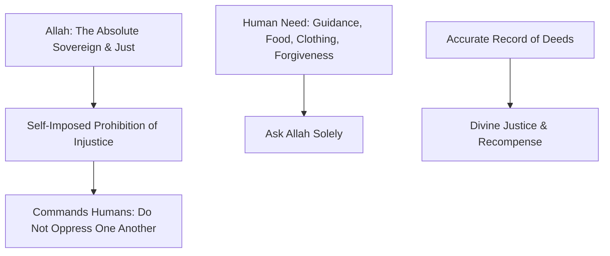

# Hadith 24: The Prohibition of Oppression (Hadith Qudsi)
### تحريم الظلم وسعة كرم الله (حديث قدسي)

> **Narrated by:** Abu Dharr al-Ghifari (رضي الله عنه)  
> **Canonical Sources:** Sahih Muslim 2577

---

## 📜 Complete Prophetic Text

**عَنْ أَبِي ذَرٍّ الْغِفَارِيِّ رَضِيَ اللهُ عَنْهُ عَنْ النَّبِيِّ صلى الله عليه و سلم فِيمَا يَرْوِيهِ عَنْ رَبِّهِ تَبَارَكَ وَتَعَالَى، أَنَّهُ قَالَ: «يَا عِبَادِي: إِنِّي حَرَّمْت الظُّلْمَ عَلَى نَفْسِي، وَجَعَلْته بَيْنَكُمْ مُحَرَّمًا؛ فَلَا تَظَالَمُوا. يَا عِبَادِي! كُلُّكُمْ ضَالٌّ إِلَّا مَنْ هَدَيْته، فَاسْتَهْدُونِي أَهْدِكُمْ... يَا عِبَادِي! إِنَّمَا هِيَ أَعْمَالُكُمْ أُحْصِيهَا لَكُمْ، ثُمَّ أُوَفِّيكُمْ إِيَّاهَا؛ فَمَنْ وَجَدَ خَيْرًا فَلْيَحْمَدْ اللَّهَ، وَمَنْ وَجَدَ غَيْرَ ذَلِكَ فَلَا يَلُومَنَّ إِلَّا نَفْسَهُ».**

> *"On the authority of Abu Dharr al-Ghifari (ra) from the Prophet (ﷺ) from what he relates from his Lord, Blessed and Exalted, that He said: "O My servants! Truly I have forbidden injustice (oppression) for Myself, and I have made it forbidden among you, so do not oppress one another. O My servants! All of you are astray except those whom I guide, so seek guidance from Me and I will guide you... O My servants! It is only your deeds that I enumerate for you and then recompense you for; so whoever finds good, let him praise Allah; and whoever finds other than that, let him blame none but himself.""*

---

## 🔍 Line-by-Line Arabic & Morphological Breakdown

| Arabic Segment | Transliteration | Word-by-Word Analysis & Meaning |
| :--- | :--- | :--- |
| **إِنِّي حَرَّمْتُ الظُّلْمَ عَلَى نَفْسِي** | *Innī ḥarramtuẓ-ẓulma 'alā nafsī* | Divine self-imposed justice: Allah is capable of all things, yet has forbidden oppression upon His Majesty by His own sovereign will. |
| **وَجَعَلْتُهُ بَيْنَكُمْ مُحَرَّمًا فَلَا تَظَالَمُوا** | *Wa ja'altuhu baynakum muḥarraman falā taẓālamū* | Universal societal mandate: all forms of interpersonal tyranny, financial exploitation, and abuse are prohibited. |
| **فَاسْتَهْدُونِي أَهْدِكُمْ** | *Fas-tahdūnī ahdikum* | Seek guidance persistently, for intellectual brilliance alone cannot navigate moral darkness without divine light. |
| **لَوْ أَنَّ أَوَّلَكُمْ وَآخِرَكُمْ... مَا زَادَ... مَا نَقَصَ...** | *Law anna awwalakum... mā zāda... mā naqaṣa...* | Divine self-sufficiency (*Al-Ghani*): Human worship adds nothing to His kingdom, and universal disobedience subtracts nothing. |
| **إِنَّمَا هِيَ أَعْمَالُكُمْ أُحْصِيهَا لَكُمْ** | *Innamā hiya a'mālukum uḥṣīhā lakum* | Absolute accountability: human actions are recorded with cryptographic precision; accountability rests with the individual. |

---

## 📊 Conceptual Framework & Visual Model

---

## 💡 In-Depth Sharh & Classical Commentary

### The Crown Jewel of Sacred Hadiths (Hadith Qudsi)
- **Status Among Scholars:** Imam Ahmad’s teacher Abu Idris al-Khawlani would fall to his knees in awe whenever narrating this hadith.
- **The Concept of Injustice (*Dhulm*):** Placing something outside its rightful place. Injustice darkens hearts and topples empires.
- **The Needle in the Ocean:** If all humans stood in one plain and Allah granted every wish, His dominion would decrease no more than water removed by a needle dipped into the ocean.

---

## ⚡ Practical & Productivity Application

### Productivity & Ethical Power Dynamics
- **Zero Injustice in Management:** Leaders, engineers, and founders must maintain scrupulous equity in crediting work, managing compensation, and treating subordinates. Power misused brings divine retribution.

---

## 📖 Canonical References & Scholarly Grading
- **References:** Sahih Muslim 2577
- **Scholarly Classification:** Authenticated in classical collections; selected by Imam an-Nawawi as foundational principles (*Qawa'id al-Deen*).

---

## 🎥 Curated Video Insights & Lectures
- **Recommended Video Lecture:** YouTube Search: `Hadith 24 Nawawi I have forbidden oppression for myself Yasir Qadhi`

---

[[Hadith_23_Purification_and_Gratitude|⬅ Prev: Hadith 23]] | [[00_Hadith_Index|📖 Hadith Index]] | [[Hadith_25_Expansive_Charity|Next: Hadith 25 ➡]]
