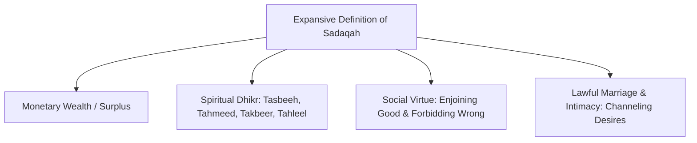

# Hadith 25: Expansive Charity: Beyond Monetary Wealth
### الصدقة بجميع أنواع المعروف

> **Narrated by:** Abu Dharr al-Ghifari (رضي الله عنه)  
> **Canonical Sources:** Sahih Muslim 1006

---

## 📜 Complete Prophetic Text

**عَنْ أَبِي ذَرٍّ رَضِيَ اللهُ عَنْهُ أَيْضًا: أَنَّ نَاسًا مِنْ أَصْحَابِ رَسُولِ اللَّهِ صلى الله عليه و سلم قَالُوا لِلنَّبِيِّ صلى الله عليه و سلم: يَا رَسُولَ اللَّهِ ذَهَبَ أَهْلُ الدُّثُورِ بِالْأُجُورِ؛ يُصَلُّونَ كَمَا نُصَلِّي، وَيَصُومُونَ كَمَا نَصُومُ، وَيَتَصَدَّقُونَ بِفُضُولِ أَمْوَالِهِمْ. قَالَ: «أَوَلَيْسَ قَدْ جَعَلَ اللَّهُ لَكُمْ مَا تَصَّدَّقُونَ؟ إِنَّ بِكُلِّ تَسْبِيحَةٍ صَدَقَةً، وَكُلِّ تَكْبِيرَةٍ صَدَقَةً، وَكُلِّ تَحْمِيدَةٍ صَدَقَةً، وَكُلِّ تَهْلِيلَةٍ صَدَقَةً، وَأَمْرٌ بِمَعْرُوفٍ صَدَقَةٌ، وَنَهْيٌ عَنْ مُنْكَرٍ صَدَقَةٌ، وَفِي بُضْعِ أَحَدِكُمْ صَدَقَةٌ»...**

> *"Also on the authority of Abu Dharr (ra) that some companions of the Messenger of Allah (ﷺ) said to him: "O Messenger of Allah, the wealthy have taken away all the rewards! They pray as we pray, they fast as we fast, and they give in charity from their surplus wealth." He (ﷺ) said: "Has not Allah made for you that which you can give in charity? Truly every Tasbeehah (Subhan-Allah) is charity, every Takbeerah (Allahu Akbar) is charity, every Tahmeedah (Al-hamdulillah) is charity, every Tahleelah (La ilaha illAllah) is charity, enjoining good is charity, forbidding evil is charity, and in the lawful marital intimacy of one of you there is charity...""*

---

## 🔍 Line-by-Line Arabic & Morphological Breakdown

| Arabic Segment | Transliteration | Word-by-Word Analysis & Meaning |
| :--- | :--- | :--- |
| **ذَهَبَ أَهْلُ الدُّثُورِ بِالْأُجُورِ** | *Dhahaba ahlud-duthūri bil-ujūr* | The wealthy have departed with supreme rewards—a lament born of noble spiritual ambition (*Ghibtah*), not bitter envy (*Hasad*). |
| **إِنَّ بِكُلِّ تَسْبِيحَةٍ صَدَقَةً...** | *Inna bi-kulli tasbīḥatin ṣadaqah...* | Democratization of charity: Remembrances of Allah are spiritual currency accessible to all socio-economic strata. |
| **وَأَمْرٌ بِمَعْرُوفٍ صَدَقَةٌ** | *Wa amrun bi-ma'rūfin ṣadaqah* | Constructive civic engagement, mentoring, and encouraging virtue constitutes tangible charity. |
| **وَفِي بُضْعِ أَحَدِكُمْ صَدَقَةٌ** | *Wa fī buḍ'i aḥadikum ṣadaqah* | Lawful marital intimacy transforms biological instinct into spiritual worship through ethical fidelity. |

---

## 📊 Conceptual Framework & Visual Model

---

## 💡 In-Depth Sharh & Classical Commentary

### The Democratization of Spiritual Wealth
- **Spiritual Ambition vs. Greed:** The poor companions did not complain about food or shelter; they grieved that they could not match the wealthy in spending for God's sake.
- **Holistic Worship:** Islam sanctifies the biological and social. Satisfying physical desires within lawful marriage earns reward because it shields society from vice and channels gratitude.

---

## ⚡ Practical & Productivity Application

### Productivity & Micro-Acts of Value
- **Constant Value Creation:** You do not need a multi-million-dollar philanthropic endowment to make an impact. Mentoring a junior colleague, sharing constructive advice, and maintaining dhikr between tasks distributes continuous value.

---

## 📖 Canonical References & Scholarly Grading
- **References:** Sahih Muslim 1006
- **Scholarly Classification:** Authenticated in classical collections; selected by Imam an-Nawawi as foundational principles (*Qawa'id al-Deen*).

---

## 🎥 Curated Video Insights & Lectures
- **Recommended Video Lecture:** YouTube Search: `Hadith 25 Nawawi The wealthy have taken the rewards explanation`

---

[[Hadith_24_Prohibition_of_Oppression|⬅ Prev: Hadith 24]] | [[00_Hadith_Index|📖 Hadith Index]] | [[Hadith_26_Daily_Charity_on_Joints|Next: Hadith 26 ➡]]
