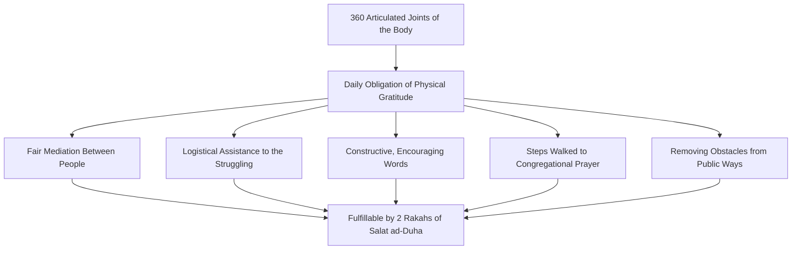

# Hadith 26: Daily Gratitude: Charity on Every Joint
### الصدقة اليومية على كل سلامى من الجسد

> **Narrated by:** Abu Hurairah (رضي الله عنه)  
> **Canonical Sources:** Sahih al-Bukhari 2989, Sahih Muslim 1009

---

## 📜 Complete Prophetic Text

**عَنْ أَبِي هُرَيْرَةَ رَضِيَ اللهُ عَنْهُ قَالَ: قَالَ رَسُولُ اللَّهِ صلى الله عليه و سلم: «كُلُّ سُلَامَى مِنْ النَّاسِ عَلَيْهِ صَدَقَةٌ، كُلَّ يَوْمٍ تَطْلُعُ فِيهِ الشَّمْسُ تَعْدِلُ بَيْنَ اثْنَيْنِ صَدَقَةٌ، وَتُعِينُ الرَّجُلَ فِي دَابَّتِهِ فَتَحْمِلُهُ عَلَيْهَا أَوْ تَرْفَعُ لَهُ عَلَيْهَا مَتَاعَهُ صَدَقَةٌ، وَالْكَلِمَةُ الطَّيِّبَةُ صَدَقَةٌ، وَبِكُلِّ خُطْوَةٍ تَمْشِيهَا إِلَى الصَّلَاةِ صَدَقَةٌ، وَتُمِيطُ الْأَذَى عَنْ الطَّرِيقِ صَدَقَةٌ».**

> *"On the authority of Abu Hurayrah (ra) who said: The Messenger of Allah (ﷺ) said: "Upon every joint of a person is a charity due each day that the sun rises: judging justly between two people is charity; assisting a person with their mount, lifting them onto it or hoisting up their belongings onto it, is charity; a good word is charity; every step you take towards prayer is charity; and removing a harmful obstacle from the path is charity.""*

---

## 🔍 Line-by-Line Arabic & Morphological Breakdown

| Arabic Segment | Transliteration | Word-by-Word Analysis & Meaning |
| :--- | :--- | :--- |
| **كُلُّ سُلَامَى** | *Kullu sulāmā* | Every bone, joint, and knuckle in the human skeleton (anatomically known to be 360 articulated joints). |
| **كُلَّ يَوْمٍ تَطْلُعُ فِيهِ الشَّمْسُ** | *Kulla yawmin taṭlu'u fīhish-shams* | A daily biological tax of gratitude required for physical vitality and movement. |
| **تَعْدِلُ بَيْنَ اثْنَيْنِ** | *Ta'dilu baynath-nayn* | Reconciling disputing parties with fairness and judicial empathy. |
| **تُعِينُ الرَّجُلَ فِي دَابَّتِهِ** | *Tu'īnur-rajula fī dābbatih* | Assisting someone in physical logistical need (loading cargo, offering transport). |
| **وَالْكَلِمَةُ الطَّيِّبَةُ صَدَقَةٌ** | *Wal-kalimatuṭ-ṭayyibatu ṣadaqah* | A courteous word, a warm greeting, or affirmative praise heals social rifts. |
| **وَتُمِيطُ الْأَذَى عَنْ الطَّرِيقِ** | *Wa tumīṭul-adhā 'aniṭ-ṭarīq* | Clearing hazards, litter, or systemic obstacles from public pathways. |

---

## 📊 Conceptual Framework & Visual Model

---

## 💡 In-Depth Sharh & Classical Commentary

### The Anatomy of Physical Thanksgiving
- **360 Joints of the Skeleton:** In Sahih Muslim, the Prophet (ﷺ) explicitly verified that humans possess 360 joints. Each day of physical functionality incurs a moral debt of gratitude (*Shukr*).
- **The Equalizer (Salat ad-Duha):** In an authentic narration in Muslim: *"And two rak'ahs recited in the mid-morning (Duha) suffices for all of that."*

---

## ⚡ Practical & Productivity Application

### Productivity & Frictionless Public Infrastructure
- **Eliminating Impediments (*Imatat al-Adha*):** In engineering and team workflows, removing a blocker, refactoring confusing code, or improving internal tooling is a direct modern application of removing obstacles from the pathway.

---

## 📖 Canonical References & Scholarly Grading
- **References:** Sahih al-Bukhari 2989, Sahih Muslim 1009
- **Scholarly Classification:** Authenticated in classical collections; selected by Imam an-Nawawi as foundational principles (*Qawa'id al-Deen*).

---

## 🎥 Curated Video Insights & Lectures
- **Recommended Video Lecture:** YouTube Search: `Hadith 26 Nawawi Charity upon every joint explanation Omar Suleiman`

---

[[Hadith_25_Expansive_Charity|⬅ Prev: Hadith 25]] | [[00_Hadith_Index|📖 Hadith Index]] | [[Hadith_27_Nature_of_Righteousness_and_Sin|Next: Hadith 27 ➡]]
