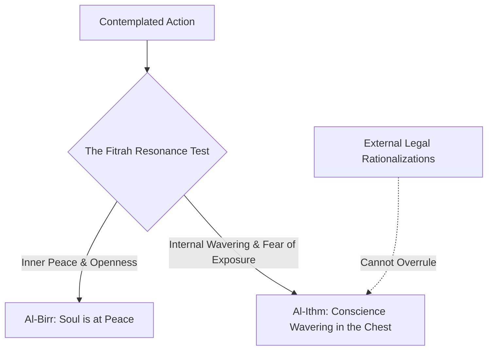

# Hadith 27: The Nature of Righteousness and Sin: Consult Your Heart
### حقيقة البر والإثم واستفتاء القلب

> **Narrated by:** An-Nawwas ibn Sam'an & Wabisah ibn Ma'bad (رضي الله عنهما)  
> **Canonical Sources:** Sahih Muslim 2553, Musnad Ahmad 4/227

---

## 📜 Complete Prophetic Text

**عَنْ النَّوَّاسِ بْنِ سَمْعَانَ رَضِيَ اللهُ عَنْهُ عَنْ النَّبِيِّ صلى الله عليه و سلم قَالَ: «الْبِرُّ حُسْنُ الْخُلُقِ، وَالْإِثْمُ مَا حَاكَ فِي صَدْرِك، وَكَرِهْت أَنْ يَطَّلِعَ عَلَيْهِ النَّاسُ». وَعَنْ وَابِصَةَ بْنِ مَعْبَدٍ رَضِيَ اللهُ عَنْهُ قَالَ: أَتَيْت رَسُولَ اللَّهِ صلى الله عليه و سلم فَقَالَ: «جِئْتَ تَسْأَلُ عَنْ الْبِرِّ؟ قُلْت: نَعَمْ. فَقَالَ: اسْتَفْتِ قَلْبَك؛ الْبِرُّ مَا اطْمَأَنَّتْ إِلَيْهِ النَّفْسُ، وَاطْمَأَنَّ إِلَيْهِ الْقَلْبُ، وَالْإِثْمُ مَا حَاكَ فِي النَّفْسِ وَتَرَدَّدَ فِي الصَّدْرِ، وَإِنْ أَفْتَاك النَّاسُ وَأَفْتَوْك».**

> *"On the authority of an-Nawwas bin Sam'an (ra) from the Prophet (ﷺ) who said: "Righteousness is good character, and sin is that which wavers in your breast and you would hate for people to find out about." And on the authority of Wabisah bin Ma'bad (ra) who said: I came to the Messenger of Allah (ﷺ) and he said: "Have you come to ask about righteousness?" I said: "Yes." He said: "Consult your heart. Righteousness is that with which the soul feels tranquil and the heart feels at rest; and sin is that which wavers in the soul and hesitates in the chest, even if people repeatedly give you their legal verdicts [in its favor].""*

---

## 🔍 Line-by-Line Arabic & Morphological Breakdown

| Arabic Segment | Transliteration | Word-by-Word Analysis & Meaning |
| :--- | :--- | :--- |
| **الْبِرُّ حُسْنُ الْخُلُقِ** | *Al-birru ḥusnul-khuluq* | Comprehensive righteousness (*Birr*) reaches its summit in noble, refined character toward God and humanity. |
| **وَالْإِثْمُ مَا حَاكَ فِي صَدْرِك** | *Wal-ithmu mā ḥāka fī ṣadrik* | Sin triggers psychological discomfort, hesitation, anxiety, and internal conflict in an uncorrupted soul. |
| **وَكَرِهْتَ أَنْ يَطَّلِعَ عَلَيْهِ النَّاسُ** | *Wa karihta an yaṭṭali'a 'alayhin-nās* | The social marker of wrongdoing: an instinct to conceal it from righteous people due to shame. |
| **اسْتَفْتِ قَلْبَك** | *Istafti qalbak* | Consult your heart: interrogate your innate moral barometer (*Fitrah*). |
| **وَإِنْ أَفْتَاكَ النَّاسُ وَأَفْتَوْك** | *Wa in aftākan-nāsu wa aftawk* | Even if permissive legal opinions or public rationalizations attempt to normalize it, inner unease signals danger. |

---

## 📊 Conceptual Framework & Visual Model

---

## 💡 In-Depth Sharh & Classical Commentary

### The Innate Moral Sensor (*Al-Fitrah*)
- **Subject of the Verdict:** Scholars note that *"Consult your heart"* applies to a purified believer striving for piety whose *Fitrah* remains sensitive, not a hardened transgressor whose moral compass is deadened.
- **Form vs. Substance:** A person may shop around for permissive legal loopholes (*Fatwas*), but genuine righteousness aligns with spiritual tranquility, not technical evasion.

---

## ⚡ Practical & Productivity Application

### Productivity & The Gut-Check in Ethics
- **The Intuitive Ethical Warning:** In complex contracts or product features (e.g., dark patterns in UX design), technical legality may exist, but if you feel hesitant about customers discovering it, your conscience is warning you of compromise.

---

## 📖 Canonical References & Scholarly Grading
- **References:** Sahih Muslim 2553, Musnad Ahmad 4/227
- **Scholarly Classification:** Authenticated in classical collections; selected by Imam an-Nawawi as foundational principles (*Qawa'id al-Deen*).

---

## 🎥 Curated Video Insights & Lectures
- **Recommended Video Lecture:** YouTube Search: `Hadith 27 Nawawi Righteousness is good character consult your heart`

---

[[Hadith_26_Daily_Charity_on_Joints|⬅ Prev: Hadith 26]] | [[00_Hadith_Index|📖 Hadith Index]] | [[Hadith_28_Adherence_to_Sunnah|Next: Hadith 28 ➡]]
