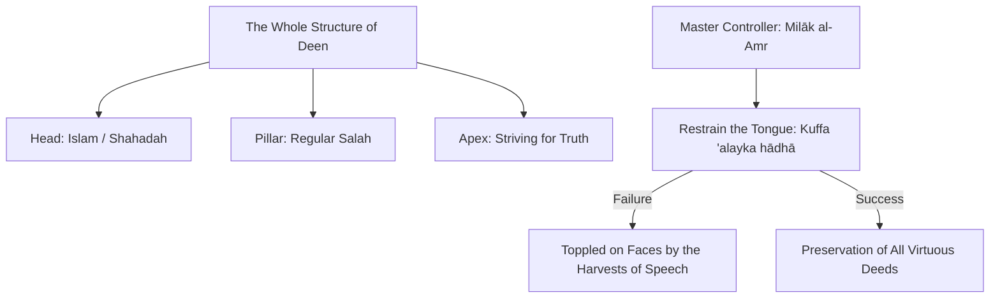

# Hadith 29: Means of Salvation & Restraining the Tongue
### أبواب الخير وحصائد الألسنة

> **Narrated by:** Mu'adh ibn Jabal (رضي الله عنه)  
> **Canonical Sources:** Jami` at-Tirmidhi 2616

---

## 📜 Complete Prophetic Text

**عَنْ مُعَاذِ بْنِ جَبَلٍ رَضِيَ اللهُ عَنْهُ قَالَ: قُلْت يَا رَسُولَ اللَّهِ! أَخْبِرْنِي بِعَمَلٍ يُدْخِلُنِي الْجَنَّةَ وَيُبَاعِدْنِي مِنْ النَّارِ... ثُمَّ قَالَ: «أَلَا أُخْبِرُك بِمَلَاكِ ذَلِكَ كُلِّهِ؟» فَقُلْت: بَلَى يَا رَسُولَ اللَّهِ! فَأَخَذَ بِلِسَانِهِ وَقَالَ: «كُفَّ عَلَيْك هَذَا». قُلْت: يَا نَبِيَّ اللَّهِ وَإِنَّا لَمُؤَاخَذُونَ بِمَا نَتَكَلَّمُ بِهِ؟ فَقَالَ: «ثَكِلَتْك أُمُّك وَهَلْ يَكُبُّ النَّاسَ عَلَى وُجُوهِهِمْ -أَوْ قَالَ عَلَى مَنَاخِرِهِمْ- إِلَّا حَصَائِدُ أَلْسِنَتِهِمْ؟!».**

> *"On the authority of Mu'adh bin Jabal (ra) who said: I said: "O Messenger of Allah, inform me of an act that will admit me into Paradise and distance me from the Fire..." Then he (ﷺ) said: "Shall I not inform you of the foundation of all of that?" I said: "Yes, O Messenger of Allah." So he took hold of his tongue and said: "Restrain this!" I said: "O Prophet of Allah, will we really be taken to account for what we speak?" He said: "May your mother be bereaved of you, O Mu'adh! Does anything topple people on their faces into the Fire except the harvests of their tongues?!""*

---

## 🔍 Line-by-Line Arabic & Morphological Breakdown

| Arabic Segment | Transliteration | Word-by-Word Analysis & Meaning |
| :--- | :--- | :--- |
| **أَبْوَابِ الْخَيْرِ: الصَّوْمُ جُنَّةٌ...** | *Abwābil-khayr: aṣ-ṣawmu junnah...* | The gates of goodness: Fasting is a protective shield; charity extinguishes sins like water douses flame; night prayer (*Tahajjud*) elevates the soul. |
| **رَأْسُ الْأَمْرِ... وَعَمُودُهُ... وَذِرْوَةُ سَنَامِهِ...** | *Ra'sul-amri... wa 'amūduhu... wa dhirwatu sanāmih...* | The head is Islam, its pillar is Salah, and its apex is striving for God's cause. |
| **مَلَاكِ ذَلِكَ كُلِّهِ** | *Milāki dhālika kullih* | The master controller and binding root that sustains and preserves the entire spiritual structure. |
| **فَأَخَذَ بِلِسَانِهِ وَقَالَ: كُفَّ عَلَيْك هَذَا** | *Fa-akhadha bi-lisānihī wa qāla: Kuffa 'alayka hādhā* | Kinesthetic pedagogy: taking hold of his physical tongue to illustrate absolute verbal discipline. |
| **حَصَائِدُ أَلْسِنَتِهِمْ** | *Ḥaṣā'idu alsinatihim* | The lethal harvest of reckless words (backbiting, lying, obscenity, defamation) reaping catastrophe. |

---

## 📊 Conceptual Framework & Visual Model

---

## 💡 In-Depth Sharh & Classical Commentary

### The Master Anchor: Verbal Governance
- **The Centrality of the Tongue:** A person may fast, donate millions, and wake for Tahajjud, but a few unchecked sentences of slander or malice can bankrupt their spiritual account on the Day of Reckoning.
- **Agricultural Metaphor (*Hasa'id*):** Every word spoken is a seed planted. Sincere dhikr reaps sweet fruit; slander and lies reap thorns that drag the speaker down.

---

## ⚡ Practical & Productivity Application

### Productivity & High-Consequence Communication
- **The Cost of Careless Words:** In executive leadership and technical collaboration, emotional emails, casual gossip, or careless promises inflict massive damage. Implement a strict filter: pause before pressing send.

---

## 📖 Canonical References & Scholarly Grading
- **References:** Jami` at-Tirmidhi 2616
- **Scholarly Classification:** Authenticated in classical collections; selected by Imam an-Nawawi as foundational principles (*Qawa'id al-Deen*).

---

## 🎥 Curated Video Insights & Lectures
- **Recommended Video Lecture:** YouTube Search: `Hadith 29 Nawawi Harvests of the tongue Muadh ibn Jabal Omar Suleiman`

---

[[Hadith_28_Adherence_to_Sunnah|⬅ Prev: Hadith 28]] | [[00_Hadith_Index|📖 Hadith Index]] | [[Hadith_30_Divine_Limits_and_Obligations|Next: Hadith 30 ➡]]
