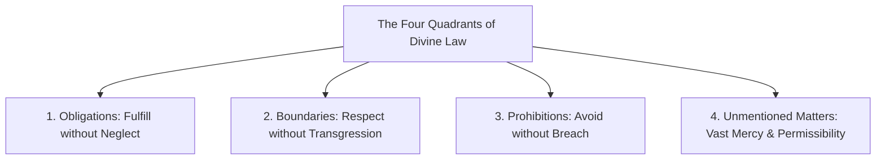

# Hadith 30: Divine Limits, Obligations, and Silence as Mercy
### الوقوف عند حدود الله وسكوت الشرع رحمة

> **Narrated by:** Abu Tha'labah al-Khushani (رضي الله عنه)  
> **Canonical Sources:** Sunan ad-Daraqutni 4/184

---

## 📜 Complete Prophetic Text

**عَنْ أَبِي ثَعْلَبَةَ الْخُشَنِيِّ جُرْثُومِ بن نَاشِر رَضِيَ اللهُ عَنْهُ عَنْ رَسُولِ اللَّهِ صلى الله عليه و سلم قَال: «إِنَّ اللَّهَ تَعَالَى فَرَضَ فَرَائِضَ فَلَا تُضَيِّعُوهَا، وَحَدَّ حُدُودًا فَلَا تَعْتَدُوهَا، وَحَرَّمَ أَشْيَاءَ فَلَا تَنْتَهِكُوهَا، وَسَكَتَ عَنْ أَشْيَاءَ رَحْمَةً لَكُمْ غَيْرَ نِسْيَانٍ فَلَا تَبْحَثُوا عَنْهَا».**

> *"On the authority of Abu Tha'labah al-Khushani Jurthum bin Nashir (ra) that the Messenger of Allah (ﷺ) said: "Verily Allah the Exalted has laid down religious obligations, so do not neglect them; He has established boundaries, so do not overstep them; He has forbidden things, so do not violate them; and He has remained silent regarding things out of mercy for you, not from forgetfulness—so do not seek after them.""*

---

## 🔍 Line-by-Line Arabic & Morphological Breakdown

| Arabic Segment | Transliteration | Word-by-Word Analysis & Meaning |
| :--- | :--- | :--- |
| **فَرَضَ فَرَائِضَ فَلَا تُضَيِّعُوهَا** | *Faraḍa farā'iḍa falā tuḍayyi'ūhā* | Binding duties (prayers, zakah, justice): do not let them slip through laziness or neglect. |
| **وَحَدَّ حُدُودًا فَلَا تَعْتَدُوهَا** | *Wa ḥadda ḥudūdan falā ta'tadūhā* | Demarcated limits (inheritance portions, legal rights): do not exceed them in extremism. |
| **وَحَرَّمَ أَشْيَاءَ فَلَا تَنْتَهِكُوهَا** | *Wa ḥarrama ashyā'a falā tantahikūhā* | Categorical prohibitions (crimes, usury, intoxicants): do not breach the sacred sanctuary. |
| **وَسَكَتَ عَنْ أَشْيَاءَ رَحْمَةً لَكُمْ** | *Wa sakata 'an ashyā'a raḥmatan lakum* | The vast domain of silence: default permissibility (*Al-Bara'ah al-Asliyyah*) bestowed as divine mercy. |
| **غَيْرَ نِسْيَانٍ فَلَا تَبْحَثُوا عَنْهَا** | *Ghayra nisyānin falā tabḥathū 'anhā* | Allah does not forget; do not constrain life by demanding unnecessary restrictions. |

---

## 📊 Conceptual Framework & Visual Model

---

## 💡 In-Depth Sharh & Classical Commentary

### The Elegant Quadrant of Islamic Jurisprudence
- **The Four Dimensions of Law:** Abu Bakr ibn al-Sam'ani stated that whoever reflects on this hadith will find it encapsulates all legal principles of the Shari'ah.
- **Silence as a Divine Blessing:** The default status of all worldly matters, foods, technologies, and contracts is permissibility (*Ibahah*) unless explicit evidence prohibits them.

---

## ⚡ Practical & Productivity Application

### Productivity & Avoiding Over-Regulation
- **Principles-Based Architecture:** In software development and enterprise governance, define clear core constraints, non-negotiable standards, and security firewalls—then leave the remaining space open for creative autonomy and rapid innovation.

---

## 📖 Canonical References & Scholarly Grading
- **References:** Sunan ad-Daraqutni 4/184
- **Scholarly Classification:** Authenticated in classical collections; selected by Imam an-Nawawi as foundational principles (*Qawa'id al-Deen*).

---

## 🎥 Curated Video Insights & Lectures
- **Recommended Video Lecture:** YouTube Search: `Hadith 30 Nawawi Allah has laid down obligations explanation`

---

[[Hadith_29_Means_of_Goodness|⬅ Prev: Hadith 29]] | [[00_Hadith_Index|📖 Hadith Index]] | [[Hadith_31_The_Reality_of_Zuhd|Next: Hadith 31 ➡]]
