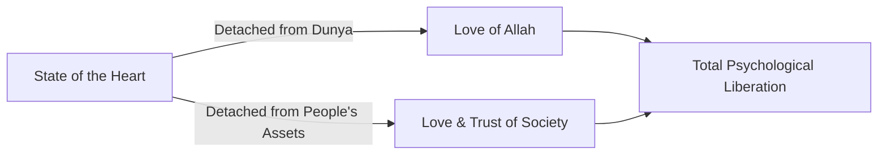

# Hadith 31: True Asceticism (Zuhd): Freedom of the Soul
### حقيقة الزهد وثمراته في حب الله وحب الناس

> **Narrated by:** Sahl ibn Sa'd as-Sa'idi (رضي الله عنه)  
> **Canonical Sources:** Sunan Ibn Majah 4102

---

## 📜 Complete Prophetic Text

**عَنْ أَبِي الْعَبَّاسِ سَهْلِ بْنِ سَعْدٍ السَّاعِدِيّ رَضِيَ اللهُ عَنْهُ قَالَ: جَاءَ رَجُلٌ إِلَى النَّبِيِّ صلى الله عليه و سلم فَقَالَ: يَا رَسُولَ اللهِ! دُلَّنِي عَلَى عَمَلٍ إِذَا عَمِلْتُهُ أَحَبَّنِي اللهُ وَأَحَبَّنِي النَّاسُ؛ فَقَالَ: «ازْهَدْ فِي الدُّنْيَا يُحِبَّك اللهُ، وَازْهَدْ فِيمَا عِنْدَ النَّاسِ يُحِبَّك النَّاسُ».**

> *"On the authority of Abu al-Abbas Sahl bin Sa'd as-Sa'idi (ra) who said: A man came to the Prophet (ﷺ) and said: "O Messenger of Allah, direct me to an action which, if I perform it, Allah will love me and the people will love me." He (ﷺ) replied: "Renounce worldly obsession (practice Zuhd) and Allah will love you; and renounce that which people possess, and the people will love you.""*

---

## 🔍 Line-by-Line Arabic & Morphological Breakdown

| Arabic Segment | Transliteration | Word-by-Word Analysis & Meaning |
| :--- | :--- | :--- |
| **دُلَّنِي عَلَى عَمَلٍ** | *Dullanī 'alā 'amal* | Seeking the dual crown of spiritual existence: divine love (*Mahabbatullah*) and sincere earthly respect. |
| **ازْهَدْ فِي الدُّنْيَا يُحِبَّكَ اللَّهُ** | *Iz-had fid-dunyā yuḥibbakallāh* | Detaching your heart from the idolatry of temporal status, wealth, and consumerism draws divine love. |
| **وَازْهَدْ فِيمَا عِنْدَ النَّاسِ يُحِبَّكَ النَّاسُ** | *Waz-had fīmā 'indan-nāsi yuḥibbakan-nās* | Covet nothing belonging to other people; when people perceive you have zero designs on their possessions, they love and trust you unconditionally. |

---

## 📊 Conceptual Framework & Visual Model

---

## 💡 In-Depth Sharh & Classical Commentary

### The Real Definition of Zuhd (Inner Detachment)
- **Misconception of Poverty:** Hasan al-Basri and Ali ibn Abi Talib clarified: *"Zuhd is not wearing rags or forbidding lawful food; Zuhd is having more reliance upon what is in Allah's Hand than what is in your own hand."*
- **Wealth in Hand vs. Wealth in Heart:** You may manage multi-million dollar corporations, yet remain a *Zahid* if money resides in your bank account to serve good, rather than possessing your soul.

---

## ⚡ Practical & Productivity Application

### Productivity & High-Integrity Relationships
- **Independence of Soul (*Al-Ghina*):** In business and professional networks, nothing repels people faster than desperate opportunism. Approaching partnerships from a posture of contribution rather than entitlement generates immediate rapport.

---

## 📖 Canonical References & Scholarly Grading
- **References:** Sunan Ibn Majah 4102
- **Scholarly Classification:** Authenticated in classical collections; selected by Imam an-Nawawi as foundational principles (*Qawa'id al-Deen*).

---

## 🎥 Curated Video Insights & Lectures
- **Recommended Video Lecture:** YouTube Search: `Hadith 31 Nawawi Renounce the world and Allah will love you Omar Suleiman`

---

[[Hadith_30_Divine_Limits_and_Obligations|⬅ Prev: Hadith 30]] | [[00_Hadith_Index|📖 Hadith Index]] | [[Hadith_32_No_Harm_Nor_Reciprocation|Next: Hadith 32 ➡]]
