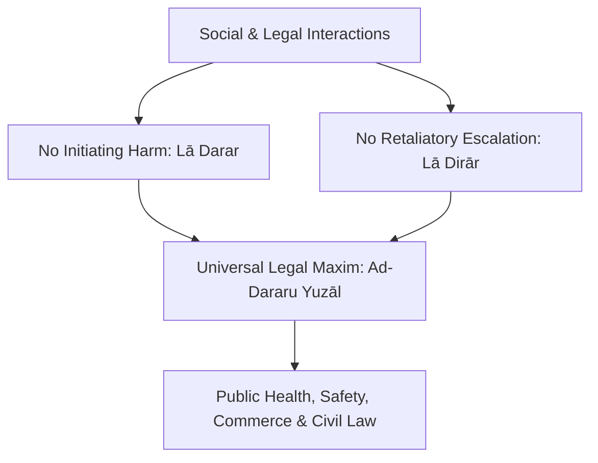

# Hadith 32: No Harming and No Reciprocation of Harm
### قاعدة لا ضرر ولا ضرار

> **Narrated by:** Abu Sa'eed al-Khudri (رضي الله عنه)  
> **Canonical Sources:** Sunan Ibn Majah 2341, Muwatta Malik 2/746

---

## 📜 Complete Prophetic Text

**عَنْ أَبِي سَعِيدٍ سَعْدِ بْنِ مَالِكِ بْنِ سِنَانٍ الْخُدْرِيّ رَضِيَ اللهُ عَنْهُ أَنَّ رَسُولَ اللَّهِ صلى الله عليه و سلم قَالَ: «لَا ضَرَرَ وَلَا ضِرَارَ».**

> *"On the authority of Abu Sa'eed Sa'd bin Malik bin Sinan al-Khudri (ra) that the Messenger of Allah (ﷺ) said: "There shall be no harming (darar) and no reciprocating of harm (dirar).""*

---

## 🔍 Line-by-Line Arabic & Morphological Breakdown

| Arabic Segment | Transliteration | Word-by-Word Analysis & Meaning |
| :--- | :--- | :--- |
| **لَا ضَرَرَ** | *Lā ḍarar* | Categorical negation of initiating harm, inflicting injury, or causing unprovoked damage to anyone. |
| **وَلَا ضِرَارَ** | *Wa lā ḍirār* | Prohibition of retaliatory harm, malicious escalation, or counter-injustice. |

---

## 📊 Conceptual Framework & Visual Model

---

## 💡 In-Depth Sharh & Classical Commentary

### The Master Juristic Maxim of Islamic Law
- **Universal Legal Foundation:** Formulates one of the five major legal maxims (*Al-Qawa'id al-Fiqhiyyah al-Kubra*): *"Ad-Dararu Yuzal"* (Harm must be eliminated).
- **Nuance Between Darar and Dirar:**
  - *Darar:* Causing harm to another for personal benefit.
  - *Dirar:* Causing harm out of pure spite where the actor derives no benefit other than seeing another suffer.

---

## ⚡ Practical & Productivity Application

### Productivity & Ethical System Design
- **Eliminating Negative Externalities:** In engineering, manufacturing, and software, systems must not harm users (data leaks, toxic waste, dark patterns) or retaliate spitefully against competitors. Design for constructive safety.

---

## 📖 Canonical References & Scholarly Grading
- **References:** Sunan Ibn Majah 2341, Muwatta Malik 2/746
- **Scholarly Classification:** Authenticated in classical collections; selected by Imam an-Nawawi as foundational principles (*Qawa'id al-Deen*).

---

## 🎥 Curated Video Insights & Lectures
- **Recommended Video Lecture:** YouTube Search: `Hadith 32 Nawawi No harm and no reciprocating harm explanation`

---

[[Hadith_31_The_Reality_of_Zuhd|⬅ Prev: Hadith 31]] | [[00_Hadith_Index|📖 Hadith Index]] | [[Hadith_33_Burden_of_Proof|Next: Hadith 33 ➡]]
