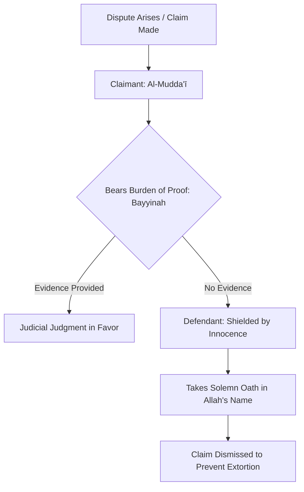

# Hadith 33: Burden of Proof and the Taking of Oaths
### البينة على المدعي واليمين على من أنكر

> **Narrated by:** Abdullah ibn Abbas (رضي الله عنهما)  
> **Canonical Sources:** Al-Sunan al-Kubra li al-Bayhaqi 10/252, Sahih al-Bukhari 4552

---

## 📜 Complete Prophetic Text

**عَنْ ابْنِ عَبَّاسٍ رَضِيَ اللَّهُ عَنْهُمَا أَنَّ رَسُولَ اللَّهِ صلى الله عليه و سلم قَالَ: «لَوْ يُعْطَى النَّاسُ بِدَعْوَاهُمْ لَادَّعَى رِجَالٌ أَمْوَالَ قَوْمٍ وَدِمَاءَهُمْ، لَكِنَّ الْبَيِّنَةَ عَلَى الْمُدَّعِي، وَالْيَمِينَ عَلَى مَنْ أَنْكَرَ».**

> *"On the authority of Ibn Abbas (ra) that the Messenger of Allah (ﷺ) said: "Were people to be given everything they claimed, men would claim the wealth and lives of other people. But the burden of proof is upon the claimant, and the taking of an oath is upon the one who denies.""*

---

## 🔍 Line-by-Line Arabic & Morphological Breakdown

| Arabic Segment | Transliteration | Word-by-Word Analysis & Meaning |
| :--- | :--- | :--- |
| **لَوْ يُعْطَى النَّاسُ بِدَعْوَاهُمْ** | *Law yu'ṭan-nāsu bi-da'wāhum* | If judicial verdicts were granted merely on unverified verbal accusations. |
| **لَادَّعَى رِجَالٌ أَمْوَالَ قَوْمٍ وَدِمَاءَهُمْ** | *Ladda'ā rijālun amwāla qawmin wa dimā'ahum* | Society would descend into predatory anarchy, with people seizing competitors' capital and reputations. |
| **الْبَيِّنَةُ عَلَى الْمُدَّعِي** | *Al-bayyinatu 'alal-mudda'ī* | The claimant advancing an accusation against the default status bears the burden of producing clear, substantiated evidence. |
| **وَالْيَمِينُ عَلَى مَنْ أَنْكَرَ** | *Wal-yamīnu 'alā man ankar* | The defendant, shielded by the presumption of innocence, must swear a solemn oath if no proof exists. |

---

## 📊 Conceptual Framework & Visual Model

---

## 💡 In-Depth Sharh & Classical Commentary

### The Bedrock of Procedural Justice
- **Presumption of Innocence (*Al-Bara'ah al-Asliyyah*):** The defendant begins with a clean slate. An unproven allegation carries zero legal weight.
- **Bayyinah (Evidence):** Encompasses documents, credible eyewitnesses, forensic data, and mathematical proof.

---

## ⚡ Practical & Productivity Application

### Productivity & Fact-Based Management
- **In God We Trust, All Others Must Bring Data:** In technical debates, bug reports, and performance reviews, subjective claims must be substantiated with logs, tests, and data. Eliminate gossip-based organizational politics.

---

## 📖 Canonical References & Scholarly Grading
- **References:** Al-Sunan al-Kubra li al-Bayhaqi 10/252, Sahih al-Bukhari 4552
- **Scholarly Classification:** Authenticated in classical collections; selected by Imam an-Nawawi as foundational principles (*Qawa'id al-Deen*).

---

## 🎥 Curated Video Insights & Lectures
- **Recommended Video Lecture:** YouTube Search: `Hadith 33 Nawawi Burden of proof on claimant explanation`

---

[[Hadith_32_No_Harm_Nor_Reciprocation|⬅ Prev: Hadith 32]] | [[00_Hadith_Index|📖 Hadith Index]] | [[Hadith_34_Changing_Evil|Next: Hadith 34 ➡]]
