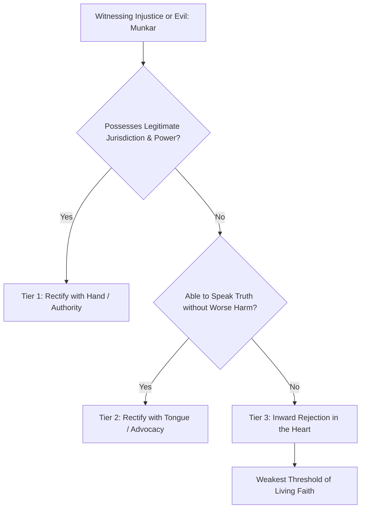

# Hadith 34: Changing Evil: Tiers of Social Responsibility
### مراتب تغيير المنكر باليد واللسان والقلب

> **Narrated by:** Abu Sa'eed al-Khudri (رضي الله عنه)  
> **Canonical Sources:** Sahih Muslim 49

---

## 📜 Complete Prophetic Text

**عَنْ أَبِي سَعِيدٍ الْخُدْرِيّ رَضِيَ اللهُ عَنْهُ قَالَ: سَمِعْت رَسُولَ اللَّهِ صلى الله عليه و سلم يَقُولُ: «مَنْ رَأَى مِنْكُمْ مُنْكَرًا فَلْيُغَيِّرْهُ بِيَدِهِ، فَإِنْ لَمْ يَسْتَطِعْ فَبِلِسَانِهِ، فَإِنْ لَمْ يَسْتَطِعْ فَبِقَلْبِهِ، وَذَلِكَ أَضْعَفُ الْإِيمَانِ».**

> *"On the authority of Abu Sa'eed al-Khudri (ra) who said: I heard the Messenger of Allah (ﷺ) say: "Whosoever of you sees an evil, let him change it with his hand; and if he is unable, then with his tongue; and if he is unable, then with his heart—and that is the weakest of faith.""*

---

## 🔍 Line-by-Line Arabic & Morphological Breakdown

| Arabic Segment | Transliteration | Word-by-Word Analysis & Meaning |
| :--- | :--- | :--- |
| **مَنْ رَأَى مِنْكُمْ مُنْكَرًا** | *Man ra'ā minkum munkarā* | Whoever witnesses an unambiguous evil or injustice violating divine commandments. |
| **فَلْيُغَيِّرْهُ بِيَدِهِ** | *Fal-yughayyir-hu bi-yadih* | Change it with direct authority and physical intervention (by legitimate authorities, parents, leaders within their jurisdiction). |
| **فَإِنْ لَمْ يَسْتَطِعْ فَبِلِسَانِهِ** | *Fa-in lam yastaṭi' fa-bi-lisānih* | Through verbal protest, principled advocacy, teaching, and courageous truth-telling. |
| **فَبِقَلْبِهِ وَذَلِكَ أَضْعَفُ الْإِيمَانِ** | *Fa-bi-qalbihī wa dhālika aḍ'aful-īmān* | Internal rejection and abhorrence of the injustice; the bare minimum threshold below which spiritual vitality dies. |

---

## 📊 Conceptual Framework & Visual Model

---

## 💡 In-Depth Sharh & Classical Commentary

### Graduated Civic and Moral Responsibility
- **Jurisdictional Boundaries:** Changing with the hand belongs to those with legitimate jurisdiction (governments for crime, parents in the home, team leads in project integrity) so as to prevent lawlessness.
- **Weighing Consequences (*Fiqh al-Ma'alat*):** If confronting an evil directly leads to a catastrophic greater evil, silence and heart-rejection are mandated.

---

## ⚡ Practical & Productivity Application

### Productivity & Culture of Accountability
- **Fix Broken Windows Early:** In organizational systems, ignoring corrupt practices or decaying code allows rot to compound. Intervene at the appropriate level to restore structural integrity.

---

## 📖 Canonical References & Scholarly Grading
- **References:** Sahih Muslim 49
- **Scholarly Classification:** Authenticated in classical collections; selected by Imam an-Nawawi as foundational principles (*Qawa'id al-Deen*).

---

## 🎥 Curated Video Insights & Lectures
- **Recommended Video Lecture:** YouTube Search: `Hadith 34 Nawawi Whoever sees an evil let him change it explanation`

---

[[Hadith_33_Burden_of_Proof|⬅ Prev: Hadith 33]] | [[00_Hadith_Index|📖 Hadith Index]] | [[Hadith_35_Islamic_Brotherhood|Next: Hadith 35 ➡]]
