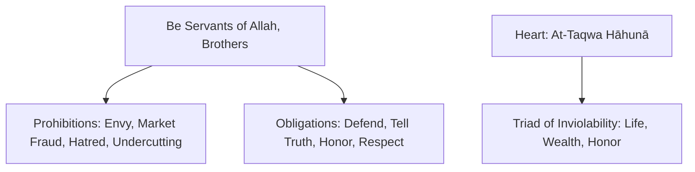

# Hadith 35: Brotherhood and the Inviolability of Honor
### حقوق الأخوة وحرمة المسلم

> **Narrated by:** Abu Hurairah (رضي الله عنه)  
> **Canonical Sources:** Sahih Muslim 2564

---

## 📜 Complete Prophetic Text

**عَنْ أَبِي هُرَيْرَةَ رَضِيَ اللهُ عَنْهُ قَالَ: قَالَ رَسُولُ اللَّهِ صلى الله عليه و سلم: «لَا تَحَاسَدُوا، وَلَا تَنَاجَشُوا، وَلَا تَبَاغَضُوا، وَلَا تَدَابَرُوا، وَلَا يَبِعْ بَعْضُكُمْ عَلَى بَيْعِ بَعْضٍ، وَكُونُوا عِبَادَ اللَّهِ إِخْوَانًا، الْمُسْلِمُ أَخُو الْمُسْلِمِ: لَا يَظْلِمُهُ، وَلَا يَخْذُلُهُ، وَلَا يَكْذِبُهُ، وَلَا يَحْقِرُهُ؛ التَّقْوَى هَاهُنَا -وَيُشِيرُ إِلَى صَدْرِهِ ثَلَاثَ مَرَّاتٍ-، بِحَسْبِ امْرِئٍ مِنْ الشَّرِّ أَنْ يَحْقِرَ أَخَاهُ الْمُسْلِمَ؛ كُلُّ الْمُسْلِمِ عَلَى الْمُسْلِمِ حَرَامٌ: دَمُهُ وَمَالُهُ وَعِرْضُهُ».**

> *"On the authority of Abu Hurayrah (ra) who said: The Messenger of Allah (ﷺ) said: "Do not envy one another; do not artificially inflate prices for one another; do not hate one another; do not turn your backs on one another; do not undercut one another in trade; and be, O servants of Allah, brothers. A Muslim is the brother of a Muslim: he does not oppress him, nor does he fail him in need, nor does he lie to him, nor does he despise him. Taqwa is right here"—and he pointed to his chest three times. "It is sufficient evil for a person to look down upon his fellow brother. The whole of a Muslim is sacred to another Muslim: his blood, his property, and his honor.""*

---

## 🔍 Line-by-Line Arabic & Morphological Breakdown

| Arabic Segment | Transliteration | Word-by-Word Analysis & Meaning |
| :--- | :--- | :--- |
| **لَا تَحَاسَدُوا** | *Lā taḥāsadū* | Do not harbor destructive envy (*Hasad*) wishing others' blessings to vanish. |
| **وَلَا تَنَاجَشُوا** | *Wa lā tanājashū* | Do not artificially inflate bids or manipulate markets deceitfully. |
| **لَا يَظْلِمُهُ، وَلَا يَخْذُلُهُ** | *Lā yaẓlimuhū wa lā yakh-dhuluh* | He neither oppresses him nor abandons him when he is vulnerable and in need of defense. |
| **التَّقْوَى هَاهُنَا** | *At-taqwā hāhunā* | True piety resides in heart sincerity and humility, not outward posturing. |
| **بِحَسْبِ امْرِئٍ مِنَ الشَّرِّ أَنْ يَحْقِرَ أَخَاهُ** | *Bi-ḥasbi-mri'in minash-sharri an yaḥqira akhāh* | It is sufficient magnitude of sin for a person to view any human being with contempt. |
| **دَمُهُ وَمَالُهُ وَعِرْضُهُ** | *Damuhu wa māluhu wa 'irḍuh* | The inviolable triad: physical life, financial assets, and public honor/reputation. |

---

## 📊 Conceptual Framework & Visual Model

---

## 💡 In-Depth Sharh & Classical Commentary

### The Magna Carta of Islamic Social Ecology
- **Contempt as the Worst Sin:** Despising others is the essence of arrogance (*Kibr*), the exact sin of Iblis.
- **Market Ethics and Anti-Collusion:** Prohibits dishonest bidding (*Najash*) and commercial sabotage, demanding ethical fairness in economics.

---

## ⚡ Practical & Productivity Application

### Productivity & Eliminating Toxic Workplace Politics
- **Zero Contempt in Teams:** High-performing engineering organizations require psychological safety. Eliminating snide condescension and backbiting unleashes genuine collaborative brilliance.

---

## 📖 Canonical References & Scholarly Grading
- **References:** Sahih Muslim 2564
- **Scholarly Classification:** Authenticated in classical collections; selected by Imam an-Nawawi as foundational principles (*Qawa'id al-Deen*).

---

## 🎥 Curated Video Insights & Lectures
- **Recommended Video Lecture:** YouTube Search: `Hadith 35 Nawawi Do not envy one another brotherhood Omar Suleiman`

---

[[Hadith_34_Changing_Evil|⬅ Prev: Hadith 34]] | [[00_Hadith_Index|📖 Hadith Index]] | [[Hadith_36_Relieving_Distress|Next: Hadith 36 ➡]]
