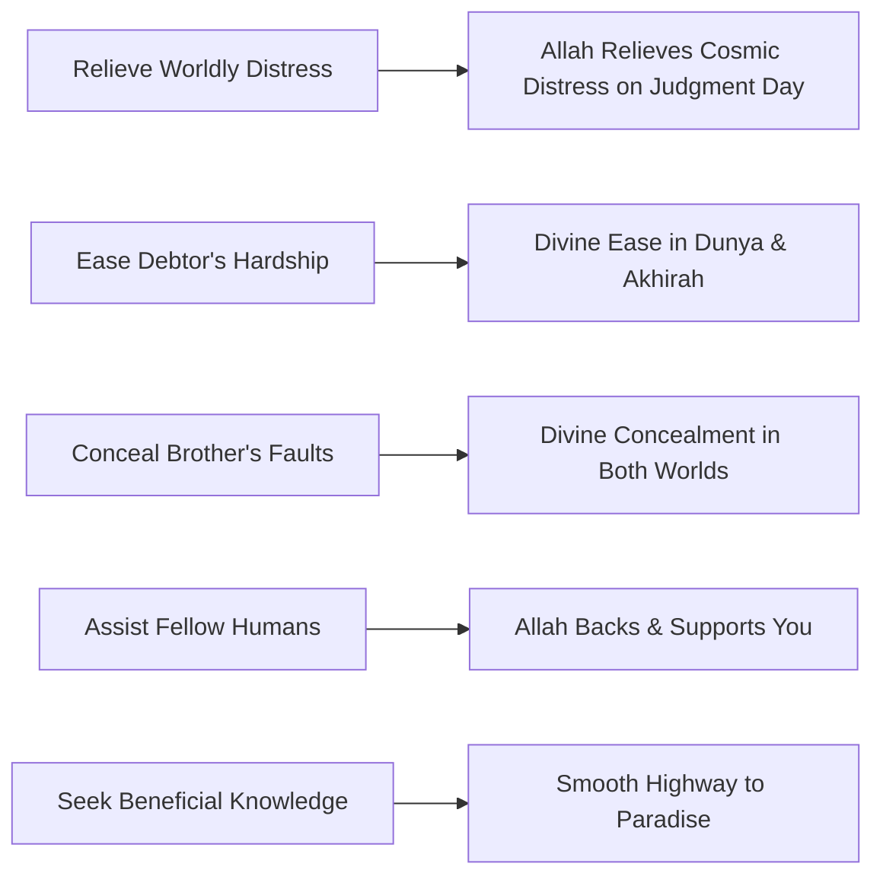

# Hadith 36: Relieving Distress, Seeking Knowledge & Sacred Gatherings
### قضاء حوائج المسلمين وفضل طلب العلم

> **Narrated by:** Abu Hurairah (رضي الله عنه)  
> **Canonical Sources:** Sahih Muslim 2699

---

## 📜 Complete Prophetic Text

**عَنْ أَبِي هُرَيْرَةَ رَضِيَ اللهُ عَنْهُ عَنْ النَّبِيِّ صلى الله عليه و سلم قَالَ: «مَنْ نَفَّسَ عَنْ مُؤْمِنٍ كُرْبَةً مِنْ كُرَبِ الدُّنْيَا نَفَّسَ اللَّهُ عَنْهُ كُرْبَةً مِنْ كُرَبِ يَوْمِ الْقِيَامَةِ، وَمَنْ يَسَّرَ عَلَى مُعْسِرٍ، يَسَّرَ اللَّهُ عَلَيْهِ فِي الدُّنْيَا وَالْآخِرَةِ، وَمَنْ سَتَرَ مُسْلِمًا سَتَرَهُ اللهُ فِي الدُّنْيَا وَالْآخِرَةِ، وَاَللَّهُ فِي عَوْنِ الْعَبْدِ مَا كَانَ الْعَبْدُ فِي عَوْنِ أَخِيهِ، وَمَنْ سَلَكَ طَرِيقًا يَلْتَمِسُ فِيهِ عِلْمًا سَهَّلَ اللَّهُ لَهُ بِهِ طَرِيقًا إِلَى الْجَنَّةِ... وَمَنْ أَبْطَأَ بِهِ عَمَلُهُ لَمْ يُسْرِعْ بِهِ نَسَبُهُ».**

> *"On the authority of Abu Hurayrah (ra) that the Prophet (ﷺ) said: "Whoever relieves a worldly distress from a believer, Allah will relieve from him a distress from the distresses of the Day of Resurrection. Whoever alleviates the need of a debtor in hardship, Allah will alleviate his needs in this world and the Hereafter. Whoever conceals the fault of a Muslim, Allah will conceal him in this world and the Hereafter. Allah remains in aid of His servant as long as the servant remains in aid of his brother. Whoever travels a path seeking knowledge, Allah makes easy for him a path to Paradise... and whoever is slowed down by his deeds will not be sped forward by his noble lineage.""*

---

## 🔍 Line-by-Line Arabic & Morphological Breakdown

| Arabic Segment | Transliteration | Word-by-Word Analysis & Meaning |
| :--- | :--- | :--- |
| **مَنْ نَفَّسَ عَنْ مُؤْمِنٍ كُرْبَةً** | *Man naffasa 'an mu'minin kurbah* | Naffasa means to breathe relief into a suffocating, agonizing crisis. |
| **وَمَنْ يَسَّرَ عَلَى مُعْسِرٍ** | *Wa man yassara 'alā mu'sir* | Granting ease to someone crushed by financial debt or bankruptcy. |
| **وَمَنْ سَتَرَ مُسْلِمًا** | *Wa man satara muslimā* | Concealing private moral slips rather than broadcasting them on social feeds. |
| **وَاَللَّهُ فِي عَوْنِ الْعَبْدِ...** | *Wallāhu fī 'awnil-'abdi...* | The divine reciprocal law: God's infinite support actively backs you while you assist others. |
| **سَلَكَ طَرِيقًا يَلْتَمِسُ فِيهِ عِلْمًا** | *Salaka ṭarīqan yaltamisu fīhi 'ilmā* | Physical, intellectual, or digital journeys dedicated to acquiring beneficial knowledge. |
| **مَنْ أَبْطَأَ بِهِ عَمَلُهُ لَمْ يُسْرِعْ بِهِ نَسَبُهُ** | *Man abṭa'a bihī 'amaluhu lam yusri' bihī nasabuh* | Ultimate meritocracy: Ancestry, titles, or prestige count for nothing if deeds are deficient. |

---

## 📊 Conceptual Framework & Visual Model

---

## 💡 In-Depth Sharh & Classical Commentary

### The Law of Cosmic Reciprocity (*Al-Jaza' min Jins al-'Amal*)
- **Divine Amplification:** The relief you provide in this world is modest and finite; the relief Allah returns on the terrifying Day of Resurrection is infinite and eternal.
- **Sacred Gathering for Study:** *"No group gathers to study the Quran except that tranquility descends, mercy envelops them, and angels surround them."*

---

## ⚡ Practical & Productivity Application

### Productivity & High-Leverage Mutual Support
- **Unlocking Divine Barakah:** When struggling with complex technical problems or career hurdles, actively unblock and mentor someone else. The divine assistance that unlocks your own breakthroughs is tied to helping others.

---

## 📖 Canonical References & Scholarly Grading
- **References:** Sahih Muslim 2699
- **Scholarly Classification:** Authenticated in classical collections; selected by Imam an-Nawawi as foundational principles (*Qawa'id al-Deen*).

---

## 🎥 Curated Video Insights & Lectures
- **Recommended Video Lecture:** YouTube Search: `Hadith 36 Nawawi Relieving distress and seeking knowledge Yaqeen`

---

[[Hadith_35_Islamic_Brotherhood|⬅ Prev: Hadith 35]] | [[00_Hadith_Index|📖 Hadith Index]] | [[Hadith_37_Recording_Good_and_Evil|Next: Hadith 37 ➡]]
