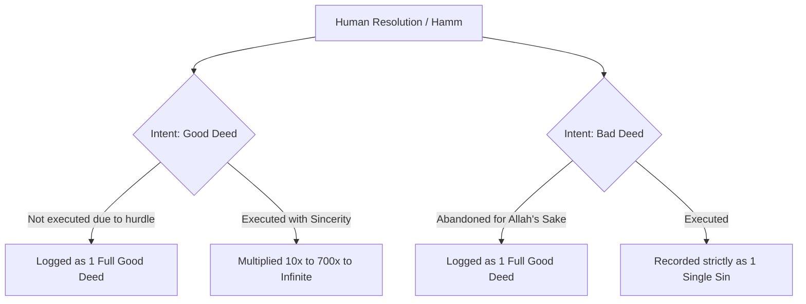

# Hadith 37: Divine Grace: Multiplying Good and Pardoning Intent
### مضاعفة الحسنات والتجاوز عن السيئات

> **Narrated by:** Abdullah ibn Abbas (رضي الله عنهما)  
> **Canonical Sources:** Sahih al-Bukhari 6491, Sahih Muslim 131

---

## 📜 Complete Prophetic Text

**عَنْ ابْنِ عَبَّاسٍ رَضِيَ اللَّهُ عَنْهُمَا عَنْ رَسُولِ اللَّهِ صلى الله عليه و سلم فِيمَا يَرْوِيهِ عَنْ رَبِّهِ تَبَارَكَ وَتَعَالَى، قَالَ: «إِنَّ اللَّهَ كَتَبَ الْحَسَنَاتِ وَالسَّيِّئَاتِ، ثُمَّ بَيَّنَ ذَلِكَ، فَمَنْ هَمَّ بِحَسَنَةٍ فَلَمْ يَعْمَلْهَا كَتَبَهَا اللَّهُ عِنْدَهُ حَسَنَةً كَامِلَةً، وَإِنْ هَمَّ بِهَا فَعَمِلَهَا كَتَبَهَا اللَّهُ عِنْدَهُ عَشْرَ حَسَنَاتٍ إِلَى سَبْعِمِائَةِ ضِعْفٍ إِلَى أَضْعَافٍ كَثِيرَةٍ، وَإِنْ هَمَّ بِسَيِّئَةٍ فَلَمْ يَعْمَلْهَا كَتَبَهَا اللَّهُ عِنْدَهُ حَسَنَةً كَامِلَةً، وَإِنْ هَمَّ بِهَا فَعَمِلَهَا كَتَبَهَا اللَّهُ سَيِّئَةً وَاحِدَةً».**

> *"On the authority of Ibn Abbas (ra) from the Messenger of Allah (ﷺ) from what he relates from his Lord, Blessed and Exalted: "Verily Allah has decreed good deeds and bad deeds, and then clarified that: whoever intends a good deed but does not perform it, Allah writes it down with Himself as a full good deed. If he intends it and performs it, Allah writes it down with Himself as ten good deeds up to seven hundred times, up to many times multiplied. And if he intends a bad deed but does not perform it, Allah writes it down with Himself as a full good deed. But if he intends it and performs it, Allah writes it down as only a single bad deed.""*

---

## 🔍 Line-by-Line Arabic & Morphological Breakdown

| Arabic Segment | Transliteration | Word-by-Word Analysis & Meaning |
| :--- | :--- | :--- |
| **فَمَنْ هَمَّ بِحَسَنَةٍ فَلَمْ يَعْمَلْهَا** | *Fa-man hamma bi-ḥasanatin falam ya'malhā* | A sincere inner resolve and contemplation of good, even if blocked by external constraints, is rewarded as a complete virtuous deed. |
| **عَشْرَ حَسَنَاتٍ إِلَى سَبْعِمِائَةِ ضِعْفٍ** | *'Ashra ḥasanātin ilā sab'i-mi'ati ḍi'f* | Divine compounding: virtuous execution is multiplied from 10x to 700x and beyond based on sincerity and difficulty. |
| **وَإِنْ هَمَّ بِسَيِّئَةٍ فَلَمْ يَعْمَلْهَا** | *Wa in hamma bi-sayyi'atin falam ya'malhā* | Contemplating a sin and actively abandoning it for Allah's sake is rewarded as a full righteous deed of restraint. |
| **كَتَبَهَا اللَّهُ سَيِّئَةً وَاحِدَةً** | *Katabahallāhu sayyi'atan wāḥidah* | Sin is never multiplied; it is logged strictly 1:1, highlighting boundless divine grace. |

---

## 📊 Conceptual Framework & Visual Model

---

## 💡 In-Depth Sharh & Classical Commentary

### The Boundless Architecture of Divine Generosity
- **Asymmetry of Grace:** The spiritual ledger is mathematically weighted overwhelmingly toward salvation. Virtue receives massive multiplier leverage, whereas error is recorded minimally and wiped by repentance.
- **The Secret of Intention (*Hamm*):** Desiring virtue opens the spiritual tap before the hands move.

---

## ⚡ Practical & Productivity Application

### Productivity & High-Aspiration Brainstorming
- **Dream Big and Execute:** Sincere ambitious plans to serve community and build beneficial technology are rewarded from the moment of conception. Strive courageously without fear of falling short.

---

## 📖 Canonical References & Scholarly Grading
- **References:** Sahih al-Bukhari 6491, Sahih Muslim 131
- **Scholarly Classification:** Authenticated in classical collections; selected by Imam an-Nawawi as foundational principles (*Qawa'id al-Deen*).

---

## 🎥 Curated Video Insights & Lectures
- **Recommended Video Lecture:** YouTube Search: `Hadith 37 Nawawi Allah has written good deeds and evil deeds Omar Suleiman`

---

[[Hadith_36_Relieving_Distress|⬅ Prev: Hadith 36]] | [[00_Hadith_Index|📖 Hadith Index]] | [[Hadith_38_Hadith_of_the_Wali|Next: Hadith 38 ➡]]
