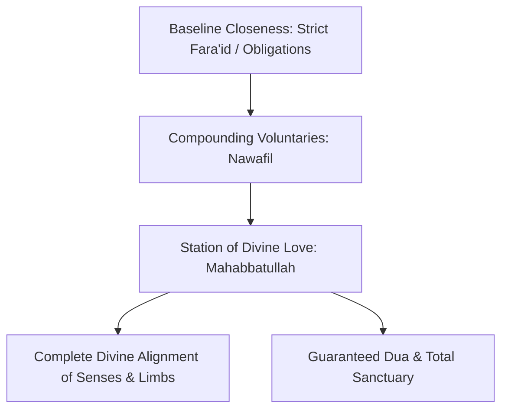

# Hadith 38: Hadith of the Wali: Drawing Near through Obligation and Sunnah
### حديث الولي والتقرب إلى الله بالنوافل

> **Narrated by:** Abu Hurairah (رضي الله عنه)  
> **Canonical Sources:** Sahih al-Bukhari 6502

---

## 📜 Complete Prophetic Text

**عَنْ أَبِي هُرَيْرَةَ رَضِيَ اللهُ عَنْهُ قَالَ: قَالَ رَسُولُ اللَّهِ صلى الله عليه و سلم: إِنَّ اللَّهَ تَعَالَى قَالَ: «مَنْ عَادَى لِي وَلِيًّا فَقْد آذَنْتهُ بِالْحَرْبِ، وَمَا تَقَرَّبَ إِلَيَّ عَبْدِي بِشَيْءٍ أَحَبَّ إِلَيَّ مِمَّا افْتَرَضْتُهُ عَلَيْهِ، وَلَا يَزَالُ عَبْدِي يَتَقَرَّبُ إِلَيَّ بِالنَّوَافِلِ حَتَّى أُحِبَّهُ، فَإِذَا أَحْبَبْتُهُ كُنْتُ سَمْعَهُ الَّذِي يَسْمَعُ بِهِ، وَبَصَرَهُ الَّذِي يُبْصِرُ بِهِ، وَيَدَهُ الَّتِي يَبْطِشُ بِهَا، وَرِجْلَهُ الَّتِي يَمْشِي بِهَا، وَلَئِنْ سَأَلَنِي لَأُعْطِيَنَّهُ، وَلَئِنْ اسْتَعَاذَنِي لَأُعِيذَنَّهُ».**

> *"On the authority of Abu Hurayrah (ra) who said: The Messenger of Allah (ﷺ) said: "Verily Allah the Exalted has said: 'Whosoever shows enmity to an ally (wali) of Mine, I have declared war against him. And My servant draws near to Me with nothing more beloved to Me than the religious duties I have obligated upon him. And My servant continues to draw near to Me with voluntary devotions until I love him. When I love him, I become his hearing with which he hears, his sight with which he sees, his hand with which he strikes, and his foot with which he walks. Were he to ask of Me, I would surely give it to him; and were he to seek refuge in Me, I would surely grant him refuge.'""*

---

## 🔍 Line-by-Line Arabic & Morphological Breakdown

| Arabic Segment | Transliteration | Word-by-Word Analysis & Meaning |
| :--- | :--- | :--- |
| **مَنْ عَادَى لِي وَلِيًّا فَقْد آذَنْتهُ بِالْحَرْبِ** | *Man 'ādā lī waliyyan faqad ādhantuhu bil-ḥarb* | Divine ultimatum: Allah declares war against anyone who harms, slanders, or persecutes His righteous allies. |
| **مِمَّا افْتَرَضْتُهُ عَلَيْهِ** | *Mimmāf-taraḍtuhu 'alayh* | The premier tier of closeness: absolute mastery and punctuality in fulfilling divine obligations (*Fara'id*). |
| **وَلَا يَزَالُ... يَتَقَرَّبُ إِلَيَّ بِالنَّوَافِلِ حَتَّى أُحِبَّهُ** | *Wa lā yazālu... yataqarrabu ilayya bin-nawāfili ḥattā uḥibbah* | The second tier: compounding voluntary acts (*Nawafil*) that unlock the transcendent station of divine love. |
| **كُنْتُ سَمْعَهُ... وَبَصَرَهُ... وَيَدَهُ...** | *Kuntu sam'ahu... wa baṣarahu... wa yadah...* | Divine alignment: His faculties become so saturated with divine light that he hears only truth, sees only wisdom, and acts solely for righteousness. |
| **وَلَئِنْ سَأَلَنِي لَأُعْطِيَنَّهُ** | *Wa la'in sa'alanī la-u'ṭiyannah* | The station of instant response (*Ijabah*): whatever he asks, Allah guarantees to bestow. |

---

## 📊 Conceptual Framework & Visual Model

---

## 💡 In-Depth Sharh & Classical Commentary

### The Ladder of Wilayah (Sainthood in Islam)
- **Who is a Wali?:** Quran confirms: *"Unquestionably, the allies of Allah—no fear shall be upon them nor shall they grieve: those who believed and maintained Taqwa."* (Surah Yunus 10:62-63). Wilayah is accessible to every sincere believer.
- **The Priority of Obligations:** Imam Ibn Hajar noted: whoever neglects obligatory duties to pursue optional spiritual exercises is deluded; obligations must be perfected first.

---

## ⚡ Practical & Productivity Application

### Productivity & High-Level Alignment
- **The Flow State of Ultimate Alignment:** When mind, hands, and vision are calibrated to divine purpose, cognitive friction vanishes. Work, decisions, and creative engineering flow with extraordinary clarity and barakah.

---

## 📖 Canonical References & Scholarly Grading
- **References:** Sahih al-Bukhari 6502
- **Scholarly Classification:** Authenticated in classical collections; selected by Imam an-Nawawi as foundational principles (*Qawa'id al-Deen*).

---

## 🎥 Curated Video Insights & Lectures
- **Recommended Video Lecture:** YouTube Search: `Hadith 38 Nawawi Whosoever shows enmity to a wali of Mine Yasir Qadhi`

---

[[Hadith_37_Recording_Good_and_Evil|⬅ Prev: Hadith 37]] | [[00_Hadith_Index|📖 Hadith Index]] | [[Hadith_39_Pardoning_Mistakes_and_Forgetfulness|Next: Hadith 39 ➡]]
