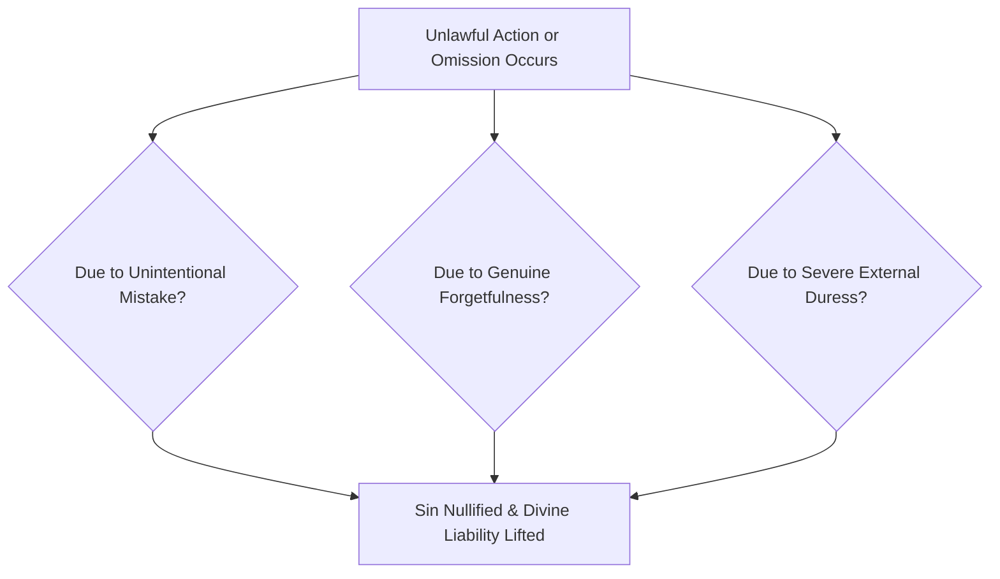

# Hadith 39: Pardoning Mistakes, Forgetfulness, and Duress
### التجاوز عن الخطأ والنسيان والإكراه

> **Narrated by:** Abdullah ibn Abbas (رضي الله عنهما)  
> **Canonical Sources:** Sunan Ibn Majah 2045, Al-Sunan al-Kubra li al-Bayhaqi 7/356

---

## 📜 Complete Prophetic Text

**عَنْ ابْنِ عَبَّاسٍ رَضِيَ اللَّهُ عَنْهُمَا أَنَّ رَسُولَ اللَّهِ صلى الله عليه و سلم قَالَ: «إِنَّ اللَّهَ تَجَاوَزَ لِي عَنْ أُمَّتِي الْخَطَأَ وَالنِّسْيَانَ وَمَا اسْتُكْرِهُوا عَلَيْهِ».**

> *"On the authority of Ibn Abbas (ra) that the Messenger of Allah (ﷺ) said: "Verily Allah has pardoned for my nation: mistakes (accidents), forgetfulness, and that which they are forced to do under duress.""*

---

## 🔍 Line-by-Line Arabic & Morphological Breakdown

| Arabic Segment | Transliteration | Word-by-Word Analysis & Meaning |
| :--- | :--- | :--- |
| **تَجَاوَزَ لِي عَنْ أُمَّتِي** | *Tajāwaza lī 'an ummatī* | Granted special pardon, leniency, and cancellation of sin for this community out of honor for the Prophet (ﷺ). |
| **الْخَطَأَ** | *Al-khaṭa'* | Unintentional error or mistake committed without deliberate intention. |
| **وَالنِّسْيَانَ** | *Wan-nisyān* | Lapse of memory or genuine forgetfulness (e.g., eating inadvertently while fasting). |
| **وَمَا اسْتُكْرِهُوا عَلَيْهِ** | *Wa mastuk-rihū 'alayh* | Coercion, compulsion, and severe duress where free will is completely compromised. |

---

## 📊 Conceptual Framework & Visual Model

---

## 💡 In-Depth Sharh & Classical Commentary

### The Legal Pillars of Moral Accountability
- **Moral Culpability vs. Civil Liability:** Sin and moral guilt (*Ithm*) are removed unconditionally. However, civil rights (e.g. paying blood money or compensating broken property by accident) remain to protect human equity.
- **Divine Ease:** Matches the supplication in Surah al-Baqarah: *"Our Lord, do not take us to task if we forget or make a mistake."* (2:286).

---

## ⚡ Practical & Productivity Application

### Productivity & Psychological Safety in Engineering
- **Blameless Culture:** High-reliability engineering teams cultivate blameless post-mortems for honest mistakes, focusing on system resilience rather than punitive finger-pointing.

---

## 📖 Canonical References & Scholarly Grading
- **References:** Sunan Ibn Majah 2045, Al-Sunan al-Kubra li al-Bayhaqi 7/356
- **Scholarly Classification:** Authenticated in classical collections; selected by Imam an-Nawawi as foundational principles (*Qawa'id al-Deen*).

---

## 🎥 Curated Video Insights & Lectures
- **Recommended Video Lecture:** YouTube Search: `Hadith 39 Nawawi Allah has pardoned mistakes and forgetfulness explanation`

---

[[Hadith_38_Hadith_of_the_Wali|⬅ Prev: Hadith 38]] | [[00_Hadith_Index|📖 Hadith Index]] | [[Hadith_40_Stranger_in_This_World|Next: Hadith 40 ➡]]
