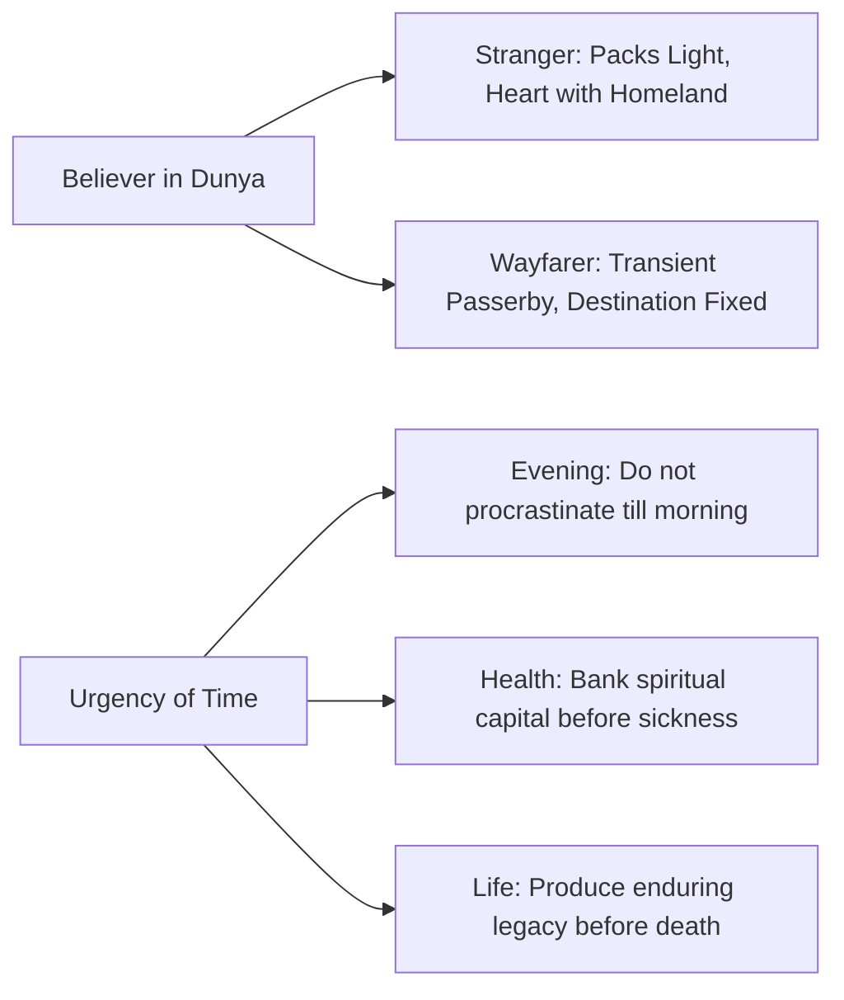

# Hadith 40: Be in This World as a Stranger or Wayfarer
### كن في الدنيا كأنك غريب أو عابر سبيل

> **Narrated by:** Abdullah ibn Umar (رضي الله عنهما)  
> **Canonical Sources:** Sahih al-Bukhari 6416

---

## 📜 Complete Prophetic Text

**عَنْ ابْن عُمَرَ رَضِيَ اللَّهُ عَنْهُمَا قَالَ: أَخَذَ رَسُولُ اللَّهِ صلى الله عليه و سلم بِمَنْكِبِي، وَقَالَ: «كُنْ فِي الدُّنْيَا كَأَنَّك غَرِيبٌ أَوْ عَابِرُ سَبِيلٍ». وَكَانَ ابْنُ عُمَرَ رَضِيَ اللَّهُ عَنْهُمَا يَقُولُ: إِذَا أَمْسَيْتَ فَلَا تَنْتَظِرْ الصَّبَاحَ، وَإِذَا أَصْبَحْتَ فَلَا تَنْتَظِرْ الْمَسَاءَ، وَخُذْ مِنْ صِحَّتِك لِمَرَضِك، وَمِنْ حَيَاتِك لِمَوْتِك.**

> *"On the authority of Abdullah ibn Umar (ra) who said: The Messenger of Allah (ﷺ) took hold of my shoulder and said: "Be in this world as though you were a stranger or a wayfarer passing along a path." And Ibn Umar used to say: "In the evening, do not wait for the morning; and in the morning, do not wait for the evening. Take advantage of your health before your sickness, and of your life before your death.""*

---

## 🔍 Line-by-Line Arabic & Morphological Breakdown

| Arabic Segment | Transliteration | Word-by-Word Analysis & Meaning |
| :--- | :--- | :--- |
| **أَخَذَ بِمَنْكِبِي** | *Akhadha bi-mankibī* | Physical mentorship: gripping the shoulder to focus attention before imparting a paradigm-shifting life maxim. |
| **كُنْ فِي الدُّنْيَا كَأَنَّك غَرِيبٌ** | *Kun fid-dunyā ka-annaka gharīb* | Live like a stranger residing temporarily in a foreign land: unattached to trivial squabbles, packing light, focused on returning home. |
| **أَوْ عَابِرُ سَبِيلٍ** | *Aw 'ābiru sabīl* | Or even more transient: a wayfarer taking brief rest beneath a tree before resuming the journey. |
| **إِذَا أَمْسَيْتَ فَلَا تَنْتَظِرْ الصَّبَاحَ** | *Idhā amsayta falā tantaẓiriṣ-ṣabāḥ* | Overcoming chronic procrastination: execute daily responsibilities without delaying under assumptions of guaranteed tomorrow. |
| **خُذْ مِنْ صِحَّتِك لِمَرَضِك** | *Khudh min ṣiḥḥatika li-maraḍik* | Leverage peak physical and mental energy before sickness and mortality close the window of opportunity. |

---

## 📊 Conceptual Framework & Visual Model

---

## 💡 In-Depth Sharh & Classical Commentary

### The Ultimate Prophetic Paradigm of Time
- **The True Homeland:** The believer's true home is Paradise, from which humanity descended. Earth is an airport terminal, not the destination.
- **The Physicality of Mentorship:** By gripping Ibn Umar's shoulder, the Prophet (ﷺ) anchored the emotional weight of this guidance forever into his memory.

---

## ⚡ Practical & Productivity Application

### Productivity & The Elimination of Procrastination
- **Extreme Daily Focus (*Carpe Diem* in Islam):** Procrastination thrives on the cognitive illusion of endless future time (*Tool al-Amal*). Operating with the consciousness that today may be your final release forces disciplined prioritization and high-velocity output.

---

## 📖 Canonical References & Scholarly Grading
- **References:** Sahih al-Bukhari 6416
- **Scholarly Classification:** Authenticated in classical collections; selected by Imam an-Nawawi as foundational principles (*Qawa'id al-Deen*).

---

## 🎥 Curated Video Insights & Lectures
- **Recommended Video Lecture:** YouTube Search: `Hadith 40 Nawawi Be in this world as a stranger explanation Omar Suleiman`

---

[[Hadith_39_Pardoning_Mistakes_and_Forgetfulness|⬅ Prev: Hadith 39]] | [[00_Hadith_Index|📖 Hadith Index]] | [[Hadith_41_Subordinating_Desires|Next: Hadith 41 ➡]]
