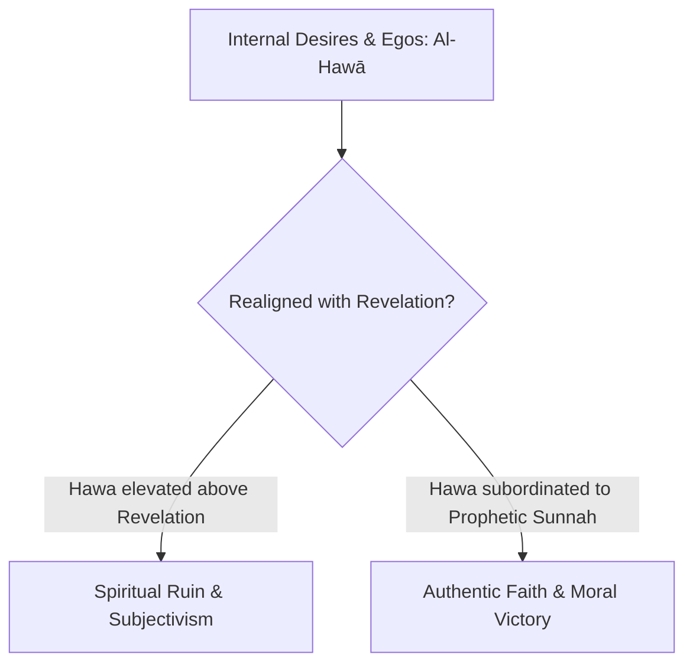

# Hadith 41: Subordinating Desires to Prophetic Revelation
### الاستسلام للشرع وتحكيم الوحي على الهوى

> **Narrated by:** Abdullah ibn Amr ibn al-Aas (رضي الله عنهما)  
> **Canonical Sources:** Kitab al-Hujjah 'ala Tarik al-Mahajjah

---

## 📜 Complete Prophetic Text

**عَنْ أَبِي مُحَمَّدٍ عَبْدِ اللَّهِ بْنِ عَمْرِو بْنِ الْعَاصِ رَضِيَ اللَّهُ عَنْهُمَا، قَالَ: قَالَ رَسُولُ اللَّهِ صلى الله عليه و سلم: «لَا يُؤْمِنُ أَحَدُكُمْ حَتَّى يَكُونَ هَوَاهُ تَبَعًا لِمَا جِئْتُ بِهِ».**

> *"On the authority of Abu Muhammad Abdullah bin 'Amr bin al-'Aas (ra) who said: The Messenger of Allah (ﷺ) said: "None of you truly believes until his desires are subservient to that which I have brought.""*

---

## 🔍 Line-by-Line Arabic & Morphological Breakdown

| Arabic Segment | Transliteration | Word-by-Word Analysis & Meaning |
| :--- | :--- | :--- |
| **لَا يُؤْمِنُ أَحَدُكُمْ** | *Lā yu'minu aḥadukum* | Negation of the perfected, mature state of faith. |
| **حَتَّى يَكُونَ هَوَاهُ** | *Ḥattā yakūna hawāhu* | Until his internal inclination, personal taste, cultural bias, and ego-driven desires (*Hawa*). |
| **تَبَعًا لِمَا جِئْتُ بِهِ** | *Taba'an limā ji'tu bih* | Become entirely aligned with, subordinate to, and delighting in the divine revelation and prophetic model. |

---

## 📊 Conceptual Framework & Visual Model

---

## 💡 In-Depth Sharh & Classical Commentary

### The Real Meaning of Submission (Islam)
- **The Battle Against Hawa:** The greatest idol worshipped is not stone or wood, but the whims of the ego (*"Have you seen he who takes his desire as his god?"* - Surah al-Furqan 25:43).
- **Joy in Divine Law:** True spiritual maturity is reached when a person does not merely obey divine injunctions with reluctance, but genuinely loves and finds peace in what the Prophet (ﷺ) brought.

---

## ⚡ Practical & Productivity Application

### Productivity & Overcoming Impulsive Distraction
- **Subjugating Impulses to Long-Term Vision:** Mastery in deep work requires conquering transient impulses (the desire to scroll, procrastinate, or compromise). Aligning daily behavior with higher principles unlocks peak focus.

---

## 📖 Canonical References & Scholarly Grading
- **References:** Kitab al-Hujjah 'ala Tarik al-Mahajjah
- **Scholarly Classification:** Authenticated in classical collections; selected by Imam an-Nawawi as foundational principles (*Qawa'id al-Deen*).

---

## 🎥 Curated Video Insights & Lectures
- **Recommended Video Lecture:** YouTube Search: `Hadith 41 Nawawi None of you believes until his desire follows what I brought`

---

[[Hadith_40_Stranger_in_This_World|⬅ Prev: Hadith 40]] | [[00_Hadith_Index|📖 Hadith Index]] | [[Hadith_42_Vastness_of_Forgiveness|Next: Hadith 42 ➡]]
