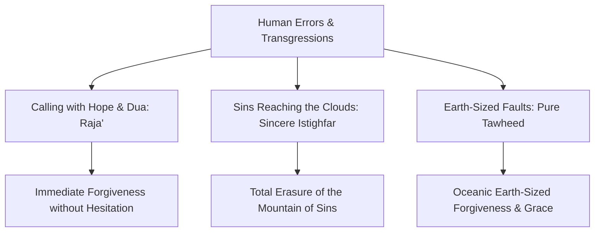

# Hadith 42: The Vastness of Divine Forgiveness (Hadith Qudsi)
### سعة مغفرة الله وجوده (حديث قدسي)

> **Narrated by:** Anas ibn Malik (رضي الله عنه)  
> **Canonical Sources:** Jami` at-Tirmidhi 3540

---

## 📜 Complete Prophetic Text

**عَنْ أَنَسِ بْنِ مَالِكٍ رَضِيَ اللهُ عَنْهُ قَالَ: سَمِعْت رَسُولَ اللَّهِ صلى الله عليه و سلم يَقُولُ: قَالَ اللَّهُ تَعَالَى: «يَا ابْنَ آدَمَ! إِنَّكَ مَا دَعَوْتنِي وَرَجَوْتنِي غَفَرْتُ لَك عَلَى مَا كَانَ مِنْك وَلَا أُبَالِي، يَا ابْنَ آدَمَ! لَوْ بَلَغَتْ ذُنُوبُك عَنَانَ السَّمَاءِ ثُمَّ اسْتَغْفَرْتنِي غَفَرْتُ لَك، يَا ابْنَ آدَمَ! إِنَّك لَوْ أَتَيْتنِي بِقُرَابِ الْأَرْضِ خَطَايَا ثُمَّ لَقِيتنِي لَا تُشْرِكُ بِي شَيْئًا لَأَتَيْتُك بِقُرَابِهَا مَغْفِرَةً».**

> *"On the authority of Anas (ra) who said: I heard the Messenger of Allah (ﷺ) say: "Allah the Almighty said: 'O Son of Adam, as long as you call upon Me and place your hope in Me, I will forgive you for what you have done and I will not mind. O Son of Adam, were your sins to reach the clouds of the sky and then you were to ask forgiveness of Me, I would forgive you. O Son of Adam, were you to come to Me with sins nearly as great as the earth and then meet Me without associating anything with Me, I would bring you forgiveness nearly as great as it.'""*

---

## 🔍 Line-by-Line Arabic & Morphological Breakdown

| Arabic Segment | Transliteration | Word-by-Word Analysis & Meaning |
| :--- | :--- | :--- |
| **مَا دَعَوْتَنِي وَرَجَوْتَنِي** | *Mā da'awtanī wa rajawtanī* | Pairing earnest supplication (*Dua*) with genuine, expectant hope (*Raja'*) in divine mercy. |
| **غَفَرْتُ لَكَ... وَلَا أُبَالِي** | *Ghafartu laka... wa lā ubālī* | Absolute forgiveness without hesitation, reluctance, or diminution of divine majesty. |
| **عَنَانَ السَّمَاءِ** | *'Anānas-samā'* | Even if sins piled high to the clouds and horizon of the sky, sincere seeking of forgiveness dissolves the mountain. |
| **بِقُرَابِ الْأَرْضِ خَطَايَا** | *Bi-qurābil-arḍi khaṭāyā* | Earth-sized errors and faults met with an earth-sized ocean of divine pardon. |
| **لَا تُشْرِكُ بِي شَيْئًا** | *Lā tushriku bī shay'ā* | The golden condition: Pure, uncompromised Tawheed (monotheism) that unlocks eternal salvation. |

---

## 📊 Conceptual Framework & Visual Model

---

## 💡 In-Depth Sharh & Classical Commentary

### The Ultimate Finale of the Forty Hadith
- **Pedagogical Culmination:** Imam an-Nawawi brilliantly closed his compilation with this Hadith Qudsi, ensuring that the student finishes not in despair over their shortcomings, but swimming in boundless hope and confidence in divine mercy.
- **The Three Pathways to Forgiveness:**
  1. Dua paired with hopeful expectation.
  2. Direct seeking of forgiveness (*Istighfar*).
  3. Pure Tawheed that meets Allah with uncompromised monotheism.

---

## ⚡ Practical & Productivity Application

### Productivity & Fearless Renewal
- **Infinite Fresh Starts:** Never surrender to guilt-induced paralysis. The Creator of the universe offers infinite resets through repentance. Clean the slate, reset your compass, and step forward into purposeful, high-impact effort.

---

## 📖 Canonical References & Scholarly Grading
- **References:** Jami` at-Tirmidhi 3540
- **Scholarly Classification:** Authenticated in classical collections; selected by Imam an-Nawawi as foundational principles (*Qawa'id al-Deen*).

---

## 🎥 Curated Video Insights & Lectures
- **Recommended Video Lecture:** YouTube Search: `Hadith 42 Nawawi O Son of Adam as long as you call upon Me Omar Suleiman`

---

[[Hadith_41_Subordinating_Desires|⬅ Prev: Hadith 41]] | [[00_Hadith_Index|📖 Hadith Index]] | [[00_Hadith_Index|Index ➡]]
